# Day 3 — CNN · 이미지 분류 · 허깅페이스 데이터

**2026-10-23 · 한국폴리텍대학 하이테크과정 AI**

이 자료는 수업의 개념 설명과 실습 절차·코드를 복습용으로 정리한 문서입니다. 복습 기준 = 이 자료 + 수업 중 필기 + 각자의 실습 노트북.

---

## 목차

1. [복습과 오늘의 목표](#1-복습과-오늘의-목표)
2. [기존 신경망의 한계](#2-기존-신경망의-한계)
3. [합성곱 연산](#3-합성곱-연산)
4. [풀링과 계층적 특징](#4-풀링과-계층적-특징)
5. [데이터 파이프라인](#5-데이터-파이프라인)
6. [실습 ① — 허깅페이스 데이터 준비](#6-실습---허깅페이스-데이터-준비)
7. [실습 ② — CNN 정의와 학습](#7-실습---cnn-정의와-학습)
8. [결과 해석](#8-결과-해석)
9. [Day 산출물 — 콩잎 분류기와 직접 선택한 데이터](#9-day-산출물--콩잎-분류기와-직접-선택한-데이터)
10. [요약과 복습문제](#10-요약과-복습문제)
11. [보충](#11-보충)
12. [다음 시간](#12-다음-시간)

---

## 1. 복습과 오늘의 목표

### 1.1 지난 시간 복습

| 항목 | 내용 |
|------|------|
| 학습의 구조 | 예측 → 손실 → 기울기 → 갱신. 손실 = 예측과 정답의 거리 |
| 경사하강 | 손실이 줄어드는 방향으로 W·b를 조금씩 이동 — 학습률이 이동 폭 |
| 텐서 | NumPy 배열과 같은 구조 + GPU 이동 + 자동 미분 |
| autograd | `requires_grad` → `backward()` — 기울기는 누적되므로 `zero_grad()` 필요 |
| 학습 루프 5단 | 순전파 → 손실 → `zero_grad` → `backward` → `step` |
| nn.Module | 층을 `__init__`에 두고 `forward`에서 연결 — 오늘 그대로 다시 사용 |

- Day 2의 입력은 값 몇 개, 출력은 값 하나였습니다. 오늘의 입력은 **이미지 한 장 = 224×224×3 = 150,528개의 값**이고, 출력은 "**어느 클래스인가**"입니다. 이것이 Day 2 말미에 예고한 분류 문제입니다

### 1.2 오늘의 목표 — 이미지 분류 모델을 처음부터 만들기

Day 2에서 만든 학습 루프에 **이미지**를 입력합니다. 데이터는 공개 모델·데이터 저장소인 **허깅페이스**(Hugging Face)에서 받습니다.

| 항목 | 내용 |
|------|------|
| 데이터 | `beans` — 콩잎 사진 3종(각진 잎 반점병 · 녹병 · 건강) |
| 과업 | 사진 한 장을 세 클래스 중 하나로 분류 — 작물 병해 진단 |
| 오늘의 작업 | 데이터 불러오기 → 합성곱 신경망 정의 → 학습 → 학습 곡선·혼동 행렬로 **왜 틀리는지** 확인 |

**오늘 완성할 것** — 세 가지가 Day 3의 산출물입니다.

| 산출물 | 형태 | 용도 |
|------|------|------|
| 가중치 파일(`.pth`) | 검증 손실이 가장 낮은 epoch의 가중치 | 학습한 모델을 다시 불러와 사용 |
| 학습 곡선 | 학습·검증 손실 2선 그래프 | 과적합·과소적합 진단 |
| 혼동 행렬 | 클래스 수 × 클래스 수 표 | 어느 클래스를 어느 클래스로 오인하는가 |

> **오늘의 핵심 —** 이미지 분류 모델에서 확인할 것은 세 가지입니다 — **데이터가 배열로 변환되는 과정 · 합성곱이 파라미터를 절약하는 구조 · 정확도 뒤에 있는 오류의 분포.** 이 셋을 콩잎 데이터로 직접 다룹니다.

### 1.3 오늘의 흐름

| 단계 | 절 | 내용 | 산출물 |
|:--:|:--:|------|------|
| ① 원리 | 2절·3절·4절 | 평탄화의 한계 → 합성곱 → 풀링·계층적 특징 | 파라미터 검산 |
| ② 파이프라인 | 5절·6절 | Dataset·DataLoader → 허깅페이스 데이터 불러오기·폴더 구성·증강 | 로더 2개 |
| ③ 학습 | 7절 | CNN 정의 → 손실·옵티마이저 → 학습 루프 | 학습된 모델 |
| ④ 해석 | 8절 | 학습 곡선 → 혼동 행렬 → 정밀도·재현율 → 오분류 관찰 | 진단 결과 |
| ⑤ 산출물 | 9절 | `.pth` 저장 → 직접 선택한 데이터로 반복 → 도달·도전 과제 | 가중치 파일 · 비교 표 |

- **11절 보충**은 진도에 여유가 있을 때 다루는 독립 소재

> ⏱ **오늘의 데이터는 수업 중에 허깅페이스에서 내려받습니다**(약 180MB). 여기에 필요한 `datasets` 라이브러리는 시작할 때 1.5에서 설치합니다.

> **진행 방식 —** 각 절에서 설명과 실습을 단계별로 번갈아 진행합니다.
> - 실습에서는 단계마다 결과를 확인한 뒤 다음으로 넘어갑니다. 「예측」이 있는 곳에서는 실행 전에 결과를 먼저 적습니다
> - 절 끝의 「응용 실습」에는 코드가 없습니다 — AI 코딩 도구로 작성하는 과제입니다. 조건을 이해해야 해결할 수 있습니다
> - 「정할 것」이 있는 단계에서는 AI에게 요청하기 전에 요청에 포함할 조건을 텍스트 셀에 먼저 적습니다. 정리는 그 뒤에 펼쳐 대조합니다

### 1.4 준비물 확인

| 품목 | 확인 사항 |
|------|----------|
| Colab | **GPU 런타임**(T4) 권장 — 미배정 시 CPU로 진행(7.4 축소 설정) |
| 인터넷 | 허깅페이스에서 데이터 다운로드(약 180MB) |
| Google Drive | 학습한 가중치(`.pth`) 저장 — 세션이 끝나도 남음 |
| Day 2 노트북 | 학습 루프 5단·nn.Module 코드 — 오늘 코드의 기본 구조 |
| Day 1 노트북 | 이미지 배열 조작(8절) — 5.4의 대응표에서 다시 다룸 |
| 필기구 | 실행 전 예측 기록 · 확인 활동의 수기 계산(2.3) |
| AI 코딩 도구 | 응용 실습과 일부 실습의 코드 작성 — Day 1 5.5의 사용 규칙 |

### 1.5 실행 환경 점검 — 수업 시작 전

**전원이 동시에 실행합니다.** 허깅페이스 데이터를 불러오는 `datasets` 라이브러리를 이 자리에서 설치합니다. 설치 뒤 런타임을 다시 시작해야 하는 경우가 있으므로, 실습(6절) 도중이 아니라 수업을 시작할 때 마칩니다.

**① 런타임 유형 확인** — Day 1 5.3 절차로 GPU(T4)를 선택합니다.

- 런타임 유형을 바꾸면 새 런타임이 시작되어 **설치한 라이브러리도 삭제됩니다** — 반드시 ②보다 먼저 실행합니다
- GPU가 배정되지 않으면 CPU로 진행합니다(7.4 축소 설정)

**② 설치와 확인**

```python
!pip install -q datasets            # ① 허깅페이스 데이터 라이브러리 설치
import datasets
print(datasets.__version__)         # ② 버전 번호가 출력되면 설치 완료
```

| 결과 | 조치 |
|------|------|
| 버전 번호가 출력됨 | 완료 — 2절로 진행 |
| 런타임을 다시 시작하라는 안내 창이 표시됨 | 안내 창에서 다시 시작 → **②의 `import` 줄부터 다시** 실행 |
| `ModuleNotFoundError` | 설치 줄이 실행되지 않은 상태 → **②를 처음부터 다시** 실행 |

---

## 2. 기존 신경망의 한계

**학습목표**

- 이미지를 완전연결 신경망에 입력할 때 무엇이 손실되는지 설명할 수 있다
- 파라미터 수를 직접 계산해 합성곱이 필요한 이유를 수치로 말할 수 있다

### 2.1 평탄화 — 공간 정보의 손실

Day 2의 신경망은 `nn.Linear`로 만든 **완전연결 신경망**(FCN — Fully Connected Network)입니다. 한 층의 모든 뉴런이 다음 층의 모든 뉴런과 연결됩니다.

이미지를 여기에 입력하려면 2차원(또는 3차원) 배열을 **1차원 벡터로 펴야** 합니다. 이것이 **평탄화**(flattening)입니다.

| 입력 | 평탄화 결과 |
|------|------|
| 4×4 흑백 손글씨 | 길이 16의 벡터 |
| 28×28 흑백 | 길이 784의 벡터 |
| 224×224 컬러 | 길이 150,528의 벡터 |

**손실되는 것** — 픽셀의 값만큼 중요한 것이 **어느 픽셀이 어느 픽셀 옆에 있는가**입니다.

- 사람의 눈·고양이의 귀·자동차의 바퀴는 **여러 픽셀이 특정한 모양으로 모여 있을 때** 의미가 생깁니다
- 1차원으로 펴는 순간, 위·아래·옆에 있던 픽셀의 위치 정보가 손실됩니다
- 신경망이 받는 것은 **독립된 값 16개의 목록**일 뿐입니다

> Day 1 8절에서 이미지가 (H, W, 3) 배열이라는 것을 확인했습니다. 그 배열의 **두 축(H, W)이 곧 공간 정보**이며, 평탄화는 그 축을 없앱니다.

**평탄화 실습 — 위아래 이웃은 몇 칸 떨어지는가**

- 0\~15를 4×4로 배치한 배열을 평탄화합니다. 값이 곧 원래 위치이므로 이동한 위치를 값으로 추적할 수 있습니다

```python
import torch
x = torch.arange(16).view(4, 4)     # ① 0~15를 4×4로 — 값 = 원래 위치
print(x)
v = x.flatten()                     # ② 모든 축을 한 축으로
print(v.shape, v)
```

> **예측** — 실행하기 전에 두 가지를 적습니다.
> - `v`의 형상 — 원소는 모두 몇 개입니까?
> - 값 `1`(0행 1열)과 그 아래 값 `5`(1행 1열)는 벡터에서 몇 칸 떨어집니까? 한 행에는 값이 몇 개 있습니까?

- **확인** — 출력을 예측과 대조합니다
- `v`가 1차원이 아니면 → ②에 `flatten()`이 있는지 확인 → **②부터 다시** 실행합니다

<details>
<summary>예측 대조</summary>

- `v.shape` = `torch.Size([16])` · `v` = 0, 1, 2, …, 15 — 0행 · 1행 · 2행 · 3행을 차례로 이어 붙임
- 값 1은 1번 위치, 값 5는 5번 위치 → **4칸** 떨어짐 = 한 행의 길이(W)
- 옆 픽셀은 1칸, 위아래 픽셀은 W칸 떨어집니다. 224×224 이미지에서는 위아래 이웃이 **224칸** 떨어집니다. 완전연결층은 이 거리 정보를 입력으로 받지 않습니다

</details>

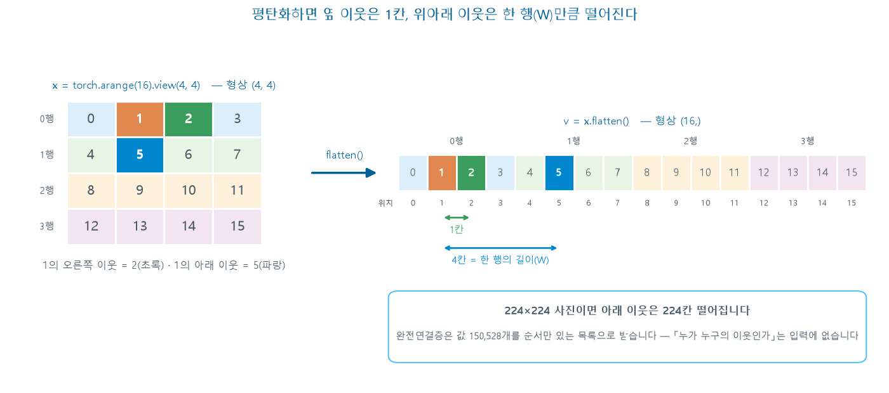

- 옆 픽셀(1 → 2)은 벡터에서 1칸, 위아래 픽셀(1 → 5)은 한 행의 길이인 4칸 떨어집니다
- 224×224 사진에서는 위아래 이웃이 224칸 떨어집니다. 완전연결층은 어느 값이 어느 값의 이웃인지를 입력으로 받지 않습니다

### 2.2 파라미터 폭증

두 번째 문제는 더 현실적입니다. 학습해야 할 **가중치의 수가 입력 크기에 비례해 폭증**합니다.

| 입력 | 입력 벡터 길이 | 첫 은닉층 512개일 때 파라미터 |
|------|--:|--:|
| 28×28 흑백 | 784 | 784 × 512 + 512 = **401,920** |
| 224×224 컬러 | 150,528 | 150,528 × 512 + 512 = **77,070,848** |

- 224×224 컬러 이미지 한 장을 받는 **첫 층 하나에 약 7,700만 개**의 파라미터가 필요합니다
- 결과 ① **계산량** — 학습에 시간과 자원이 과다하게 소요됨
- 결과 ② **과적합** — 모델이 지나치게 복잡해 학습 데이터에만 맞추어지며, 그 결과 새 데이터에서 성능이 낮아짐

Colab에서 직접 확인합니다.

```python
import torch, torch.nn as nn

def count_parameters(model):
    return sum(p.numel() for p in model.parameters() if p.requires_grad)

fcn1 = nn.Linear(in_features=784, out_features=512)       # 28×28 흑백
fcn2 = nn.Linear(in_features=150528, out_features=512)    # 224×224 컬러
print(f"28x28 흑백:   {count_parameters(fcn1):,}")
print(f"224x224 컬러: {count_parameters(fcn2):,}")
```

- 출력이 2.2 파라미터 수 표의 계산과 일치합니다 — `p.numel()`은 파라미터 텐서의 원소 개수(Day 2 4.2)

### 2.3 확인 활동 — 파라미터 검산

수기로 계산합니다. 32×32 컬러 이미지(3채널)를 입력으로 받는 두 가지 층의 **가중치 개수**를 구합니다.

| 층 | 계산 | 가중치 수 |
|------|------|--:|
| 완전연결 — 은닉 뉴런 100개 | 32 × 32 × 3 = 3,072 → 3,072 × 100 | ? |
| 합성곱 — 3×3×3 커널 16개 | (3 × 3 × 3) × 16 + 편향 16 | ? |

<details>
<summary>정답 보기</summary>

- 완전연결 = **307,200**개 (편향 100개 별도)
- 합성곱 = 432 + 16 = **448**개
- 약 **700배** 차이입니다. 합성곱이 파라미터를 어떻게 절약하는지가 3절의 내용입니다

</details>

**합성곱 신경망의 계기가 된 질문** — *"이미지의 공간 구조를 유지하면서 파라미터 수를 크게 줄일 수는 없는가."*

- 답의 두 축 = **국소성**(작은 창으로 본다) + **파라미터 공유**(같은 창을 이미지 전체에 재사용한다)
- 이 두 축을 구현한 것이 3절의 합성곱 연산입니다

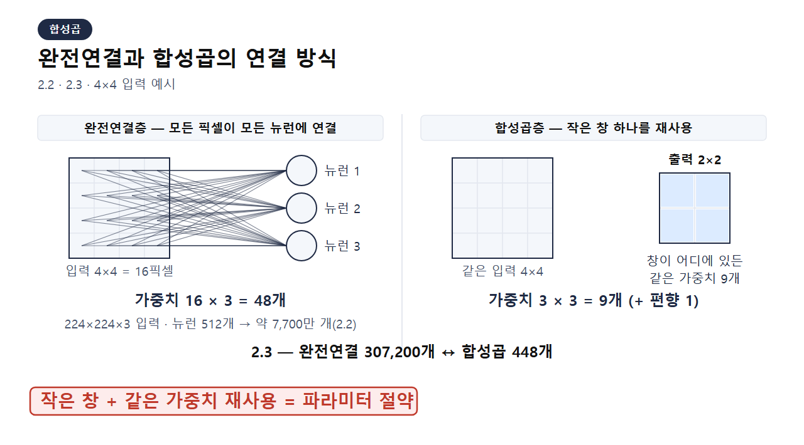

### 2.4 응용 실습 — 파라미터 수에서 은닉 뉴런 수 찾기

- 64×64 컬러 이미지를 입력으로 받는 완전연결층 하나의 파라미터 수(가중치 + 편향)가 **1,572,992**개로 출력되었습니다. 이 층의 은닉 뉴런 수를 찾습니다
- 코드는 AI 코딩 도구로 작성합니다. 각 단계의 결과를 「확인」 기준과 대조합니다

**① 식 세우기**

- 입력 벡터의 길이를 구하고, 파라미터 수를 뉴런 수 $n$에 대한 식으로 적습니다

> **예측** — $n$을 구합니다. 편향은 뉴런 하나에 몇 개 있습니까? 입력 길이에 3을 곱해야 하는 이유는 무엇입니까?

**② 코드로 확인**

- ①의 $n$으로 `nn.Linear`를 만들고 2.2의 `count_parameters`로 개수를 출력합니다
- **확인** — `1,572,992`가 출력되면 정상입니다
- 다르면 → 입력 길이에 채널 수 3을 곱했는지 확인 → **①부터 다시** 계산합니다

<details>
<summary>응용 실습 정리</summary>

- 입력 길이 = 64 × 64 × 3 = **12,288** · 파라미터 수 = 12,288 × $n$ + $n$ = 12,289 × $n$
- $n$ = 1,572,992 ÷ 12,289 = **128**
- 파라미터 수가 입력 길이에 비례하므로, 이미지 크기가 커지면 같은 뉴런 수에서도 파라미터가 빠르게 늘어납니다 — 2.2의 폭증과 같은 원리

</details>

### 2.5 응용 실습 — 채널을 빠뜨린 평탄화

- 32×32 컬러 이미지 8장을 완전연결층에 입력하는 코드에서 오류가 발생했습니다. 원인을 찾아 수정합니다

```python
x = torch.rand(8, 3, 32, 32)          # 32×32 컬러 이미지 8장
fc = nn.Linear(32 * 32, 100)
out = fc(x.flatten(1))                # flatten(1) — 1번 축부터 끝까지 한 축으로(0번 = 이미지 수 유지)
```

**① 실행과 오류 확인**

- 위 코드를 그대로 실행하고 오류 메시지의 두 형상을 적습니다

> **예측** — `x.flatten(1)`의 형상을 먼저 적습니다. 0번 축의 8은 유지됩니다. 나머지 세 축을 곱하면 몇입니까?

**② 원인 찾기**

- 오류 메시지의 두 형상 가운데 `x.flatten(1)`의 형상과 `nn.Linear`가 요구하는 입력 길이를 구분해 적습니다

**③ 수정과 확인**

- `nn.Linear`의 첫 인자를 고쳐 다시 실행합니다
- **확인** — `out.shape`가 `torch.Size([8, 100])`이면 정상입니다. 고친 층의 파라미터 수를 2.3의 완전연결 가중치 수와 대조합니다
- 오류가 계속되면 → 첫 인자가 `x.flatten(1)`의 두 번째 축 길이와 같은지 확인 → **③을 다시** 실행합니다

<details>
<summary>응용 실습 정리</summary>

- 오류 = `mat1 and mat2 shapes cannot be multiplied (8x3072 and 1024x100)` — 입력은 길이 3,072이지만 층이 요구하는 길이는 1,024
- 원인 = 채널 축(3)을 빠뜨림. 수정 = `nn.Linear(3 * 32 * 32, 100)`
- 수정한 층의 파라미터 = 3,072 × 100 + 100 = **307,300** — 2.3의 가중치 307,200에 편향 100을 더한 값

</details>

---

## 3. 합성곱 연산

**학습목표**

- 커널·슬라이딩·특징 지도의 관계를 설명할 수 있다
- 패딩·스트라이드가 출력 크기를 어떻게 바꾸는지 계산할 수 있다

### 3.1 커널·슬라이딩·특징 지도

합성곱(convolution)의 핵심은 **커널**(kernel) 또는 **필터**(filter)라 불리는 작은 행렬입니다. 커널은 이미지에서 특정 **특징을 찾아내는 검출기**(feature detector)입니다 — 수직선을 찾는 커널, 수평선을 찾는 커널, 특정 색 덩어리를 찾는 커널.

| 단계 | 동작 |
|:--:|------|
| ① 슬라이딩 | 커널이 이미지의 왼쪽 위에서 오른쪽 아래로 일정 간격으로 이동 |
| ② 원소별 곱·합 | 커널이 덮은 영역(**수용 영역**)의 각 픽셀과 커널 값을 곱해 모두 더함 |
| ③ 특징 지도 | 그 합이 출력의 픽셀 하나가 됨 — 전체를 차례로 이동하면 **특징 지도**(feature map) 완성 |

- 특징 지도 = "커널이 찾는 특징이 **어디에 얼마나 강하게** 나타나는가"의 지도

**합성곱 실습 1단계 — 창 하나의 값을 수기로 계산**

- 6×6 입력과 3×3 커널로 특징 지도의 첫 행 두 칸을 계산합니다. 입력은 왼쪽이 어둡고(1) 오른쪽이 밝은(9) 이미지입니다. 아래 세 행은 밝기 경계가 한 칸 오른쪽에 있습니다

```
입력 6×6                     커널 3×3 (수직 경계 검출)
1  1  1  9  9  9            -1  0  1
1  1  1  9  9  9            -1  0  1
1  1  1  9  9  9            -1  0  1
1  1  1  1  9  9
1  1  1  1  9  9
1  1  1  1  9  9
```

> **예측** — 두 값을 수기로 계산합니다.
> - 창이 왼쪽 위(0\~2행 · 0\~2열)에 있을 때의 값
> - 창이 한 칸 오른쪽(0\~2행 · 1\~3열)에 있을 때의 값
> - 커널의 가운데 열은 0입니다. 결과는 (창의 오른쪽 열 합) − (창의 왼쪽 열 합)과 같습니까?

**합성곱 실습 2단계 — 코드로 특징 지도 전체 계산**

```python
import torch.nn.functional as F
img = torch.tensor([[1, 1, 1, 9, 9, 9],
                    [1, 1, 1, 9, 9, 9],
                    [1, 1, 1, 9, 9, 9],
                    [1, 1, 1, 1, 9, 9],
                    [1, 1, 1, 1, 9, 9],
                    [1, 1, 1, 1, 9, 9]], dtype=torch.float32)   # ① 입력 6×6
k = torch.tensor([[-1, 0, 1],
                  [-1, 0, 1],
                  [-1, 0, 1]], dtype=torch.float32)            # ② 커널 — 오른쪽이 밝을수록 큰 값
fm = F.conv2d(img.view(1, 1, 6, 6), k.view(1, 1, 3, 3))       # ③ (배치, 채널, 높이, 너비) 4축으로 바꾸어 합성곱
print(fm.shape)
print(fm[0, 0])                                                # ④ 배치 0번 · 채널 0번의 특징 지도
```

> **예측** — 출력 형상을 적습니다. 3칸 너비의 창이 6칸 길이의 행 위에서 한 칸씩 이동하면 가로로 몇 자리에 놓일 수 있습니까?

- **확인** — 형상과 첫 행 두 값을 1단계 예측과 대조합니다
- 값이 다르면 → 1단계 계산에서 왼쪽 열에 −1을 곱했는지 확인 → **1단계를 다시** 계산합니다

<details>
<summary>예측 대조</summary>

- 1단계 = **0**(왼쪽 열 1 · 오른쪽 열 1 → −3 + 3) · **24**(왼쪽 열 1 · 오른쪽 열 9 → −3 + 27)
- 형상 = `torch.Size([1, 1, 4, 4])` — 창이 놓일 수 있는 자리는 가로 4 · 세로 4
- 특징 지도 = `[[0, 24, 24, 0], [0, 16, 24, 8], [0, 8, 24, 16], [0, 0, 24, 24]]` — 큰 값이 **밝기 경계의 위치**에 나타나고, 경계가 아래에서 한 칸 오른쪽으로 옮겨 가는 모양이 그대로 반영됨

</details>

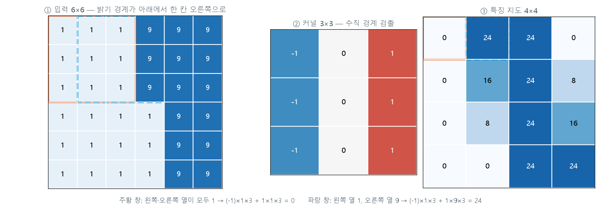

- 주황 창(왼쪽 위)은 경계를 포함하지 않아 0이고, 파랑 창(한 칸 오른쪽)은 경계를 포함해 24입니다
- 특징 지도의 가운데 두 행(16·8)은 창이 경계 위치가 서로 다른 행에 걸친 경우입니다
- **같은 커널 9개 값**으로 36칸 입력 전체를 이동하며 16개 값을 계산합니다 — 위치마다 가중치를 따로 두지 않습니다

**관찰 — 실제 콩잎 사진의 특징 지도**

같은 수직 경계 커널과 그 커널을 90° 회전한 수평 경계 커널을 콩잎 사진(6절의 데이터 · 흑백 250×250)에 적용한 결과입니다.

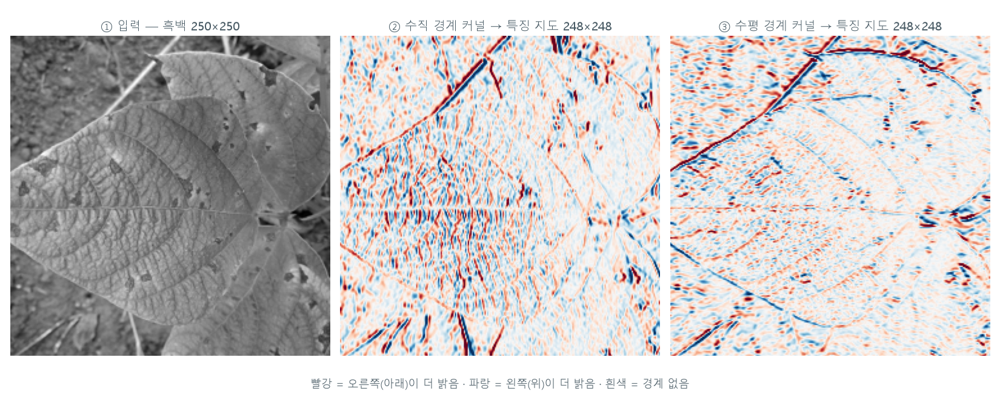

- 잎 가장자리·줄기·잎맥처럼 밝기가 바뀌는 곳이 강하게 나타납니다. 밝기가 고른 잎 면은 흰색에 가깝습니다
- 반점(어두운 점)은 빨강과 파랑이 나란히 붙은 작은 점으로 나타납니다 — 점의 한쪽은 어두워지는 경계이고, 반대쪽은 밝아지는 경계이기 때문입니다
- 커널 9개 값만 바꾸면 찾는 특징이 달라집니다. CNN에서는 이 9개 값을 사람이 정하지 않고 **학습으로 찾습니다**(7절)

**핵심 두 가지** — 2.3의 700배 차이는 여기에서 비롯합니다.

| 원리 | 뜻 | 절약 |
|------|------|------|
| **국소성**(locality) | 이미지 전체가 아니라 커널 크기의 **작은 창**만 참조 | 연결 수 축소 |
| **파라미터 공유** | 왼쪽 위에서 수직선을 찾는 커널이 오른쪽 아래에서도 같은 특징을 검출 — **커널 하나를 전체에 재사용** | 위치마다 가중치를 두지 않음 |

- 근거 — 이미지의 특징(예: 눈)은 개별 픽셀이 아니라 **주변 픽셀의 조합**으로 만들어지며, 같은 특징은 어느 위치에나 나타날 수 있습니다

### 3.2 패딩·스트라이드

합성곱을 더 정밀하게 제어하는 두 개의 설정값입니다.

| 설정 | 뜻 | 효과 |
|------|------|------|
| **스트라이드**(stride) | 커널이 한 번에 이동하는 픽셀 수 | 클수록 출력이 작아지고 계산량 감소 |
| **패딩**(padding) | 입력 가장자리를 특정 값(보통 0)으로 둘러쌈 | 출력 크기 유지 · 가장자리 정보 손실 방지 |

- 패딩이 없으면 가장자리 픽셀은 중앙보다 연산에 적게 참여합니다 — 정보가 상대적으로 손실됨
- 출력 크기를 입력과 같게 유지하는 패딩을 **'same' 패딩**이라 부릅니다

**출력 크기 공식** — 입력 I×I · 커널 K×K · 패딩 P · 스트라이드 S일 때

$$O = \left\lfloor \frac{I - K + 2P}{S} \right\rfloor + 1$$

- $\lfloor \ \rfloor$ = 내림 — 나누어떨어지지 않으면 소수점 아래를 절사합니다(창이 입력 범위를 벗어나는 위치는 계산하지 않음)

| 입력 | 커널 | 패딩 | 스트라이드 | 출력 |
|:--:|:--:|:--:|:--:|:--:|
| 10×10 | 3×3 | 0 | 1 | (10 − 3 + 0)/1 + 1 = **8×8** |
| 10×10 | 3×3 | 1 | 1 | (10 − 3 + 2)/1 + 1 = **10×10** |
| 10×10 | 3×3 | 1 | 2 | (10 − 3 + 2)/2 + 1 = **5×5** |

- 세 경우를 3.6에서 코드로 확인합니다 — 계산과 실행 결과가 일치해야 합니다

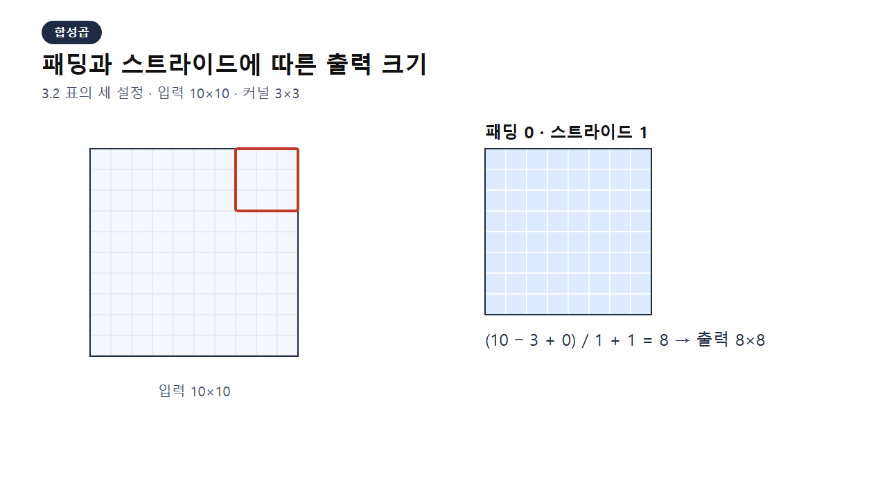

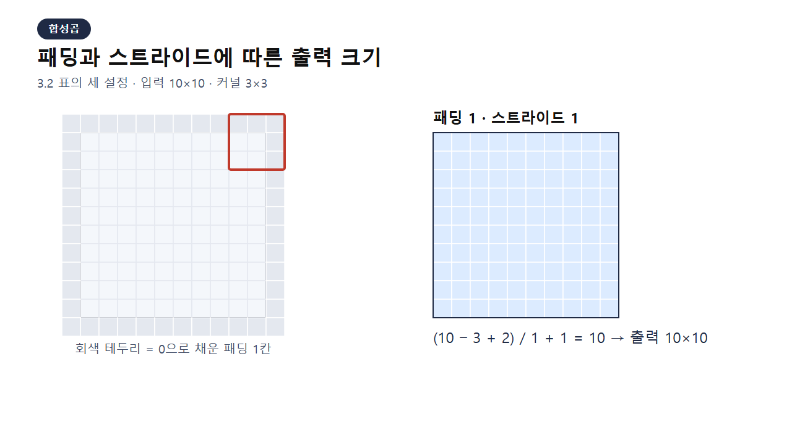

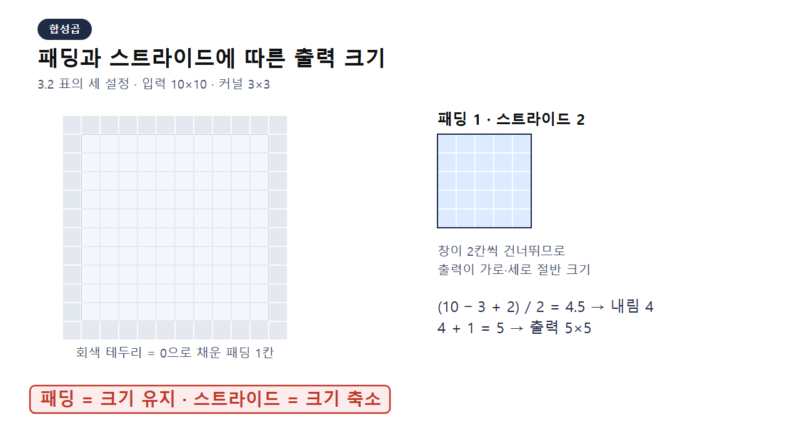

### 3.3 채널 — 컬러 이미지와 여러 커널

| 항목 | 내용 |
|------|------|
| 입력 채널 | 흑백 = 1채널 · 컬러 = R·G·B 3채널 (Day 1 8.1의 세 번째 축) |
| 커널의 깊이 | 입력이 3채널이면 커널도 **3×3×3의 정육면체** — 채널별로 합성곱한 뒤 모두 더해 값 하나 |
| 커널의 개수 | 서로 다른 특징을 동시에 찾으려면 커널을 여러 개 사용 — **커널 수 = 출력 특징 지도의 채널 수** |

- 2.3의 "3×3×3 커널 16개 = 448"이 이 구조입니다 — 커널 하나 27 + 편향 1 = 28, 열여섯 개 = 448
- PyTorch 표기 = `nn.Conv2d(in_channels=3, out_channels=16, kernel_size=3)` — 입력 채널·커널 수·커널 크기 순서

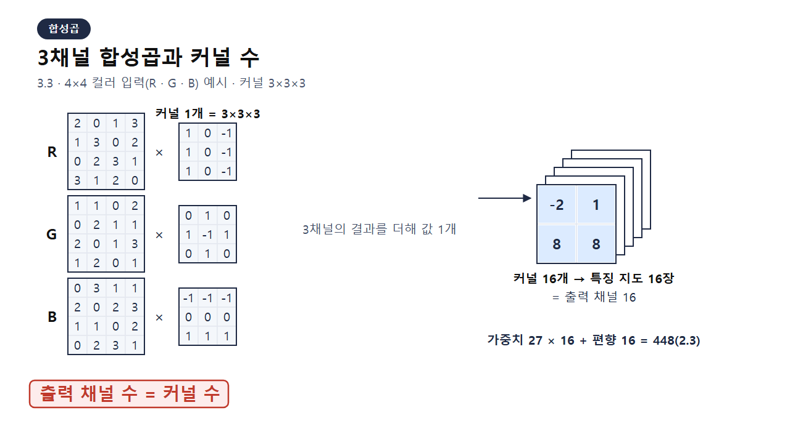

### 3.4 CNN 계보 — 오늘 만드는 모델의 위치

| 연도 | 모델 | 의미 | 수치 |
|:--:|------|------|------|
| 1998 | LeNet-5 | 손글씨 수표 인식에 은행이 실사용 — CNN의 원형 | 7층 |
| 2012 | **AlexNet** | ImageNet 우승 — 딥러닝 부흥의 기점(Day 1 2.2) | 오류 15.3% · 약 6,000만 파라미터 |
| 2014 | VGG | 3×3 합성곱만 깊게 쌓음 — 구조의 단순화 | 16\~19층 |
| 2014 | GoogLeNet | 인셉션 모듈 — 파라미터 **약 400만**으로 축소 | 오류 6.67% |
| 2015 | **ResNet** | **스킵 연결** — 층을 건너뛰어 신호를 더함 | 매우 깊은 층 학습 가능 |

- 오늘 만드는 것은 **LeNet 급의 소형 CNN**입니다. 계보의 기초이며, 구조는 같습니다
- 6,000만 → 400만의 축소가 **Day 4 경량화의 역사적 선례**입니다. ResNet의 스킵 연결은 Day 5 Transformer의 잔차 연결로 이어집니다

### 3.5 웨이퍼 맵 — 같은 구조의 전공 데이터

Day 1 4.4에서 다룬 WM-811K 웨이퍼 맵 결함 분류도 이 절에서 다루는 문제와 구조가 같습니다.

| 항목 | 웨이퍼 맵 | 콩잎 사진 |
|------|------|------|
| 입력 | 다이 격자 배열(양품·불량 0/1) | 픽셀 배열(RGB) |
| 찾는 것 | 국소 패턴 — 스크래치·링·중심 결함 | 국소 패턴 — 반점·녹 포자·잎맥 |
| 출력 | 결함 유형 클래스 | 병해 클래스 |

- 보고된 성능 — 랜덤 포레스트 0.815 → **CNN + 앙상블 0.96**. "왜 CNN의 성능이 더 높은가"의 답이 4.2 계층적 특징에 있습니다
- 오늘의 파이프라인(5절\~8절)은 입력 폴더만 바꾸면 웨이퍼 맵에도 그대로 적용됩니다

### 3.6 코드 확인 — 세 가지 합성곱의 출력 크기

3.2의 표를 코드로 확인합니다. 각자의 Colab에서 아래 셀을 실행합니다.

```python
import torch, torch.nn as nn

x = torch.randn(1, 1, 10, 10)                  # (배치, 채널, 높이, 너비)

conv_a = nn.Conv2d(1, 1, kernel_size=3, stride=1, padding=0)
conv_b = nn.Conv2d(1, 1, kernel_size=3, stride=1, padding=1)
conv_c = nn.Conv2d(1, 1, kernel_size=3, stride=2, padding=1)

print("패딩 0 · 스트라이드 1:", conv_a(x).shape)
print("패딩 1 · 스트라이드 1:", conv_b(x).shape)
print("패딩 1 · 스트라이드 2:", conv_c(x).shape)
print("conv_a 가중치:", conv_a.weight.shape)
```

> **예측** — 실행하기 전에 네 형상을 적습니다.
> - 세 출력의 높이·너비 — 3.2 공식에 I = 10 · K = 3과 각 P · S를 대입하면 몇입니까?
> - `conv_a.weight.shape` — 가중치는 (커널 수, 입력 채널, 높이, 너비) 순서입니다

- **확인** — 출력을 예측과 대조합니다
- 다르면 → 공식에 대입한 P · S가 코드의 `padding` · `stride`와 같은지 확인 → **예측을 다시** 계산합니다

<details>
<summary>예측 대조</summary>

- 출력 = `[1, 1, 8, 8]` · `[1, 1, 10, 10]` · `[1, 1, 5, 5]` — 3.2 표의 계산과 일치
- `conv_a.weight.shape` = `[1, 1, 3, 3]` — 학습 대상 파라미터 9개 + 편향 1개

</details>

| 관찰 | 의미 |
|------|------|
| `x.shape`의 네 축 | (배치, 채널, 높이, 너비) — Day 2 4.4의 형상 규약. **이미지는 항상 4축**으로 모델에 입력됨 |
| 입력 채널 3 · 커널 16 | `weight.shape`가 `[16, 3, 3, 3]` — 2.3의 432 |

### 3.7 응용 실습 — 출력 크기를 정하는 설정 찾기

- 32×32 입력에 5×5 커널을 적용합니다. 출력이 **32×32**와 **16×16**이 되는 패딩·스트라이드를 각각 찾습니다
- 코드는 AI 코딩 도구로 작성합니다. 각 단계의 결과를 「확인」 기준과 대조합니다

**① 32×32 — 크기 유지**

> **예측** — 스트라이드 1에서 출력을 32로 만드는 패딩 $P$를 공식으로 구합니다. 커널이 5칸이면 가장자리에서 몇 칸이 부족합니까?

- `nn.Conv2d(1, 1, 5, stride=?, padding=?)`에 `torch.randn(1, 1, 32, 32)`를 입력해 형상을 출력합니다
- **확인** — `torch.Size([1, 1, 32, 32])`이면 정상입니다

**② 16×16 — 크기 절반**

> **예측** — 스트라이드 2에서 출력이 16이 되는 $P$를 구합니다. 나누어떨어지지 않을 때 공식은 어느 방향으로 처리합니까?

- **확인** — `torch.Size([1, 1, 16, 16])`이면 정상입니다
- 15×15가 출력되면 → 공식의 내림을 적용해 $P$를 다시 계산 → **②를 다시** 실행합니다

**③ 한 칸 차이의 원인**

- 스트라이드 2 · 패딩 1로 실행해 ②의 결과와 비교하고, 출력이 한 칸 달라지는 이유를 공식으로 설명합니다

<details>
<summary>응용 실습 정리</summary>

- ① $P = 2$, $S = 1$ → (32 − 5 + 4) ÷ 1 + 1 = 32
- ② $P = 2$, $S = 2$ → ⌊31 ÷ 2⌋ + 1 = 15 + 1 = **16**
- ③ $P = 1$, $S = 2$ → ⌊29 ÷ 2⌋ + 1 = 14 + 1 = **15** — 패딩 한 칸 차이가 내림을 거쳐 출력 한 칸 차이가 됨
- 커널이 $K$칸이면 크기를 유지하는 패딩은 $(K-1) \div 2$ — 3×3이면 1, 5×5이면 2

</details>

### 3.8 응용 실습 — 채널과 크기를 함께 계산

- 64×64 컬러 이미지 1장(형상 `(1, 3, 64, 64)`)에 `nn.Conv2d(3, 8, 3, stride=2, padding=1)`을 적용합니다
- 출력 형상과 이 층의 파라미터 수를 먼저 계산하고 코드로 확인합니다

> **예측** — 두 값을 적습니다.
> - 출력 형상 — 출력의 채널 수를 정하는 것은 무엇입니까(3.3)? 높이·너비를 정하는 것은 무엇입니까(3.2)?
> - 파라미터 수 — 커널 하나의 크기는 3 × 3 × (입력 채널 수)입니다. 커널이 몇 개이고 편향은 몇 개입니까?

- 코드로 출력 형상과 `count_parameters`(2.2) 값을 출력합니다
- **확인** — 두 값이 예측과 같으면 정상입니다
- 형상의 채널 축이 3이면 → `out_channels`(두 번째 인자)를 확인 → **다시** 실행합니다

<details>
<summary>응용 실습 정리</summary>

- 출력 = `torch.Size([1, 8, 32, 32])` — 채널 = 커널 수 8 · 높이·너비 = ⌊(64 − 3 + 2) ÷ 2⌋ + 1 = 32
- 파라미터 = 3 × 3 × 3 × 8 + 8 = **224**
- 높이·너비는 패딩·스트라이드가 정하고, 채널은 커널 수가 정합니다 — 두 값은 서로 독립입니다

</details>

**코드 읽기 — 합성곱 실습의 문법**

| 코드 | 뜻 |
|------|------|
| `torch.arange(16).view(4, 4)` | 0\~15 정수 텐서를 만들어 형상을 4×4로 — Day 2 4.4의 `view` |
| `x.flatten()` · `x.flatten(1)` | 모든 축을 한 축으로 · 1번 축부터 한 축으로(0번 = 배치 축 유지) |
| `torch.tensor([[...], ...], dtype=torch.float32)` | 중첩 리스트로 2차원 텐서 생성 · `dtype=`로 자료형 지정 |
| `img.view(1, 1, 6, 6)` | (배치, 채널, 높이, 너비) 4축으로 — 합성곱 함수의 입력 형식 |
| `import torch.nn.functional as F` | 층 객체가 아니라 **함수** 형태의 신경망 연산 모음 |
| `F.conv2d(입력, 커널)` | 커널 값을 직접 지정한 합성곱 — `nn.Conv2d`는 커널 값을 학습으로 정함 |
| `fm[0, 0]` | 배치 0번 · 채널 0번 — 4×4 특징 지도만 선택 |

- 이 표는 이후 Day에도 다시 싣습니다 — 지금 모두 암기할 필요는 없습니다. 코드를 읽을 때마다 표를 참조합니다

---

## 4. 풀링과 계층적 특징

**학습목표**

- 맥스 풀링의 두 가지 효과를 설명할 수 있다
- CNN이 얕은 층에서 깊은 층으로 갈수록 무엇을 학습하는지 설명할 수 있다

### 4.1 맥스 풀링 — 크기 축소와 핵심 보존

합성곱을 거친 특징 지도는 여전히 큽니다. 또한 고양이의 눈이 사진에서 **한두 픽셀 옆으로 이동해도 같은 고양이로 인식**해야 합니다. **풀링**(pooling) 층이 크기 축소와 이동 허용이라는 두 요구를 처리합니다.

| 항목 | 내용 |
|------|------|
| 동작 | 창(보통 2×2)이 특징 지도 위를 이동하며 **가중치 없이** 규칙에 따라 값 하나를 선택 |
| **맥스 풀링** | 창 안의 **가장 큰 값**만 남기고 나머지는 버림 — 가장 널리 사용 |
| 평균 풀링 | 창 안의 평균 — 특징 보존은 맥스 풀링이 더 유리 |

**맥스 풀링의 두 효과**

| 효과 | 설명 |
|------|------|
| 계산 효율 | 특징 지도의 가로·세로가 절반 → 다음 층의 파라미터·연산량 감소 |
| **이동 불변성** | 창 안의 가장 강한 신호만 남기므로, 특징이 **같은 창 안에서** 이동하면 결과가 같음 → 작은 위치 변화에 견고해짐. 창 경계를 넘으면 결과가 달라짐(4.1 풀링 실습 2단계) |

- PyTorch 표기 = `nn.MaxPool2d(2)` — 2×2 창·스트라이드 2. 학습 파라미터가 **없습니다**(2.3 검산에 풀링이 없는 이유)
- 224×224 입력이 풀링 두 번을 거치면 56×56 — 7.1에서 이 값을 사용합니다

**풀링 실습 1단계 — 3.1 특징 지도에 맥스 풀링 적용**

```python
pool = nn.MaxPool2d(2)          # ① 2×2 창 · 스트라이드 2
p = pool(fm)                    # ② 3.1 실습의 특징 지도(1, 1, 4, 4)
print(p.shape)
print(p[0, 0])
```

> **예측** — 형상과 네 값을 적습니다. 4×4를 2×2 창 네 개로 나누면 각 창은 어느 칸입니까? 창마다 가장 큰 값은 몇입니까?

- **확인** — 출력을 예측과 대조합니다
- `NameError: name 'fm' is not defined`이면 → 3.1 2단계 셀을 먼저 실행 → **1단계를 다시** 실행합니다

**풀링 실습 2단계 — 반응 위치를 옮기며 비교**

- 한 칸에만 반응(9)이 있는 4×4 특징 지도 세 개를 만들어 각각 풀링합니다 — 반응 위치 = (1, 0) · (1, 1) · (1, 2)

```python
for col in [0, 1, 2]:
    m = torch.zeros(1, 1, 4, 4)
    m[0, 0, 1, col] = 9                 # ③ 1행 col열에만 반응
    print(col, pool(m)[0, 0].tolist())
```

> **예측** — 세 출력을 적습니다. 반응이 (1, 0)에서 (1, 1)로 옮겨 가면 같은 창 안에 있습니까? (1, 2)로 옮겨 가면 어느 창에 포함됩니까?

- **확인** — 세 출력을 예측과 대조합니다

<details>
<summary>예측 대조</summary>

- 1단계 = `torch.Size([1, 1, 2, 2])` · `[[24, 24], [8, 24]]` — 왼쪽 아래 창만 경계가 약하게 걸쳐 8
- 2단계 = (1, 0) → `[[9, 0], [0, 0]]` · (1, 1) → `[[9, 0], [0, 0]]` · (1, 2) → `[[0, 9], [0, 0]]`
- 같은 창 안의 이동(0열 → 1열)은 결과가 같고, 창 경계를 넘는 이동(1열 → 2열)은 결과가 달라집니다

</details>

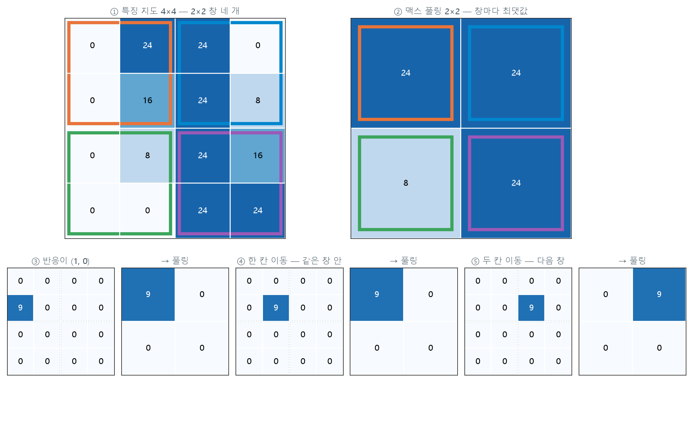

- 윗줄 = 1단계 — 색이 같은 창끼리 대응합니다. 16개 값이 4개로 줄어도 경계가 있는 위치(24)는 남습니다
- 아랫줄 = 2단계 — ③→④는 같은 창 안의 이동이므로 결과가 같고, ⑤는 다음 창으로 옮겨 가 결과가 달라집니다
- 풀링을 여러 번 거치면 창이 덮는 원래 이미지의 범위가 넓어지고, 그만큼 더 큰 이동까지 흡수됩니다 — 다만 어떤 이동에도 결과가 같은 것은 아닙니다

### 4.2 특징 추출부와 분류부 — 전체 구조

전형적인 CNN은 두 부분으로 나뉩니다.

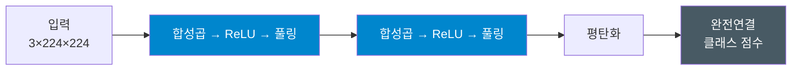

| 부분 | 구성 | 역할 |
|------|------|------|
| **특징 추출부** | [합성곱 → 활성화(ReLU) → 풀링] 블록을 여러 개 쌓음 | 이미지에서 특징을 추출 |
| **분류부** | 평탄화 → 완전연결층(Day 2의 `nn.Linear`) | 추출된 특징으로 클래스 점수 계산 |

- 평탄화를 여기서 다시 사용합니다 — 다만 2.1과 달리 이미 공간 정보를 반영해 추출된 특징을 폅니다

**활성화(ReLU) — 합성곱 뒤에 두는 이유**

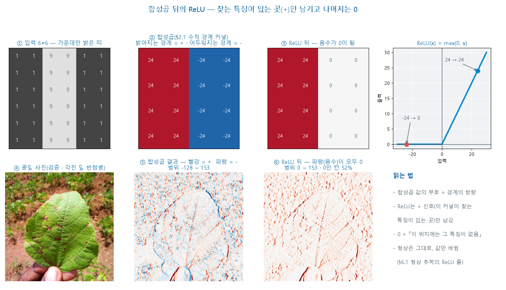

- 합성곱 값의 부호는 경계의 방향입니다 — 밝아지는 경계는 양수, 어두워지는 경계는 음수입니다(①\~②)
- ReLU = `max(0, x)` — 음수는 0으로 바꾸고 양수는 그대로 둡니다(Day 2 7.3)
- 커널이 찾는 특징이 있는 위치(양수)만 남습니다. 나머지 위치는 0(「그 특징이 없음」)이 됩니다 — 콩잎 사진에서는 칸의 52%가 0입니다(⑥)
- 합성곱 두 층을 활성화 없이 이으면 하나의 합성곱으로 합쳐집니다(Day 2 7.2 「활성화 없이 쌓기」와 같은 원리) — 아래의 계층적 특징이 성립하려면 층 사이에 활성화가 필요합니다

**계층적 특징 학습** — 이 구조는 학습으로 특징의 위계를 형성합니다.

| 층 | 학습하는 특징 | 예 |
|------|------|------|
| 얕은 층 | 단순·저수준 — 선·대각선·색 덩어리·명암 경계 | 수직선 커널 · 갈색 커널 |
| 중간 층 | 저수준 특징의 조합 — 부분 | 눈 모양 · 바퀴의 원 · 반점의 둥근 가장자리 |
| 깊은 층 | 부분의 조합 — 전체·추상 | 얼굴 · 자동차 · **녹병이 퍼진 잎** |

- 단순한 요소를 조합해 복잡한 구조를 만드는 방식입니다. CNN이 이미지 인식에 효과적인 근본 이유
- 마지막 고수준 특징 지도는 평탄화되어 분류부로 전달됩니다. 분류부는 **어느 클래스일 확률이 가장 높은지** 계산합니다

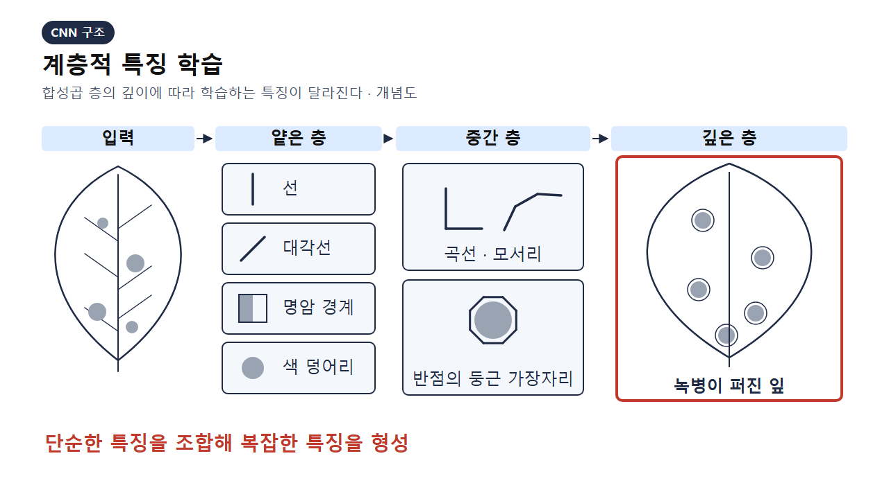

### 4.3 확인 활동 — 특징 지도 판독

아래 네 가지 커널이 만드는 특징 지도가 있다고 할 때, 각각이 **얕은 층·중간 층·깊은 층 중 어디에서** 학습되는지 판정합니다.

| 커널이 반응하는 것 | 층 |
|------|:--:|
| ㉠ 수직 방향의 밝기 경계 | ? |
| ㉡ 갈색 반점의 둥근 가장자리 | ? |
| ㉢ 녹 포자가 흩어진 잎 전체 | ? |
| ㉣ 잎맥이 갈라지는 지점 | ? |

<details>
<summary>정답 보기</summary>

- ㉠ 얕은 층 · ㉡ 중간 층 · ㉢ 깊은 층 · ㉣ 중간 층
- 같은 얕은 층 커널(㉠)이 반점이 있는 잎에도 녹병 잎에도 사용됩니다 — **얕은 층은 범용, 깊은 층은 과업 특화**. 이 사실이 11.1 전이 학습의 근거입니다

</details>

### 4.4 응용 실습 — 홀수 크기 특징 지도의 풀링

- 5×5 특징 지도(값 0\~24)에 `nn.MaxPool2d(2)`를 적용했더니 출력이 3×3이 아니라 **2×2**였습니다. 마지막 행과 열이 어떻게 처리되었는지 찾습니다
- 코드는 AI 코딩 도구로 작성합니다

**① 출력 값 확인**

- 0\~24를 5×5로 배치한 텐서(형상 `(1, 1, 5, 5)`)를 만들어 맥스 풀링하고 출력합니다

> **예측** — 네 값을 적습니다. 2×2 창이 한 번에 두 칸씩 이동하면 5칸 가운데 몇 칸을 덮습니까?

- **확인** — 2×2 출력의 값이 예측과 같으면 정상입니다

**② 사용되지 않은 값 찾기**

- 5×5 배열에서 어느 창에도 포함되지 않은 값을 모두 적고, 3.2 출력 크기 공식(K = 2 · S = 2 · P = 0)으로 출력 크기를 계산합니다

**③ 마지막 행·열까지 포함하기**

> **정할 것** — 3.2 공식의 어느 처리를 바꾸면 마지막 행과 열이 창에 포함됩니까? 바꾼 처리로 계산한 출력 크기는 몇입니까?

- 정한 처리를 조건으로 맥스 풀링을 다시 요청하고, 출력 형상과 값을 ①과 비교합니다

<details>
<summary>응용 실습 정리</summary>

- ① `[[6, 8], [16, 18]]` · ② 마지막 열(4·9·14·19·24)과 마지막 행(20\~24)은 어느 창에도 포함되지 않음 · ⌊(5 − 2) ÷ 2⌋ + 1 = **2**
- ③ 공식의 내림을 올림으로 바꿈 → ⌈(5 − 2) ÷ 2⌉ + 1 = **3** · PyTorch 옵션 = `ceil_mode=True` → 3×3 `[[6, 8, 9], [16, 18, 19], [21, 23, 24]]` — 마지막 창이 남은 행·열을 포함
- 합성곱과 풀링은 같은 출력 크기 공식을 따릅니다. 홀수 크기에서는 가장자리 정보가 제외될 수 있습니다

</details>

### 4.5 응용 실습 — 작은 반점과 두 가지 풀링

- 4.1의 평균 풀링은 창 안의 평균을 남깁니다. 반점처럼 **한 칸에만 강한 반응**이 있을 때 두 풀링 가운데 어느 것이 그 신호를 보존하는지 확인합니다

**① 3.1 특징 지도에 두 풀링 적용**

- 3.1 실습의 `fm`에 `nn.MaxPool2d(2)`와 `nn.AvgPool2d(2)`를 각각 적용해 2×2 결과를 나란히 출력합니다

> **예측** — 평균 풀링의 왼쪽 위 값을 수기로 계산합니다. 창 안의 네 값은 0 · 24 · 0 · 16입니다

**② 한 칸 반응에 두 풀링 적용**

- 4.1 2단계의 반응 지도(9가 한 칸)에 두 풀링을 적용합니다
- **확인** — 맥스 풀링의 9와 평균 풀링의 값을 비교합니다

**③ 정리**

- 콩잎 사진에서 작은 반점이 병해 판정의 기준이라면 두 풀링 가운데 무엇이 유리한지 근거와 함께 적습니다

<details>
<summary>응용 실습 정리</summary>

- ① 맥스 `[[24, 24], [8, 24]]` · 평균 `[[10, 14], [2, 22]]` — 왼쪽 위 = (0 + 24 + 0 + 16) ÷ 4 = 10
- ② 맥스 = 9 · 평균 = 9 ÷ 4 = **2.25** — 평균 풀링은 한 칸의 강한 신호를 넷으로 나누어 약하게 만듦
- ③ 작은 국소 특징을 보존하는 데는 맥스 풀링이 유리합니다 — CNN 특징 추출부에서 맥스 풀링이 널리 사용되는 이유

</details>

**여기까지가 원리입니다.** 다음은 이 구조에 **데이터를 공급하는 파이프라인**입니다(5절). 그 뒤에 허깅페이스의 콩잎 데이터를 이 파이프라인에 적용합니다(6절).

---

## 5. 데이터 파이프라인

**학습목표**

- Dataset과 DataLoader의 역할 분담을 설명할 수 있다
- 폴더 구조가 라벨이 되는 방식과 학습용·검증용 변환이 다른 이유를 설명할 수 있다
- 변환과 배치 구성이 데이터의 형상·자료형·값을 어떻게 바꾸는지 예측하고 출력과 대조할 수 있다

### 5.1 로더가 필요한 이유

수십 GB의 데이터셋은 메모리에 한 번에 적재할 수 없습니다. 적재할 수 있더라도 데이터 전체로 기울기를 한 번 계산하는 방식은 비효율적입니다(Day 2 3.4 「배치를 사용하는 이유」).

| 요구 | 내용 |
|------|------|
| 미니배치 | 전체를 작은 묶음으로 나누어 처리 |
| 섞기 | 매 epoch 순서를 무작위로 — 모델이 데이터 순서에 맞추어지는 것을 방지 |
| 병렬 | 여러 CPU 코어로 미리 읽어 GPU의 대기 시간을 최소화 |

PyTorch는 이 세 요구를 **두 구성 요소로 분리**합니다.


**Dataset** — 데이터셋의 **명세**입니다. 상속하여 세 메서드만 구현합니다.

| 메서드 | 역할 | 호출되는 때 |
|------|------|------|
| `__init__(self, ...)` | 경로·파일 목록 등 준비 — 데이터를 모두 읽는 단계가 **아님** | 객체 생성 시 |
| `__len__(self)` | 전체 샘플 수 반환 | `len(dataset)` |
| `__getitem__(self, idx)` | idx번째 샘플(이미지, 라벨)을 읽어 **변환까지 적용해** 반환 | `dataset[idx]` |

**DataLoader** — Dataset을 받아 원하는 방식으로 공급하는 **반복자**입니다.

| 인자 | 뜻 | 관행 |
|------|------|------|
| `batch_size` | 한 번에 묶는 샘플 수 | 32 |
| `shuffle` | 매 epoch 섞을지 | 학습 `True` · 검증 `False` |
| `num_workers` | 읽기에 사용할 CPU 프로세스 수 | Colab 2 |

**역할 분리의 이점** — Dataset은 데이터 자체만, DataLoader는 공급 방식만 담당합니다. 같은 Dataset에 학습용(`shuffle=True`)·검증용(`shuffle=False`) DataLoader를 따로 연결할 수 있습니다.

```python
from torch.utils.data import Dataset, DataLoader

class MyImages(Dataset):                   # ① 상속 — Dataset의 규약을 따르는 새 클래스
    def __init__(self, paths, labels, transform=None):
        self.paths, self.labels = paths, labels
        self.transform = transform
    def __len__(self):
        return len(self.paths)
    def __getitem__(self, idx):
        image = Image.open(self.paths[idx]).convert('RGB')
        if self.transform:                 # ② 읽는 순간 변환 적용
            image = self.transform(image)
        return image, self.labels[idx]     # ③ (이미지, 라벨) 튜플
```

- 오늘은 이 클래스를 **직접 사용하지 않습니다** — 5.2의 `ImageFolder`가 같은 역할을 대신합니다. 구조를 이해하는 것이 목적입니다

**로더 실습 1단계 — 가장 작은 Dataset**

- 이미지 대신 수치로 Dataset의 세 메서드를 확인합니다. `idx`번째 샘플 = (입력 $x$ = `idx` · 정답 = $x^2$)
- 이 실습은 5.5까지 세 단계로 이어집니다

```python
import torch
from torch.utils.data import Dataset, DataLoader

class Squares(Dataset):
    def __init__(self, n):
        self.n = n                          # ① 샘플 수만 보관 — 데이터를 미리 만들지 않음
    def __len__(self):
        return self.n
    def __getitem__(self, idx):
        x = torch.tensor([float(idx)])      # ② 요청받은 순간 샘플 하나를 만듦
        return x, x ** 2

sq = Squares(10)
print(len(sq))                              # ③ __len__ 호출
print(sq[3])                                # ④ __getitem__(3) 호출
```

> **예측** — 두 출력을 실행하기 전에 적습니다.
> - `len(sq)`는 어느 메서드가 반환한 값입니까?
> - `sq[3]`은 값 몇 개를 어떤 형태로 반환합니까? 각 값의 형상은 무엇입니까?

- **확인** — 출력을 예측과 대조합니다
- 예측과 다르면 → 아래 「예측 대조」를 펼쳐 `__getitem__`의 반환문을 확인 → **1단계를 다시** 실행합니다

<details>
<summary>예측 대조</summary>

- `len(sq)` = `10` — `__init__`에 전달한 `n`을 `__len__`이 반환
- `sq[3]` = `(tensor([3.]), tensor([9.]))` — 튜플 하나에 텐서 두 개 · 각 형상 `(1,)`
- 대괄호 인덱싱 `sq[3]`이 `__getitem__(3)`을 호출합니다 — 이미지 Dataset도 같은 방식으로 샘플 하나를 읽습니다

</details>

### 5.2 `ImageFolder` — 폴더명을 라벨로 사용

이미지 분류에서 가장 흔한 데이터 구조는 **클래스별 폴더**입니다. `torchvision.datasets.ImageFolder`는 이 구조를 읽어 5.1의 Dataset을 자동으로 만듭니다.

```
data/
  train/
    angular_leaf_spot/   0000.jpg  0001.jpg ...
    bean_rust/           ...
    healthy/             ...
  val/
    angular_leaf_spot/  bean_rust/  healthy/
```

| 규칙 | 내용 |
|------|------|
| 라벨 | **폴더 이름**이 클래스 — 라벨 파일을 따로 만들지 않음 |
| 번호 | 폴더명을 **문자열 순서(`sorted`)로 정렬**해 0부터 부여 — `angular_leaf_spot`=0 · `bean_rust`=1 · `healthy`=2 |
| 확인 | `dataset.classes`(이름 목록) · `dataset.class_to_idx`(이름 → 번호) |

- "라벨은 어디에 있는가"의 답이 폴더 구조입니다. Day 1 4.4의 WM-811K는 라벨이 20%에만 있었습니다 — 오늘 데이터는 전문가가 촬영 현장에서 병명을 판정했으므로 **모든 사진에 라벨**이 있습니다(6.1)
- 모델이 출력하는 것은 이름이 아니라 **번호**입니다 — 결과를 읽으려면 번호 → 이름 대응(`classes`)을 모델과 함께 보관해야 합니다

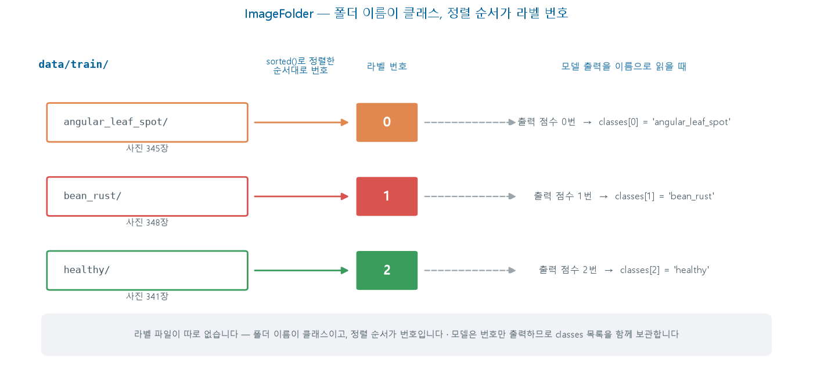

- 폴더 이름을 문자열 순서로 정렬해 0부터 번호를 붙입니다. 라벨 파일은 따로 없습니다
- 모델은 번호만 출력하므로, 출력을 이름으로 읽으려면 `classes` 목록이 필요합니다(9.2)

### 5.3 학습용·검증용 변환의 차이와 그 이유

`__getitem__`이 이미지를 읽는 순간 적용하는 것이 **변환**(transform)입니다. 학습용과 검증용을 **다르게** 구성합니다.

| 학습(train) | 검증(val) |
|------|------|
| `RandomResizedCrop(224)` — 무작위 부분 확대 | `Resize((256, 256))` — 크기 통일 |
| `RandomRotation(10)` — ±10° 회전 | `CenterCrop(224)` — 가운데 잘라내기 |
| `ColorJitter(...)` — 밝기·대비 변동 | — |
| `ToTensor()` | `ToTensor()` |
| `Normalize(MEAN, STD)` | `Normalize(MEAN, STD)` |

| 이유 | 설명 |
|------|------|
| 학습 = 무작위 변형 | 매 epoch 조금씩 다른 이미지가 입력되어 **일반화**에 도움 — 6.3 증강 |
| 검증 = 결정론 | 같은 이미지에 항상 같은 처리 → 측정이 **재현**됨. 무작위 변환이 섞이면 정확도가 실행마다 달라짐 |

**두 변환의 공통 부분**

| 변환 | 역할 |
|------|------|
| `ToTensor()` | PIL(Python Imaging Library) 이미지(0\~255 · H×W×C) → 텐서(0.0\~1.0 · **C×H×W**) |
| `Normalize(MEAN, STD)` | 채널별 (값 − 평균) ÷ 표준편차 — 학습 안정화 |

- `ToTensor()`는 Day 2 4.1 대응표를 이미지에 적용한 형태입니다
- `MEAN = [0.485, 0.456, 0.406]` · `STD = [0.229, 0.224, 0.225]` = **ImageNet 통계값**. 관행적 표준값이며 11.1 전이 학습에서는 사전학습 조건과 일치시키기 위해 반드시 사용합니다
- 검증 변환의 `(256, 256)`은 **튜플** — 가로·세로를 모두 256으로. 학습한 모델을 다른 환경에서 사용할 때도 이 전처리를 같은 순서·같은 값으로 적용해야 합니다(5.4)

**변환 실습 1단계 — 2×2 이미지의 `ToTensor()`**

- 값을 수기로 계산해 확인할 수 있도록 화소 네 개로 된 이미지에 두 변환을 적용합니다

```python
import numpy as np
from PIL import Image
from torchvision import transforms

arr = np.array([[[255, 0, 0], [0, 255, 0]],
                [[0, 0, 255], [128, 128, 128]]], dtype=np.uint8)   # ① 2×2 RGB — 빨강·초록 / 파랑·회색
img = Image.fromarray(arr)                                         # ② 배열 → PIL 이미지
t = transforms.ToTensor()(img)                                     # ③ 변환 객체를 만들어 이미지에 적용
print(t.shape, t.dtype)
print(t)
```

> **예측** — 형상·자료형·값을 적습니다.
> - `arr`의 축 순서는 (H, W, C)입니다. `ToTensor()` 뒤의 축 순서와 형상은 무엇입니까?
> - 255는 몇이 됩니까? 128은 대략 몇입니까?

- **확인** — 출력을 예측과 대조합니다
- 예측과 다르면 → 아래 「예측 대조」의 표에서 어긋난 항목을 확인 → **1단계를 다시** 실행합니다

<details>
<summary>예측 대조 — 형상·자료형·값 변화</summary>

| 항목 | 변환 전 (`arr`) | 변환 후 (`t`) |
|------|------|------|
| 형상 | (2, 2, 3) — (H, W, C) | (3, 2, 2) — (C, H, W) |
| 자료형 | `uint8` | `float32` |
| 값 범위 | 0\~255 | 0.0\~1.0 |
| 회색 칸 | 128 | 0.5020 (= 128 ÷ 255) |

- 채널 0(빨강) 평면 = `[[1.0, 0.0], [0.0, 0.502]]` — 왼쪽 위 화소가 빨강이므로 1.0
- Day 2 4.7 응용 실습에서 직접 작성한 세 조작(형상 · 자료형 · 0\~1 범위)을 `ToTensor()`가 한 번에 수행합니다

</details>

**변환 실습 2단계 — `Normalize()`**

```python
MEAN, STD = [0.485, 0.456, 0.406], [0.229, 0.224, 0.225]
n = transforms.Normalize(MEAN, STD)(t)                             # ④ 채널별 (값 − 평균) ÷ 표준편차
print(n[0])                                                        # ⑤ 채널 0 평면만 출력
```

> **예측** — 채널 0 평면의 네 값을 계산합니다. 채널 0의 평균은 0.485, 표준편차는 0.229입니다.
> - 1.0은 몇이 됩니까? 0.0은 몇이 됩니까?
> - 정규화한 뒤의 값은 모두 0 이상입니까?

- **확인** — 출력을 예측과 대조합니다
- 예측과 다르면 → 「예측 대조」의 계산 열을 따라 다시 계산 → **2단계를 다시** 실행합니다

<details>
<summary>예측 대조</summary>

| 위치 | `ToTensor()` 뒤 | `Normalize()` 뒤 | 계산 |
|------|:--:|:--:|------|
| (0, 0) 빨강 | 1.0000 | 2.2489 | (1.0 − 0.485) ÷ 0.229 |
| (0, 1) 초록 | 0.0000 | −2.1179 | (0.0 − 0.485) ÷ 0.229 |
| (1, 0) 파랑 | 0.0000 | −2.1179 | (0.0 − 0.485) ÷ 0.229 |
| (1, 1) 회색 | 0.5020 | 0.0741 | (0.502 − 0.485) ÷ 0.229 |

- 정규화한 뒤에는 **음수**가 생깁니다 — 이미지로 표시하려면 정규화를 되돌려야 합니다(8.6의 `denorm`)
- 채널마다 평균·표준편차가 다르므로 같은 0.0도 채널에 따라 다른 값이 됩니다 — 초록 채널의 0.0 → −2.0357

</details>

**실제 사진에 적용한 결과** — 콩잎 검증 이미지 한 장(6절의 데이터)

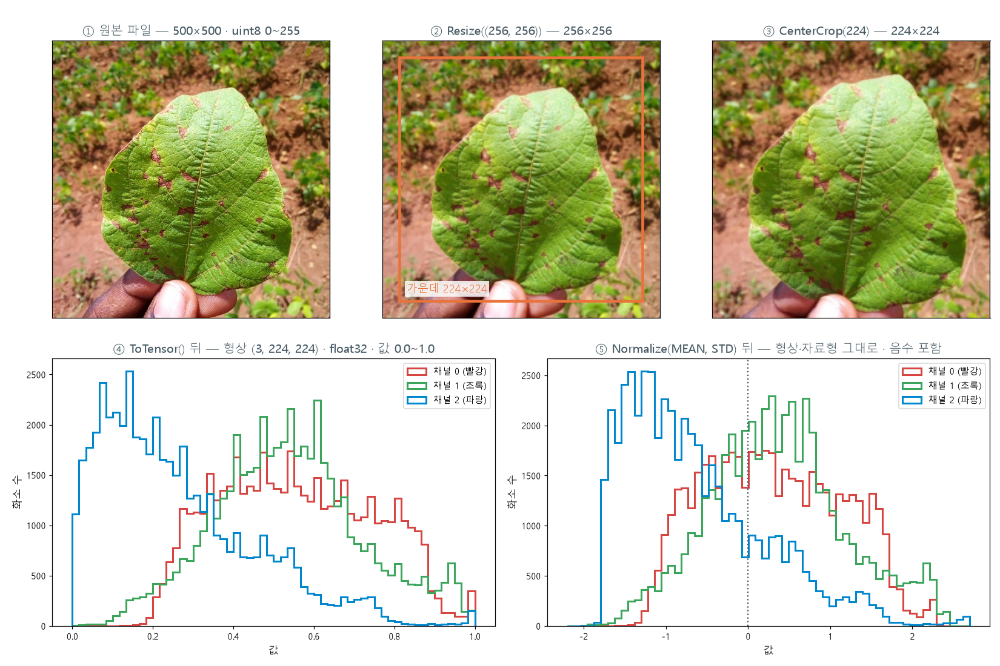

- ①\~③ 크기 변환 — 500×500 → 256×256 → 가운데 224×224. 가장자리에서 16화소씩 제외됩니다
- ④ `ToTensor()` 뒤 — 채널별 값이 0\~1 사이에 분포합니다. 잎 사진이므로 파랑 채널이 낮은 값에 치우칩니다
- ⑤ `Normalize()` 뒤 — 분포의 모양은 변하지 않고 위치와 폭만 바뀝니다. 값의 범위는 약 −2.1\~2.6입니다

> **자주 하는 실수 —** 학습용 변환(무작위 포함)을 검증 세트에도 적용하면 **정확도가 실행할 때마다 달라지고 대개 낮게** 측정됩니다. 검증 로더에는 반드시 결정론적 변환만 연결합니다.

### 5.4 Day 1·2의 배열 조작과 `transforms`의 대응

Day 1·2에서 배열·텐서 명령으로 직접 작성한 조작이 여기서는 `transforms` 한 줄이 됩니다.

| 직접 작성 (Day 1·2) | 오늘 (transforms) |
|------|------|
| 슬라이싱으로 가운데 잘라내기 `arr[16:240, 16:240]` — Day 1 6.4 | `CenterCrop(224)` |
| `arr.astype(np.float32) / 255` — 0\~1 범위 · Day 2 4.7 | `ToTensor()` |
| `(arr - mean) / std` 채널별 정규화 — 브로드캐스팅 · Day 1 8.2 | `Normalize(MEAN, STD)` |
| `permute(2, 0, 1)` — (H,W,C) → (C,H,W) · Day 2 4.4 | `ToTensor()`가 함께 수행 |

- PyTorch를 설치하지 않은 환경에서 모델을 사용할 때는 이 순서를 NumPy로 다시 작성합니다 — 5.6 응용 실습

### 5.5 배치와 epoch의 순환

| 용어 | 뜻 |
|------|------|
| **배치**(batch) | 한 번의 파라미터 갱신에 사용하는 샘플 묶음 — `batch_size` |
| **epoch** | 학습 데이터 **전체를 한 번** 통과 |
| 배치 수 | 샘플 수 ÷ 배치 크기(올림) — 예: 학습 1,034장 ÷ 32 = **33배치**(마지막 배치는 10장) |

```python
for epoch in range(EPOCHS):                # 바깥 반복 = epoch
    for images, labels in train_loader:    # 안쪽 반복 = 배치 — 로더가 (이미지, 라벨) 묶음을 공급
        ...                                # Day 2 6절 학습 루프 5단의 위치
```

- `shuffle=True`이면 매 epoch 배치의 구성이 달라집니다 — 같은 조합으로 다시 묶일 가능성은 매우 낮습니다
- Day 2 6.4 「순환 1회와 반복의 구조」의 바깥에 epoch 반복이 하나 더 있는 구조입니다

**로더 실습 2단계 — 배치로 묶기**

```python
loader = DataLoader(sq, batch_size=4, shuffle=False)   # ① 1단계의 sq — 샘플 10개
print(len(loader))                                     # ② 배치 수
for xb, yb in loader:
    print(xb.shape, xb.flatten().tolist())             # ③ 배치마다 형상과 입력값
```

> **예측** — 배치 수와 각 배치의 형상을 적습니다.
> - 샘플 10개를 4개씩 묶으면 배치는 몇 개입니까? 마지막 배치에는 샘플이 몇 개 남습니까?
> - 1단계에서 입력 하나의 형상은 `(1,)`이었습니다. 4개를 묶은 배치의 형상은 무엇입니까?

- **확인** — 출력을 예측과 대조합니다
- 예측과 다르면 → 「예측 대조」의 표에서 어긋난 배치를 확인 → **2단계를 다시** 실행합니다

<details>
<summary>예측 대조 — 배치 구성</summary>

| 배치 | 형상 | 입력값 |
|:--:|:--:|------|
| 1 | (4, 1) | 0 · 1 · 2 · 3 |
| 2 | (4, 1) | 4 · 5 · 6 · 7 |
| 3 | (2, 1) | 8 · 9 |

- `len(loader)` = 3 = ⌈10 ÷ 4⌉ — 마지막 배치는 남은 2개
- 샘플 형상 `(1,)` 앞에 **배치 축**이 추가됩니다 — 6.4의 `[32, 3, 224, 224]`도 같은 규칙(이미지 형상 (3, 224, 224) 앞에 32)

</details>

**로더 실습 3단계 — 섞기와 epoch**

```python
loader = DataLoader(sq, batch_size=4, shuffle=True)    # ④ 매 epoch 순서를 섞음
for epoch in range(2):
    for xb, _ in loader:
        print(epoch, xb.flatten().tolist())            # ⑤ epoch 번호와 배치의 입력값
```

> **예측** — 두 epoch의 배치 구성은 같습니까? 한 epoch 안에서 같은 샘플이 두 번 출력될 수 있습니까?

- **확인** — 두 epoch의 배치 구성이 다르고, 각 epoch에 0\~9가 한 번씩 출력되면 정상입니다
- 실행할 때마다 순서가 달라집니다

<details>
<summary>예측 대조</summary>

- 실행 예(소수점 생략) — epoch 0 = [6, 7, 1, 4] · [2, 0, 9, 8] · [3, 5] / epoch 1 = [2, 4, 7, 0] · [8, 9, 5, 3] · [6, 1]
- 매 epoch 순서를 새로 섞지만, 한 epoch 안에서는 모든 샘플을 **한 번씩만** 사용합니다 — 5.5 용어 표의 「epoch = 학습 데이터 전체를 한 번 통과」
- `_` = 받기는 하지만 사용하지 않는 값(여기서는 정답 배치)을 담는 변수 이름 — 관행

</details>

**코드 읽기 — Python 문법 ① 클래스·상속·특수 메서드**

| 코드 | 뜻 |
|------|------|
| `class MyImages(Dataset):` | 괄호 = 상속 — `Dataset`의 규약을 이어받아 새 클래스를 정의(Day 2 7.1) |
| `def __init__(self, ...):` | 객체가 만들어질 때 자동 실행되는 메서드 — 앞뒤 밑줄 두 개 = 특수 메서드 |
| `self.paths = paths` | `self.` = 이 객체에 값을 보관 — 다른 메서드에서 `self.paths`로 다시 사용 |
| `def __len__(self):` | `len(obj)`가 호출하는 메서드 — 반환값이 곧 길이 |
| `def __getitem__(self, idx):` | `obj[idx]`가 호출하는 메서드 — 대괄호 인덱싱의 실체 |
| `return image, self.labels[idx]` | 쉼표로 두 값 반환 = 튜플 하나 |
| `for images, labels in loader:` | 튜플을 두 변수로 나누어 받음(언패킹) — 로더가 공급하는 (이미지 배치, 라벨 배치) |

- 이 표는 이후 Day에도 다시 싣습니다 — 지금 모두 암기할 필요는 없습니다. 코드를 읽을 때마다 표를 참조합니다

**코드 읽기 — Python 문법 ① (계속) 로더·변환 실습**

| 코드 | 뜻 |
|------|------|
| `torch.tensor([float(idx)])` | `float()` = 정수를 실수로 변환 · 대괄호 = 원소 1개로 된 리스트 → 형상 `(1,)` |
| `x ** 2` | 거듭제곱 — `x`의 제곱 |
| `np.array([...], dtype=np.uint8)` | 중첩 리스트 → 배열 · 자료형 지정(Day 1 6.2 재등장) |
| `Image.fromarray(arr)` | NumPy 배열 → PIL 이미지 |
| `transforms.ToTensor()(img)` | 괄호 두 쌍 — 앞 괄호 = 변환 객체 생성 · 뒤 괄호 = 그 객체를 이미지에 적용 |
| `n[0]` | 0번 축의 0번 = 채널 0 평면(Day 2 4.4 재등장) |
| `DataLoader(sq, batch_size=4, shuffle=False)` | 첫 인자 = Dataset · 나머지 = 키워드 인자(5.1 표) |
| `xb.flatten().tolist()` | 텐서를 1차원으로 편 뒤 파이썬 리스트로 변환 — 출력용 |

### 5.6 응용 실습 — 검증 변환을 NumPy로 재현

- 5.3 검증 변환과 같은 결과를 PIL과 NumPy만으로 만들고, 두 결과가 같은지 **값으로** 확인합니다
- 코드는 AI 코딩 도구로 작성합니다. 단계마다 하나씩 요청하고 결과를 「확인」 기준과 대조합니다

**① 시험 이미지와 기준 결과**

- `np.random.seed(0)`로 고정한 무작위 화소 배열(높이 300 · 너비 400 · 채널 3 · `uint8`)을 만들고 PIL 이미지 `img`로 바꿉니다
- 배열의 `shape`와 이미지의 `size`를 함께 출력합니다
- 아래 검증 변환을 `img`에 적용한 결과를 `ref`로 두고 형상을 출력합니다(6.4에서 같은 정의를 다시 사용)

```python
MEAN, STD = [0.485, 0.456, 0.406], [0.229, 0.224, 0.225]
val_tf = transforms.Compose([                 # 5.3 표의 검증 변환 네 단계를 순서대로 묶음
    transforms.Resize((256, 256)),
    transforms.CenterCrop(224),
    transforms.ToTensor(),
    transforms.Normalize(MEAN, STD),
])
```

> **예측** — `shape`와 `size`가 표시하는 크기의 순서는 같습니까? `ref`의 형상은 무엇입니까?

**② 요청 조건 적기**

- `val_tf`의 네 단계를 PIL과 NumPy 조작으로 바꾸어 실행할 때 정해야 하는 값을 텍스트 셀에 적습니다 — 이 목록이 AI에게 보낼 요청문입니다(5.3 · 5.4 대응표)

> **정할 것** — 요청문을 적기 전에 답합니다.
> - 네 단계는 어떤 순서로 적용합니까? 값을 0\~1 범위로 바꾸는 단계는 몇 번째입니까?
> - 256×256에서 가운데 224×224를 잘라 낼 때 시작 위치는 몇 화소입니까?
> - 마지막 결과의 축 순서는 무엇입니까? 크기를 바꾸는 방법(보간)은 무엇으로 지정합니까?

**③ NumPy로 재현**

- ②의 요청문으로 결과 `mine`을 만드는 코드를 요청합니다
- `np.allclose(mine, ref.numpy(), atol=1e-5)`로 비교하고, 두 결과의 최대 차이도 출력합니다
- **확인** — `True`이고 최대 차이가 0.0이면 정상입니다
- `False`이면 → 단계마다 중간 결과의 형상을 출력해 순서 · 잘라내는 시작 위치 · 축 순서를 ②의 요청문과 대조 → 요청문을 고쳐 **③을 다시** 실행합니다

**④ 크기 변경 방법 바꾸기**

- ③에서 PIL `resize` 대신 이미지를 먼저 텐서로 바꾼 뒤 `torchvision.transforms.functional.resize`로 크기를 바꾸고 같은 비교를 실행합니다

> **예측** — 결과는 `True`입니까? 두 방법은 모두 BILINEAR 보간을 사용합니다.

**⑤ 축 순서 바꾸기**

- ③의 마지막 축 변환을 `reshape(3, 224, 224)`로 바꾸어 같은 비교를 실행합니다(Day 2 4.6)

<details>
<summary>응용 실습 정리</summary>

- ① `shape` = (300, 400, 3) — (높이, 너비, 채널) / `size` = (400, 300) — PIL은 (너비, 높이) 순서. 크기를 지정할 때 순서를 확인합니다 · `ref` = (3, 224, 224)
- ② 모범 요청 조건 = PIL `resize`(BILINEAR)로 256×256 → NumPy 배열 → `float32`로 바꾸어 255로 나누기 → 가운데 224×224(시작 위치 (256 − 224) ÷ 2 = **16**) → 채널별 (값 − 평균) ÷ 표준편차 → (C, H, W) 순서로 변경 — 5.3 표의 검증 변환과 같은 순서
- ③ `True` · 최대 차이 0.0(실측)
- ④ `False` · 최대 차이 약 0.017(실측) — 같은 이름의 보간이라도 PIL과 텐서 연산은 계산 방식이 달라 값이 조금 다릅니다. 다른 방법으로 전처리하면 모델이 받는 입력이 학습 때와 달라집니다
- ⑤ `False` · 최대 차이 약 3.4(실측) — 형상은 같지만 채널 값이 섞입니다. 형상만으로는 확인할 수 없습니다
- AI에 요청할 때는 「PIL `resize`(BILINEAR)로 256×256」처럼 **학습 때와 같은 방법**을 포함해야 합니다 — 지정하지 않으면 다른 크기 변경 방법이 선택될 수 있습니다

</details>

### 5.7 응용 실습 — 같은 사진, 다른 결과

- 아래 코드는 검증 변환으로 작성했습니다. 같은 이미지에 두 번 적용하면 결과가 다릅니다. 원인을 찾습니다
- 원인 분석 코드는 AI 코딩 도구로 작성합니다

```python
check_tf = transforms.Compose([
    transforms.Resize((256, 256)),
    transforms.CenterCrop(224),
    transforms.ColorJitter(brightness=0.3),
    transforms.ToTensor(),
    transforms.Normalize(MEAN, STD),
])
a, b = check_tf(img), check_tf(img)           # 5.6 ①의 시험 이미지
print(a.shape, b.shape, torch.equal(a, b))
```

**① 현상 확인**

> **예측** — 두 결과의 형상은 같습니까? `torch.equal(a, b)`는 `True`입니까?

- **확인** — 형상이 둘 다 (3, 224, 224)이고 `False`가 출력되면 이 실습의 현상이 재현된 상태입니다

**② 원인 찾기**

> **예측** — 실행하기 전에 원인 변환을 지목합니다. 5.3 표에서 학습 변환에만 있는 변환은 무엇입니까? 그 변환은 실행할 때마다 무엇을 새로 정합니까?

- `Resize` · `CenterCrop` · `ColorJitter`를 각각 `img`에 두 번 적용해 두 결과 배열이 같은지 출력하는 코드를 작성합니다
- **확인** — 세 변환 가운데 하나만 `False`이면 그 변환이 원인입니다. 예측과 대조합니다

**③ 수정**

- 원인 변환을 제거하고 ①을 다시 실행합니다
- **확인** — `True`가 출력되면 정상입니다

**④ 영향**

- 이 변환을 검증 로더에 연결할 때 같은 모델 · 같은 검증 데이터의 정확도가 실행마다 달라지는 이유를 한 문장으로 적습니다

<details>
<summary>응용 실습 정리</summary>

- ① 형상은 같고 `False` — 오류가 발생하지 않습니다. 값을 비교해야 차이를 발견할 수 있습니다
- ② `Resize` = `True` · `CenterCrop` = `True` · `ColorJitter` = `False` — `ColorJitter`가 밝기 계수를 0.7\~1.3 사이에서 **실행마다 새로** 무작위로 선택합니다(두 결과의 최대 차이 — 실측 4회 0.35\~1.3)
- ④ 검증 이미지가 실행마다 다른 밝기로 바뀌어 모델의 입력이 달라지므로 정확도도 측정할 때마다 변동합니다 — 5.3 「자주 하는 실수」
- AI에게 검증 변환을 요청할 때는 「무작위 변환 없이」를 조건으로 포함합니다

</details>

---

## 6. 실습 ① — 허깅페이스 데이터 준비

**학습목표**

- 허깅페이스에서 데이터셋의 구성(분할·열·클래스·라이선스)을 확인하고 불러올 수 있다
- 불러온 데이터를 클래스별 폴더로 내보내고 장 수를 확인할 수 있다
- 증강 변환이 라벨을 보존하는지 판별할 수 있다
- 변환을 적용한 샘플과 배치의 형상·값을 예측하고 출력과 대조할 수 있다

### 6.1 허깅페이스 — 공개 모델과 데이터의 저장소

**허깅페이스**(Hugging Face)는 AI 모델·데이터셋·데모를 공개하고 공유하는 플랫폼입니다. 공개 데이터셋은 계정 없이 이름 하나로 불러올 수 있습니다.

| 구성 | 내용 |
|------|------|
| Hub | 모델·데이터셋·데모(Spaces)를 검색하는 사이트 — `huggingface.co` |
| 데이터셋 페이지 | 데이터셋 카드(출처·라이선스·분할 설명) · 뷰어(행을 표로 미리 확인) · 파일 목록 |
| `datasets` 라이브러리 | `load_dataset("이름")` 한 줄로 내려받아 불러옴 — 1.5에서 설치 |

**데이터셋 페이지에서 확인할 것**

| 확인 | 이유 |
|------|------|
| 작업 유형(Tasks) | 이미지 분류(Image Classification)인가 |
| 라이선스 | 교육·실습에 사용할 수 있는가 |
| 분할(Split) | 학습·검증·시험이 나뉘어 있는가 |
| 열(column) 이름 | 이미지와 라벨이 어느 열에 있는가 — 데이터셋마다 다름 |
| 크기 | 내려받는 용량과 장 수 |
| 접근 조건 | 로그인·동의 없이 받을 수 있는가 |
| 파일 형식 | parquet·이미지 폴더인가 — 불러오기 스크립트(`.py`) 방식은 현행 `datasets`에서 불러올 수 없음 |

**오늘의 데이터 — `AI-Lab-Makerere/beans`**

| 항목 | 내용 |
|------|------|
| 클래스 | `angular_leaf_spot`(각진 잎 반점병) · `bean_rust`(녹병) · `healthy`(건강) |
| 수집 | 우간다 여러 지역의 밭에서 보급형 스마트폰으로 촬영 |
| 라벨 | 현지 작물 연구소(NaCRRI) 전문가가 촬영 현장에서 병명 판정 |
| 분할 | 학습 1,034 · 검증 133 · 시험 128장 |
| 크기 | 500×500 RGB · 약 180MB |
| 라이선스 | MIT — Makerere AI Lab |

허깅페이스에서 불러와 구성을 확인합니다.

```python
from datasets import load_dataset

ds = load_dataset("AI-Lab-Makerere/beans")         # ① 세 분할을 한 번에 내려받음 — 약 180MB
print(ds)                                           # ② 분할별 행 수와 열 이름

names = ds["train"].features["labels"].names        # ③ 라벨 번호 → 클래스 이름 목록
print(names)

row = ds["train"][0]                                # ④ 한 행 = 열 이름을 키로 하는 딕셔너리
print(row["labels"], names[row["labels"]], row["image"].size)
```

| # | 확인 |
|:--:|------|
| ② | `train` 1,034 · `validation` 133 · `test` 128행 · 열 = `image_file_path` · `image` · `labels` |
| ③ | `['angular_leaf_spot', 'bean_rust', 'healthy']` — 라벨 번호 0·1·2의 순서 |
| ④ | 라벨 번호와 클래스 이름 · 이미지 크기 `(500, 500)` |

- 라벨 열의 이름은 `label`이 아니라 **`labels`입니다** — 다른 데이터셋을 사용할 때 가장 먼저 확인할 부분
- `row["image"]`는 PIL 이미지 — Day 1 8절에서 배열로 바꾼 이미지와 같은 형식

| 결과 | 조치 |
|------|------|
| ②의 출력이 6.1의 확인 표와 같음 | 6.2로 진행 |
| `HF_TOKEN` 관련 경고가 표시됨 | 공개 데이터는 토큰 없이 받을 수 있음 — 경고는 두고 내려받기가 끝날 때까지 기다림 |
| 연결 오류로 중단됨 | **같은 셀을 다시** 실행 |
| 다시 실행해도 같은 오류 | 교수에게 알림 — 교수 안내에 따라 6.5 |

### 6.2 클래스별 폴더로 내보내기

5.2의 `ImageFolder`는 **클래스별 폴더**를 읽습니다. 허깅페이스 데이터를 이 구조로 내보내면 6.3 이후의 코드를 데이터셋과 관계없이 그대로 사용할 수 있습니다.

```
/content/data/
  train/   angular_leaf_spot/   bean_rust/   healthy/
  val/     angular_leaf_spot/   bean_rust/   healthy/
  test/    angular_leaf_spot/   bean_rust/   healthy/
```

**내보내기 실습 1단계 — 클래스별 폴더로 저장**

```python
import os
ROOT = '/content/data'                                         # ① 내보낼 위치
SPLITS = {'train': 'train', 'validation': 'val', 'test': 'test'}   # ② 허깅페이스 분할 → 폴더 이름

for hf_split, folder in SPLITS.items():
    for i, row in enumerate(ds[hf_split]):
        cls = names[row['labels']]                             # ③ 번호 → 클래스 이름
        dst = os.path.join(ROOT, folder, cls)
        os.makedirs(dst, exist_ok=True)                        # ④ 폴더가 없으면 생성
        row['image'].save(os.path.join(dst, f'{i:04d}.jpg'), quality=95)   # ⑤ 파일로 저장
```

| # | 동작 |
|:--:|------|
| ① | Colab 로컬 — 세션이 끝나면 사라짐. 이 셀을 다시 실행하면 같은 구조가 생성됨 |
| ② | 허깅페이스의 `validation` 분할을 `val` 폴더로 — 이후 코드의 폴더 이름과 맞춤 |
| ⑤ | JPEG 품질 95로 저장 — 다시 압축할 때의 화질 손실을 줄임 |

**내보내기 실습 2단계 — 장 수 확인**

- 분할 폴더(`train` · `val` · `test`)마다 클래스 폴더의 이름과 파일 수를 출력하는 코드를 AI 코딩 도구로 작성합니다. 조건 = 클래스 폴더를 정렬한 순서로 출력

> **예측** — 실행하기 전에 적습니다.
> - 학습 폴더 세 클래스의 파일 수를 더하면 몇 장입니까?(6.1 「오늘의 데이터」 표)
> - 정렬한 클래스 폴더의 순서는 6.1에서 출력한 `names`의 순서와 같습니까?

- **확인** — 「예측 대조」의 장 수와 같으면 정상입니다
- 합계가 적으면 → 1단계 셀이 끝나기 전에 중단된 상태 → `!rm -rf /content/data`로 폴더를 지우고 **1단계부터 다시** 실행합니다

<details>
<summary>예측 대조</summary>

| 확인 | 기대 |
|------|------|
| 클래스별 장 수 | 학습 345 · 348 · 341 / 검증 44 · 45 · 44 / 시험 43 · 43 · 42 — 합계 1,034 · 133 · 128 |
| 폴더 순서 | `sorted` 결과가 `names`의 순서와 같음 — `ImageFolder`의 번호(5.2)와 허깅페이스 라벨 번호가 일치 |
| 클래스 균형 | 세 클래스의 장 수가 거의 같음 — 8.3의 불균형 문제가 이 데이터에서는 작음 |

</details>

<details>
<summary>참고 코드</summary>

```python
for folder in ['train', 'val', 'test']:
    for cls in sorted(os.listdir(os.path.join(ROOT, folder))):
        n = len(os.listdir(os.path.join(ROOT, folder, cls)))
        print(f'{folder:5s} {cls:18s} {n:4d}장')
```

</details>

**세 분할의 역할**

| 분할 | 역할 |
|------|------|
| 학습(`train`) | 가중치 갱신에 사용 |
| 검증(`val`) | 학습 중 성능 확인 · 최적 epoch 선택(8.2) |
| 시험(`test`) | 학습을 마친 뒤 최종 성능을 한 번 확인 — 8절까지는 사용하지 않음 |

- 분할이 없으면 데이터셋을 직접 나눕니다. 이때는 **무작위로** 나눕니다 — 촬영 순서대로 나누면 같은 조건의 사진이 한쪽에 치우쳐 검증이 무의미해집니다

> **자주 하는 실수 —** 다른 데이터셋으로 바꾸어 다시 내보낼 때 `ROOT` 폴더를 그대로 두면 **이전 데이터의 클래스 폴더가 남아** `ImageFolder`가 두 데이터의 클래스를 함께 읽습니다. 데이터셋을 바꿀 때는 `!rm -rf /content/data`로 폴더를 먼저 지우거나 `ROOT`를 다른 이름으로 바꿉니다.

### 6.3 증강 변환 목록과 자르기 범위 판별 활동

학습 데이터는 클래스당 약 345장입니다. CNN을 처음부터 학습하기에는 적은 규모여서 모델이 **학습 데이터에만 맞추어지기** 쉽습니다(과적합 — 8.1). **증강**(augmentation) = **라벨을 보존하는 변형**으로 데이터를 인위적으로 늘리는 것입니다.

| 원칙 | 내용 |
|------|------|
| 즉석 생성 | 변형된 이미지를 디스크에 저장하지 않고 **읽는 순간** 만듦 — 5.1 `__getitem__` |
| 적용 범위 | **학습 세트에만**. 검증·시험 세트에는 적용하지 않음(5.3) |
| 라벨 보존 | 변형 뒤에도 정답이 같아야 함 — 이 절 끝의 판별 활동 |

| 변환 | 효과 | 콩잎 적합 |
|------|------|:--:|
| `RandomResizedCrop` | 무작위 부분 확대 — 위치·크기 변화 대응 | **판정 필요** — 자르는 범위 |
| `RandomRotation(10)` | ±10° 회전 — 촬영 각도 대응 | ✅ |
| `ColorJitter(brightness, contrast)` | 밝기·대비 변동 — 밭의 햇빛·그늘 차이에 대응 | ✅ |
| `RandomHorizontalFlip` | 좌우 반전 | 아래 판별 활동 마지막 질문 |
| `RandomVerticalFlip` | 상하 반전 | 라벨은 보존 · 이 수업의 학습 변환에는 포함하지 않음 |

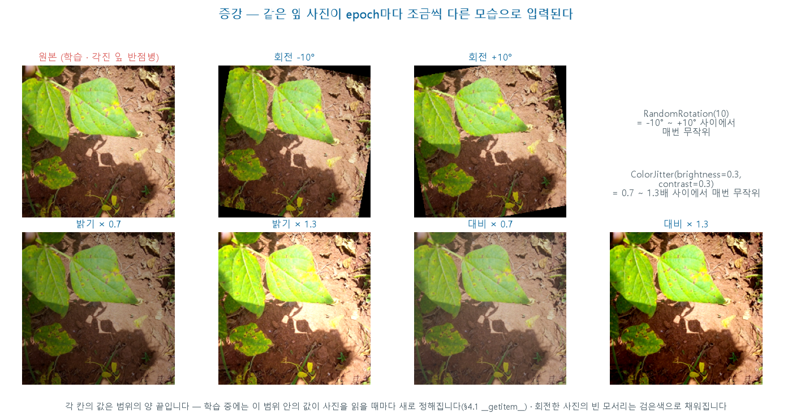

- 회전(±10°)과 밝기 · 대비(0.7\~1.3배)는 사진을 읽을 때마다 범위 안에서 새로 정해집니다
- 어느 변형에서도 반점이 남아 있으므로 라벨이 변하지 않습니다
- 자르는 범위와 좌우 반전은 아래 판별 활동에서 판단합니다

**판정 실습 — 자르는 범위 두 가지 비교**

- `RandomResizedCrop`은 원본에서 **`scale`이 정한 넓이 비율 범위 안의 영역**을 무작위로 잘라 224×224로 확대합니다
- 기본값 `scale=(0.08, 1.0)`과 6.4 학습 변환의 `scale=(0.7, 1.0)`을 같은 병해 잎 사진에 각각 4번 적용해 비교합니다

```python
from torchvision import transforms
from PIL import Image
import matplotlib.pyplot as plt

cls_dir = os.path.join(ROOT, 'train', 'angular_leaf_spot')
sample = Image.open(os.path.join(cls_dir, sorted(os.listdir(cls_dir))[0]))   # ① 병해 잎 사진 한 장
crop_wide  = transforms.RandomResizedCrop(224, scale=(0.08, 1.0))          # ② 기본값 — 원본 넓이의 8~100%
crop_tight = transforms.RandomResizedCrop(224, scale=(0.7, 1.0))           # ③ 6.4의 값 — 원본 넓이의 70~100%

fig, axes = plt.subplots(2, 4, figsize=(12, 6))
for ax in axes[0]:                                                         # ④ 윗줄 = 기본값
    ax.imshow(crop_wide(sample)); ax.axis('off')
for ax in axes[1]:                                                         # ⑤ 아랫줄 = 0.7
    ax.imshow(crop_tight(sample)); ax.axis('off')
plt.show()
```

> **예측** — 실행하기 전에 적습니다.
> - 500×500 사진에서 넓이 8%인 정사각형의 한 변은 대략 몇 화소입니까? 70%이면 몇 화소입니까?
> - 사진에서 반점이 잎 전체에 고르게 있습니까? 작게 자른 칸에는 무엇이 남을 수 있습니까?

- **확인** — 윗줄과 아랫줄의 확대 정도를 예측과 대조합니다
- 무작위로 잘라 내므로 실행할 때마다 다른 칸이 생성됩니다 — 같은 셀을 2\~3회 다시 실행해 비교합니다
- `cls_dir`의 `angular_leaf_spot`을 `bean_rust`로 바꾸어 같은 비교를 실행합니다

**판별 활동** — 격자를 보고 다음에 답합니다.

| 질문 | 각자의 답 |
|------|------|
| 윗줄에 반점이 보이지 않는 칸(흙·그림자·잎 가장자리만 남은 칸)이 있는가 | |
| 그 칸만 보고 `angular_leaf_spot`이라고 판정할 수 있는가 | |
| 아랫줄(0.7)에도 같은 칸이 생기는가 | |
| 결론 — 이 데이터에서 `scale`의 하한을 기본값으로 둘 것인가, 0.7로 둘 것인가 | |
| 좌우 반전한 병해 잎의 라벨은 여전히 같은가 — 6.4의 `RandomHorizontalFlip` 주석을 해제할 것인가 | |

<details>
<summary>판정 보기</summary>

- 넓이 8%의 한 변 = √(0.08 × 500 × 500) ≈ 141화소 · 70% ≈ 418화소 — 기본값은 원본의 작은 일부를 224로 확대합니다(가로세로 비율도 무작위로 3/4\~4/3)
- 이 자료를 작성할 때 3회 실행한 결과 — 윗줄 12칸 가운데 2칸에 흙만 남거나 반점이 없는 잎 가장자리만 남았습니다. 아랫줄 12칸은 모두 반점이 있는 잎을 포함했습니다
- 반점이 없는 칸에 `angular_leaf_spot` 라벨을 붙인 채 학습하면 「흙 사진 = 병해」를 학습시키는 샘플이 됩니다 — 데이터를 늘리는 것이 아니라 **라벨을 오염**시킵니다
- 6.4 학습 변환이 `scale=(0.7, 1.0)`을 사용하는 근거입니다
- 좌우 반전 — 잎의 좌우가 바뀌어도 병은 같으므로 라벨이 보존됩니다 → 6.4 ①의 주석을 해제합니다. 좌회전·우회전 표지판처럼 **방향이 클래스인 데이터**에서는 반전이 라벨을 바꾸므로 제외합니다
- 원칙 — 증강의 적용 여부는 **클래스를 구분하는 단서가 변형 뒤에도 남는가**로 판단합니다. 단서는 데이터마다 다릅니다(콩잎 = 작은 반점 · 방향 표지판 = 화살표의 방향)

</details>

### 6.4 로더 실행과 배치 형상 확인

5.3의 표준형을 코드로 만들고, 로더가 실제로 무엇을 출력하는지 확인합니다.

```python
from torchvision import datasets, transforms
from torch.utils.data import DataLoader

MEAN, STD = [0.485, 0.456, 0.406], [0.229, 0.224, 0.225]
train_tf = transforms.Compose([
    transforms.RandomResizedCrop(224, scale=(0.7, 1.0)),
    transforms.RandomRotation(10),
    transforms.ColorJitter(brightness=0.3, contrast=0.3),
    # transforms.RandomHorizontalFlip(),                  # ① 6.3 판정 결과에 따라 주석 해제
    transforms.ToTensor(),
    transforms.Normalize(MEAN, STD),
])
val_tf = transforms.Compose([
    transforms.Resize((256, 256)),                        # ② 튜플 — 가로·세로 모두 256
    transforms.CenterCrop(224),
    transforms.ToTensor(),
    transforms.Normalize(MEAN, STD),
])
```

**콩잎 로더 1단계 — 데이터셋과 샘플 하나**

```python
train_ds = datasets.ImageFolder(f'{ROOT}/train', transform=train_tf)
val_ds   = datasets.ImageFolder(f'{ROOT}/val',   transform=val_tf)
print(train_ds.classes, train_ds.class_to_idx)            # ③ 이름 목록 · 이름 → 번호
print(len(train_ds), len(val_ds))                         # ④ 샘플 수

x, y = val_ds[0]                                          # ⑤ 검증 샘플 하나 — 변환을 적용한 결과
print(x.shape, x.dtype, y)
print(x.min().item(), x.max().item())
```

> **예측** — 실행하기 전에 적습니다.
> - ③의 번호는 무엇입니까?(5.2 규칙)
> - `x`의 형상과 자료형은 무엇입니까? 최솟값은 음수입니까?(5.3 변환 실습)

- **확인** — 출력을 예측과 대조합니다
- 예측과 다르면 → 「예측 대조」의 표에서 어긋난 단계를 확인 → 변환 정의를 고쳐 **1단계를 다시** 실행합니다

<details>
<summary>예측 대조 — 샘플 하나의 변화</summary>

| 단계 | 형상 | 자료형 | 값 |
|------|------|:--:|------|
| 파일 `val/angular_leaf_spot/0000.jpg` | 500×500 RGB | `uint8` | 0\~255 |
| `Resize((256, 256))` | 256×256 | `uint8` | 0\~255 |
| `CenterCrop(224)` | 224×224 | `uint8` | 가운데 화소 (183, 114, 84) |
| `ToTensor()` | (3, 224, 224) | `float32` | 가운데 화소 (0.7176, 0.4471, 0.3294) |
| `Normalize()` | (3, 224, 224) | `float32` | 가운데 화소 (1.0159, −0.0399, −0.3404) · 전체 −2.02\~2.64 |

- ③ `['angular_leaf_spot', 'bean_rust', 'healthy']` · `{'angular_leaf_spot': 0, 'bean_rust': 1, 'healthy': 2}` — 허깅페이스 `names`와 같은 순서
- ④ `1034 133` — 6.2 1단계의 합계와 같음
- ⑤ `y` = 0 — 정렬한 첫 폴더(`angular_leaf_spot`)의 첫 파일. 5.3 「실제 사진에 적용한 결과」 그림과 같은 사진입니다
- 화소 값은 이 자료를 작성할 때 실행한 결과입니다 — 실행 환경에 따라 조금 다를 수 있습니다

</details>

**콩잎 로더 2단계 — 배치 확인**

```python
train_loader = DataLoader(train_ds, batch_size=32, shuffle=True,  num_workers=2)
val_loader   = DataLoader(val_ds,   batch_size=32, shuffle=False, num_workers=2)
print(len(train_loader), len(val_loader))                 # ⑥ 배치 수

images, labels = next(iter(train_loader))                 # ⑦ 첫 배치 하나만 받음
print(images.shape, images.dtype)
print(labels)
```

> **예측** — 두 로더의 배치 수와 각 로더의 마지막 배치 장 수를 계산합니다(5.5 로더 실습 2단계). `images`의 형상은 무엇입니까?

- **확인** — 출력을 예측과 대조합니다
- 예측과 다르면 → 「예측 대조」에서 배치 수 계산을 확인 → **2단계를 다시** 실행합니다

<details>
<summary>예측 대조</summary>

- ⑥ `33 5` — 학습 1,034 = 32 × 32 + 10(마지막 배치 10장) · 검증 133 = 32 × 4 + 5(마지막 배치 5장)
- ⑦ `torch.Size([32, 3, 224, 224]) torch.float32` — 4축 = (배치, 채널, 높이, 너비). 1단계의 `x` 형상 앞에 배치 축 32
- `labels` = 0·1·2가 섞인 길이 32 텐서 — `shuffle=True`이므로 실행마다 다름

</details>

> **자주 하는 실수 —**
> - `images.shape`가 `[32, 224, 224, 3]`이면 `ToTensor()`가 빠진 것 — 축 순서가 (H, W, C)로 유지됨
> - `FileNotFoundError`는 대개 `ROOT` 경로의 오타 — `!ls /content/data/train`으로 실제 위치 확인. 런타임을 다시 시작했으면 `/content/data`가 사라진 상태이므로 6.1의 불러오기와 6.2 1단계를 다시 실행
> - `num_workers=2`에서 경고가 반복되면 0으로 — 동작은 같고 속도만 느려짐

### 6.5 허깅페이스에서 데이터를 받을 수 없을 때의 대체 경로

> **교수가 전환을 안내한 경우에만** 이 절을 진행합니다 — 6.1에서 다시 실행해도 연결 오류가 계속될 때.

**CIFAR-10**(32×32 컬러 10클래스 60,000장)을 torchvision으로 받습니다. 허깅페이스가 아닌 별도 서버를 사용하므로 접속 문제와 관계없이 진행할 수 있습니다. 구조·학습 루프는 같지만 데이터만 다릅니다.

CIFAR-10 대체 시 6.4의 데이터셋 두 줄만 바꿉니다.

```python
cifar_tf = transforms.Compose([transforms.Resize((224, 224)), transforms.ToTensor(),
                               transforms.Normalize(MEAN, STD)])
train_ds = datasets.CIFAR10(root='/content/cifar', train=True,  download=True, transform=cifar_tf)
val_ds   = datasets.CIFAR10(root='/content/cifar', train=False, download=True, transform=cifar_tf)
```

- 입력을 224로 확대해 7.1 모델을 그대로 사용하기 위한 설정입니다. 클래스 수는 10 — 7.1의 `num_classes`에 자동으로 반영됩니다
- 학습 데이터가 50,000장이므로 한 epoch의 소요 시간이 beans(1,034장)보다 훨씬 깁니다

**코드 읽기 — Python 문법 ② 데이터 불러오기·딕셔너리**

| 코드 | 뜻 |
|------|------|
| `from datasets import load_dataset` | 라이브러리에서 필요한 함수 하나만 가져옴 |
| `ds = load_dataset("이름")` | 내려받아 불러옴 — 결과는 분할 이름(`train` 등)을 키로 하는 딕셔너리 형태 |
| `ds["train"].features["labels"].names` | 대괄호와 점을 이어 안쪽으로 접근 — 학습 분할 → 열 정보 → 라벨 열 → 이름 목록 |
| `names[row["labels"]]` | 리스트를 번호로 인덱싱 — 라벨 번호 → 클래스 이름 |
| `row["image"].save(경로, quality=95)` | 이미지 객체의 메서드 호출 — 파일로 저장 · `quality=`는 키워드 인자 |
| `SPLITS = {'train': 'train', ...}` | 딕셔너리 — 키(허깅페이스 분할 이름) → 값(폴더 이름) |

**코드 읽기 — Python 문법 ② (계속) 경로·반복·서식**

| 코드 | 뜻 |
|------|------|
| `for hf_split, folder in SPLITS.items():` | 딕셔너리의 키와 값을 함께 받는 반복 |
| `for i, row in enumerate(ds[hf_split]):` | 번호와 항목을 함께 받는 반복 — `i`=0,1,2… · `row`=한 행 |
| `os.path.join(ROOT, folder, cls)` | 경로 요소를 `/`로 이어 붙임 — 운영체제에 맞는 구분자를 자동 선택 |
| `os.makedirs(dst, exist_ok=True)` | 폴더 생성 — 이미 있으면 오류를 내지 않음 |
| `sorted(os.listdir(경로))` | 폴더 안 이름 목록(리스트)을 정렬해 새 리스트로 — `listdir`은 순서 보장이 없음 |
| `f'{i:04d}.jpg'` · `f'{n:4d}장'` | f-문자열 — `:04d` 0을 채운 4자리 정수 · `:4d` 4칸 정수(Day 1 6절) |

**코드 읽기 — Python 문법 ② (계속) 로더 출력 확인**

| 코드 | 뜻 |
|------|------|
| `next(iter(train_loader))` | 로더에서 **배치 하나만** 받음 — `for` 없이 첫 항목 확인 |
| `x, y = val_ds[0]` | 대괄호 인덱싱 = `__getitem__(0)` 호출(5.1) — 반환된 튜플을 두 변수로 나누어 받음 |
| `x.min().item()` | 텐서 전체의 최솟값 → `.item()`으로 파이썬 실수 하나로 변환(Day 2 재등장) |

- 이 표는 이후 Day에도 다시 싣습니다 — 지금 모두 암기할 필요는 없습니다. 코드를 읽을 때마다 표를 참조합니다

### 6.6 응용 실습 — 번호가 바뀐 클래스

- 다른 학생이 내보내기 코드를 고친 뒤 `train_ds.class_to_idx`를 확인하자 다음 결과가 출력되었습니다

```
{'Healthy': 0, 'angular_leaf_spot': 1, 'bean_rust': 2}
```

- 이 결과를 만든 폴더 구성을 찾고, 이 데이터로 학습한 모델의 결과를 읽을 때 생기는 문제를 확인합니다
- 코드는 AI 코딩 도구로 작성합니다. 단계마다 하나씩 요청하고 결과를 「확인」 기준과 대조합니다

**① 결과 재현**

- `/content/case/` 아래에 클래스 폴더 세 개를 만들고, 6.2에서 저장한 이미지를 폴더마다 한 장씩 복사합니다
- `datasets.ImageFolder('/content/case').class_to_idx`가 6.6에 제시한 출력과 같아지도록 폴더 이름을 정합니다

> **예측** — 5.2 표의 번호 규칙은 알파벳순입니까, 문자열 순서(`sorted`)입니까? 두 순서가 달라지는 이름은 무엇입니까?

- **확인** — 출력이 위 결과와 같으면 재현된 상태입니다

**② 원인 확인**

- 소문자 이름 세 개와 ①의 이름 세 개를 각각 `sorted`로 정렬한 결과와 `ord('H')` · `ord('a')` · `ord('h')`를 함께 출력합니다

**③ 영향**

- 이 데이터로 학습한 모델이 어떤 사진에 번호 0을 출력했습니다. 6.1의 `names`로 이름을 읽으면 무엇이 됩니까? 실제 클래스는 무엇입니까?

**④ 대책**

- 같은 문제를 막는 방법 두 가지를 적습니다

<details>
<summary>응용 실습 정리</summary>

- ① 폴더 이름 = `Healthy` · `angular_leaf_spot` · `bean_rust` — 첫 글자만 대문자
- ② `sorted`는 문자 코드 순서로 정렬합니다. `ord('H')` = 72 · `ord('a')` = 97 · `ord('h')` = 104 — 대문자가 소문자보다 앞이므로 `Healthy`가 0번이 됩니다
- ③ `names[0]` = `angular_leaf_spot` — 실제 클래스는 `Healthy`(건강한 잎). 오류 없이 **틀린 이름**이 출력됩니다
- ④ 폴더 이름의 대소문자를 통일합니다 · 결과의 이름은 학습에 사용한 데이터셋의 `train_ds.classes`로 읽습니다(5.2 — 번호 → 이름 대응을 모델과 함께 보관)
- 학습 자체는 정상으로 진행되므로 정확도만으로는 발견되지 않습니다

</details>

### 6.7 응용 실습 — 이 데이터의 평균과 표준편차

- 5.3의 `MEAN` · `STD`는 ImageNet 사진의 값입니다. 콩잎 학습 데이터의 채널별 평균과 표준편차를 구해 비교합니다
- 코드는 AI 코딩 도구로 작성합니다. 단계마다 하나씩 요청하고 결과를 「확인」 기준과 대조합니다

**① 조건 없이 요청**

- 「`/content/data/train`의 이미지로 채널별 평균과 표준편차를 구하라」고만 요청하고 실행합니다

> **예측** — 출력되는 값은 0\~1 범위입니까, 0\~255 범위입니까? 그 값을 `Normalize()`에 그대로 사용할 수 있습니까?(5.3 변환 실습 2단계)

- **확인** — 평균이 100 이상이면 0\~255 단위로 계산된 상태입니다 → **②로 진행**합니다
- 평균이 1 이하이면 → 단위 조건이 이미 반영된 상태입니다 → 요청에 사용된 계산 방법을 확인하고 **③으로 진행**합니다

**② 요청 조건 적기와 다시 요청**

- ①의 결과를 5.3 변환 실습 2단계와 대조해 다시 요청할 때 포함할 조건을 텍스트 셀에 적고, 그 조건으로 다시 실행합니다

> **정할 것** — 요청문을 적기 전에 답합니다.
> - `Normalize()`가 받는 값은 어느 범위입니까? ①에서 출력된 값은 어느 범위입니까?
> - 표준편차는 「사진마다 구한 값의 평균」과 「모든 화소를 한꺼번에 계산한 값」 가운데 어느 기준으로 구합니까?

- **확인** — 평균이 약 (0.485, 0.518, 0.312)이면 정상입니다. 표준편차는 요청문에 적은 계산 기준에 따라 0.17\~0.22 사이의 값이 출력됩니다

**③ 비교**

- ②의 값을 ImageNet 값과 채널별로 비교하고, 차이가 큰 채널과 그 이유를 사진 내용으로 설명합니다

**④ 판단**

- 11.1 전이 학습에서는 어느 값을 사용해야 합니까? 7절처럼 처음부터 학습하는 모델에서는 어떻습니까?

<details>
<summary>응용 실습 정리</summary>

- ① 0\~255 단위의 평균 = (123.68, 132.19, 79.62)(실측). `Normalize()`는 0\~1 값에 적용됩니다. 평균·표준편차를 이 단위 그대로 사용하면 채널마다 모든 화소가 폭 약 0.02의 좁은 범위(빨강·초록 약 −2.3 · 파랑 약 −1.55)에 분포해 화소 간 차이가 거의 없어집니다
- ② 모범 요청 조건 = 「`ToTensor()`를 적용한 0\~1 단위로 · 학습 폴더 전체 화소를 기준으로 채널별 평균과 표준편차」 — `Normalize()`는 0\~1 값에 적용되므로 단위를 맞춥니다. 결과 평균 = (0.485, 0.518, 0.312)(실측) — 빨강은 ImageNet과 우연히 같고 초록은 높고 파랑은 낮습니다. 잎과 흙이 사진의 대부분을 차지하기 때문입니다
- 표준편차(실측) = 전체 화소 기준 (0.211, 0.223, 0.200) · 224×224로 줄인 뒤 계산 (0.201, 0.213, 0.190) · 사진별 표준편차의 평균 (0.182, 0.199, 0.168) — 요청에 계산 기준을 명시해야 같은 값을 얻습니다
- ④ 전이 학습에서는 사전학습 모델이 학습한 조건과 같은 ImageNet 값을 사용합니다(5.3). 처음부터 학습하는 모델은 이 데이터의 값을 사용할 수도 있습니다 — 학습 · 검증 · 사용 시점에 **같은 값**을 적용해야 합니다

</details>

---

## 7. 실습 ② — CNN 정의와 학습

**학습목표**

- 합성곱·풀링·완전연결층을 조합해 CNN 클래스를 정의할 수 있다
- 학습 루프에 검증 단계를 추가하고 epoch별 손실을 기록할 수 있다
- 층별 형상과 손실 값으로 모델의 결함을 진단할 수 있다

### 7.1 모델 클래스 — `SmallCNN`

이 클래스는 Day 2 7.6에서 `nn.Module`을 상속해 정의한 방식과 같습니다. `nn.Linear` 대신 `nn.Conv2d`·`nn.MaxPool2d`를 사용합니다.

```python
import torch, torch.nn as nn

class SmallCNN(nn.Module):
    def __init__(self, num_classes):
        super().__init__()                                # ① 부모(nn.Module) 초기화 — 반드시 첫 줄
        self.features = nn.Sequential(                    # ② 특징 추출부 — 층을 순서대로 묶음
            nn.Conv2d(3, 16, 3, padding=1), nn.ReLU(), nn.MaxPool2d(2),
            nn.Conv2d(16, 32, 3, padding=1), nn.ReLU(), nn.MaxPool2d(2),
        )
        self.classifier = nn.Linear(32 * 56 * 56, num_classes)   # ③ 분류부

    def forward(self, x):                                 # ④ 층을 적용하는 순서
        x = self.features(x)
        x = torch.flatten(x, 1)                           # ⑤ 평탄화 — 배치 축(0)은 남기고 나머지를 펴기
        return self.classifier(x)

model = SmallCNN(num_classes=len(train_ds.classes))
print(model)
```

**모델 실습 1단계 — 층별 형상 추적**

- 가장 중요한 것은 데이터가 각 층을 지날 때 **형상이 어떻게 바뀌는가**입니다. 이미지 1장 크기의 입력을 특징 추출부의 층에 하나씩 통과시킵니다

```python
x = torch.zeros(1, 3, 224, 224)                       # ① 이미지 1장 크기의 입력(값은 모두 0)
for layer in model.features:                          # ② 특징 추출부의 층을 하나씩 통과
    x = layer(x)
    print(type(layer).__name__, tuple(x.shape))       # ③ 층 이름과 출력 형상
print('flatten', tuple(torch.flatten(x, 1).shape))
```

> **예측** — 여섯 층의 출력 형상과 평탄화 결과를 적습니다.
> - 패딩 1인 3×3 합성곱은 크기를 바꿉니까?(3.2) 채널 수는 무엇으로 정해집니까?
> - `MaxPool2d(2)`는 크기를 몇 분의 1로 줄입니까?(4.1)

- **확인** — 출력을 예측과 대조합니다
- 예측과 다르면 → 「예측 대조」의 근거 열에서 어긋난 층을 확인 → **1단계를 다시** 실행합니다

<details>
<summary>예측 대조 — 형상 추적</summary>

| 층 | 출력 형상 | 근거 |
|------|------|------|
| 입력 | (1, 3, 224, 224) | 배치 1 · 3채널 · 224×224 |
| `Conv2d(3, 16, 3, padding=1)` | (1, 16, 224, 224) | 패딩 1 = 크기 유지 · 커널 16개 = 채널 16 |
| `ReLU` | (1, 16, 224, 224) | 값만 바꾸고 형상은 유지 |
| `MaxPool2d(2)` | (1, 16, 112, 112) | 절반 |
| `Conv2d(16, 32, 3, padding=1)` | (1, 32, 112, 112) | 채널 32 |
| `ReLU` | (1, 32, 112, 112) | 형상 유지 |
| `MaxPool2d(2)` | (1, 32, **56**, 56) | 절반 — 4.1 |
| `flatten` | (1, 100352) | 32 × 56 × 56 |

- 이 값이 클래스 정의 ③의 `32 * 56 * 56`과 **정확히 같아야** 합니다 — 입력이 224가 아니면 이 값도 달라집니다(7.7 응용 실습)
- `Linear(100352, 3)`을 지나면 (1, 3) — 클래스별 점수 3개

</details>

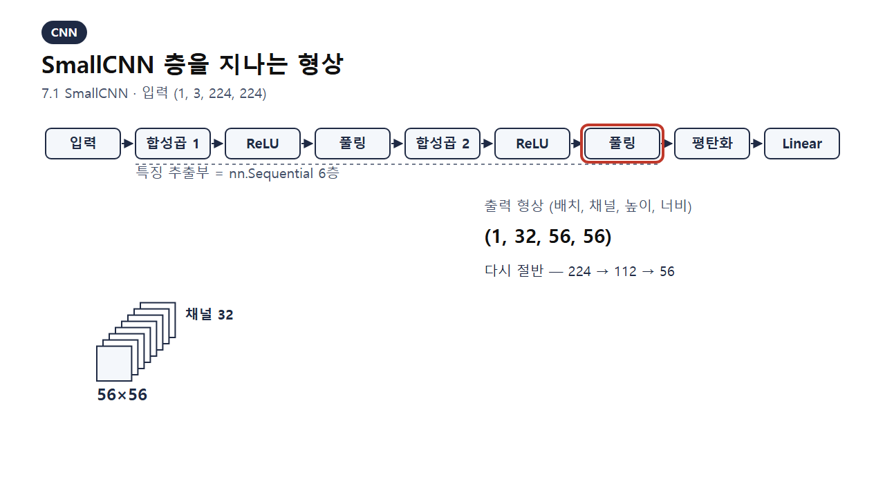

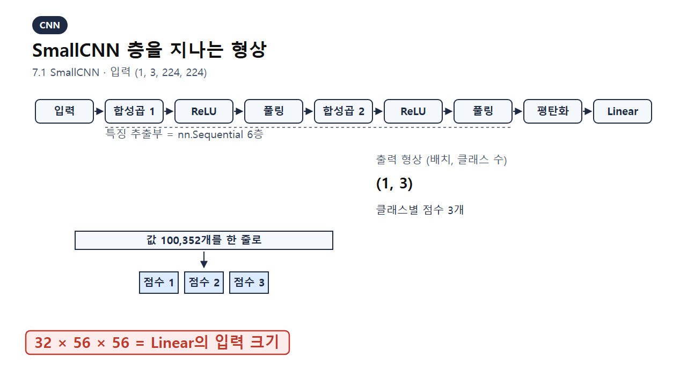

**실제 사진이 층을 지나는 모습** — 7.3까지 학습을 마친 모델에 검증 사진 한 장을 입력한 결과

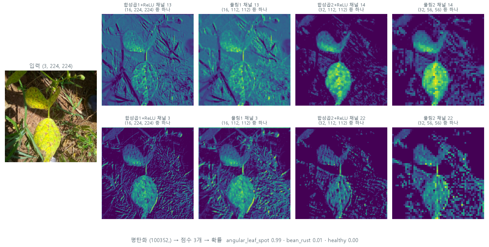

- 각 칸은 그 층 출력의 채널 하나입니다 — 밝을수록 큰 값(ReLU를 지난 값이므로 0 이상)
- 이 그림에서 합성곱1의 채널은 잎맥·풀잎 같은 선과 질감에, 합성곱2의 채널은 잎 영역 전체에 크게 반응합니다 — 뒤 층일수록 더 넓은 범위를 묶어 처리합니다(4.2 계층적 특징)
- 풀링을 지날 때마다 칸이 커 보입니다 — 같은 그림을 절반의 화소로 표현하기 때문(224 → 112 → 56)
- 마지막 (32, 56, 56)을 평탄화한 100,352개 값이 점수 3개가 됩니다. 이 사진은 `angular_leaf_spot` 확률 0.99로 판정됩니다

**모델 실습 2단계 — 파라미터 위치**

```python
for name, p in model.named_parameters():              # ④ 파라미터 이름과 텐서를 함께 받음
    print(name, tuple(p.shape), p.numel())
print('합계', sum(p.numel() for p in model.parameters()))
```

> **예측** — 파라미터가 가장 많은 층은 어디입니까? 2.3에서 계산한 448은 어느 두 줄의 합입니까?

- **확인** — 출력을 예측과 대조합니다

<details>
<summary>예측 대조 — 파라미터 위치</summary>

| 이름 | 형상 | 개수 |
|------|------|--:|
| `features.0.weight` · `features.0.bias` | (16, 3, 3, 3) · (16,) | 432 + 16 = 448 |
| `features.3.weight` · `features.3.bias` | (32, 16, 3, 3) · (32,) | 4,608 + 32 = 4,640 |
| `classifier.weight` · `classifier.bias` | (3, 100352) · (3,) | 301,056 + 3 = 301,059 |
| 합계 | | **306,147** |

- 이름의 번호 0·3 = `nn.Sequential` 안의 순서 — 1·2·4·5번(ReLU·풀링)에는 파라미터가 없습니다
- 2.3의 448이 첫 층에 그대로 있습니다. 합성곱 두 층의 파라미터는 5천 개 남짓입니다. **파라미터의 98%는 마지막 완전연결층**에 있습니다 — 평탄화 뒤에 남은 크기가 비용을 결정
- 파일 크기 ≈ 306,147 × 4바이트 ≈ **1.2MB** — 7.3에서 저장한 파일의 실측 크기 = 1,227,821바이트(층 이름 등 부가 정보 포함)

</details>

> **클래스 문법 — 7.1 코드를 읽는 순서**
> 1. `class SmallCNN(nn.Module):` — **설계도**를 만듭니다. `nn.Module`을 상속하므로 `.to()`·`.parameters()`·`.eval()` 같은 기능을 상속받습니다
> 2. `__init__` — 설계도에 **층**을 등록합니다. `self.features`처럼 `self.`로 등록해야 나중에 `forward`에서 찾을 수 있습니다
> 3. `forward` — 등록한 층을 **어떤 순서로 연결**할지 기술합니다. 입력 `x`는 위에서 아래 순서로 각 층을 통과합니다
> 4. `model = SmallCNN(3)` — 설계도로 **실제 객체**를 만듭니다. 이때 `__init__`이 한 번 실행됩니다
> 5. `model(images)` — 객체를 함수처럼 호출하면 PyTorch가 **`forward`를 대신 호출**합니다. `model.forward(images)`라고 직접 작성하지 않습니다

> **자주 하는 실수 —**
> - `RuntimeError: mat1 and mat2 shapes cannot be multiplied` → `Linear`의 입력 크기(`32*56*56`)와 실제 평탄화 결과가 다름. 입력이 224×224인지, 풀링 횟수가 2회인지 확인
> - `super().__init__()`를 빠뜨리면 첫 층을 등록하는 줄에서 `AttributeError: cannot assign module before Module.__init__() call` — `__init__`의 첫 줄에 추가
> - 마지막 층 뒤에 `softmax`를 **두지 않습니다** — 7.2의 손실 함수가 내부에서 처리(7.6 응용 실습)

**코드 읽기 — Python 문법 ③ 클래스 정의·`nn.Sequential`**

| 코드 | 뜻 |
|------|------|
| `class SmallCNN(nn.Module):` | 괄호 = 상속 — `nn.Module`의 기능을 상속받은 새 클래스(Day 2 7.1 · 오늘 5.1 표 ①) |
| `def __init__(self, num_classes):` | 객체 생성 시 실행 — `num_classes`는 만들 때 넘기는 값 |
| `super().__init__()` | 부모 클래스의 `__init__`을 먼저 실행 — 상속받은 기능의 준비 |
| `self.features = nn.Sequential(...)` | 층 여러 개를 **순서대로 실행하는 하나의 층**으로 묶음 — 쉼표로 나열 |
| `nn.Conv2d(3, 16, 3, padding=1)` | 위치 인자 3개(입력 채널·출력 채널·커널) + 키워드 인자 `padding=` |
| `def forward(self, x):` | `model(x)`가 호출하는 메서드 — 이름을 바꾸면 동작하지 않음 |
| `torch.flatten(x, 1)` | 1번 축부터 끝까지 한 축으로 — 0번(배치) 축은 유지(Day 2 4.4 `view`와 같은 효과) |

- 이 표는 이후 Day에도 다시 싣습니다 — 지금 모두 암기할 필요는 없습니다. 코드를 읽을 때마다 표를 참조합니다

**코드 읽기 — Python 문법 ③ (계속) 모델 실습**

| 코드 | 뜻 |
|------|------|
| `for layer in model.features:` | `nn.Sequential`은 반복할 수 있음 — 등록한 층을 순서대로 하나씩 받음 |
| `type(layer).__name__` | 객체의 클래스 이름 문자열 — `'Conv2d'` 등 |
| `tuple(x.shape)` | 형상을 튜플로 — 출력을 간결하게 |
| `model.named_parameters()` | (이름, 파라미터 텐서) 쌍을 차례로 반환 |
| `p.numel()` | 텐서의 원소 개수(Day 2 재등장) |
| `sum(p.numel() for p in ...)` | 괄호 안에서 반복하며 합계 — 반복문을 한 줄로 작성한 형태 |

### 7.2 손실 함수와 옵티마이저

Day 2 6절·7절과 같은 자리에 **분류용 구성 요소**를 배치합니다.

```python
device = torch.device('cuda' if torch.cuda.is_available() else 'cpu')   # ① GPU가 있으면 GPU
model = model.to(device)                                                  # ② 모델을 그 장치로

criterion = nn.CrossEntropyLoss()                                         # ③ 분류용 손실
optimizer = torch.optim.Adam(model.parameters(), lr=1e-3)                 # ④ Day 2 7.4의 Adam
print(device)
```

| # | 역할 |
|:--:|------|
| ① | `cuda`가 출력되면 GPU 런타임. `cpu`이면 7.4의 축소 설정으로 진행 |
| ③ | **교차 엔트로피** — 7.2의 「교차 엔트로피」 설명 |
| ④ | Adam · 학습률 0.001 — 손실이 요동치면 낮춤(Day 2 3.2) |

**Adam이 하는 일** — 기울기의 반대 방향으로 이동하는 것은 Day 2의 경사하강(SGD)과 같습니다. 다른 점은 이동 폭을 정하는 방식입니다.

| 옵티마이저 | 이동 폭 |
|------|------|
| SGD | 학습률 × 기울기 — 기울기가 크면 크게, 작으면 작게 |
| Adam | 파라미터마다 최근 기울기의 크기로 나누어 이동 폭을 맞춤 — 기울기가 작은 파라미터도 비슷한 폭으로 이동 |

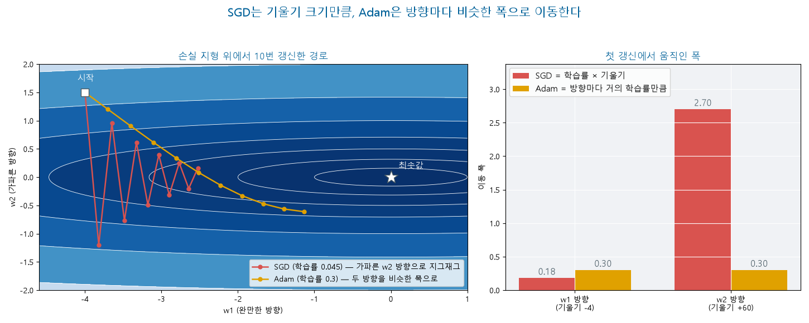

- 왼쪽 — 가파른 방향(w2)에서 SGD는 크게 이동해 골짜기를 넘나들고(지그재그), 완만한 방향(w1)에서는 조금씩만 이동합니다. Adam은 두 방향을 비슷한 폭으로 이동합니다
- 오른쪽 — 첫 갱신의 폭은 SGD가 0.18 · 2.70(기울기 −4 · +60에 비례)입니다. Adam은 두 방향 모두 0.30입니다
- Adam은 최근 기울기의 평균 방향도 함께 사용합니다(모멘텀). 파라미터마다 기울기 크기가 크게 다른 신경망에서도 학습률 하나(기본값 0.001)로 대부분 학습되는 이유입니다

**교차 엔트로피**(cross-entropy) — 다중 클래스 분류의 표준 손실입니다.

| 단계 | 내용 |
|:--:|------|
| ① | 모델 출력 = 클래스별 **점수**(logit) 3개 — 예: [2.1, −0.5, 0.3] |
| ② | 소프트맥스로 **확률**을 계산 — 합이 1: [0.81, 0.06, 0.13] |
| ③ | **정답 클래스의 확률에 −log** — 정답이 0번이면 −log 0.81 = 0.21 |
| ④ | 정답 확률이 1에 가까울수록 손실 0 · 0에 가까울수록 손실 증가 |

- Day 2의 MSE는 "값의 거리"였으나, 교차 엔트로피는 **"정답에 부여한 확률이 얼마나 낮은가"** 입니다
- `nn.CrossEntropyLoss`는 ②③을 **내부에서** 수행합니다 — 모델은 점수만 출력합니다. 소프트맥스를 모델에 두면 두 번 적용되어 학습이 느려집니다(7.6 응용 실습)

**손실 실습 1단계 — 점수에서 손실까지**

```python
logits = torch.tensor([[2.1, -0.5, 0.3]])                          # ① 클래스별 점수 — 사진 1장
print(torch.softmax(logits, dim=1))                                # ② 확률
for label in [0, 1, 2]:
    print(label, criterion(logits, torch.tensor([label])).item())  # ③ 정답 번호별 손실
```

> **예측** — 실행하기 전에 적습니다.
> - 세 확률 가운데 가장 큰 것은 몇 번입니까? 세 값의 합은 얼마입니까?
> - 정답이 0번 · 1번 · 2번일 때 손실이 가장 작은 정답 번호와 가장 큰 정답 번호는 각각 무엇입니까?

- **확인** — 출력을 예측과 대조합니다
- 예측과 다르면 → 「예측 대조」에서 확률과 손실의 대응을 확인 → **1단계를 다시** 실행합니다

<details>
<summary>예측 대조 — 점수 → 확률 → 손실</summary>

| 정답 번호 | 점수 | 확률 | 손실 = −log(확률) |
|:--:|:--:|:--:|:--:|
| 0 | 2.1 | 0.8067 | 0.2148 |
| 1 | −0.5 | 0.0599 | 2.8148 |
| 2 | 0.3 | 0.1334 | 2.0148 |

- 확률의 합 = 1 · 점수가 가장 높은 0번의 확률이 가장 큽니다
- 두 손실의 차이는 두 점수의 차이와 같습니다 — 1번과 0번 = 2.8148 − 0.2148 = 2.6 = 2.1 − (−0.5)

</details>

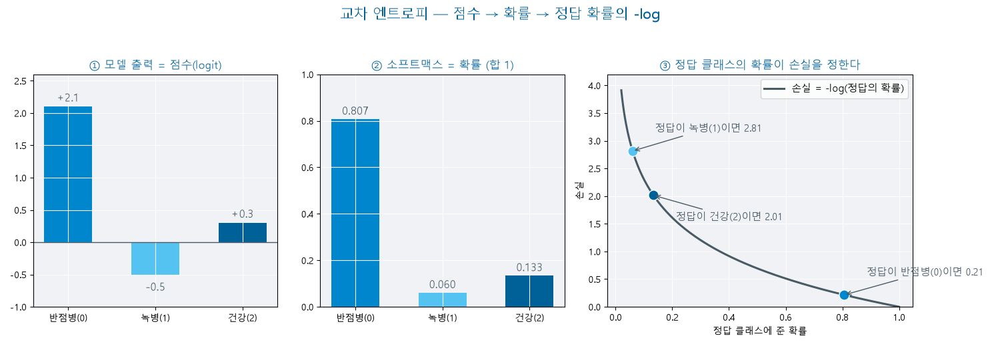

- 점수 → 소프트맥스 확률(합 1) → 정답 클래스 확률의 −log가 손실입니다
- 정답 확률이 작을수록 손실이 빠르게 커집니다. 정답이 녹병(확률 0.06)이면 손실은 2.81입니다

**손실 실습 2단계 — 학습 전의 손실**

```python
images, labels = next(iter(train_loader))                          # ④ 학습 배치 하나
images, labels = images.to(device), labels.to(device)
with torch.no_grad():
    outputs = model(images)
print(criterion(outputs, labels).item())                           # ⑤ 학습 전 손실
print(torch.softmax(outputs, dim=1).mean(0))                       # ⑥ 클래스별 평균 확률
```

> **예측** — 학습하지 않은 모델은 세 클래스에 어떤 확률을 부여합니까? 그 확률로 정답 확률이 정해지면 손실은 대략 몇입니까?(−log의 값을 계산)

- **확인** — 손실이 1.1 근처이고 평균 확률이 세 클래스 모두 0.33 근처이면 정상입니다
- 손실이 1.1에서 크게 벗어나면 → `model`이 이미 학습된 상태(셀을 여러 번 실행) → 7.1의 `model = SmallCNN(...)` 셀을 다시 실행한 뒤 **2단계를 다시** 실행합니다

<details>
<summary>예측 대조</summary>

- 무작위로 초기화한 모델은 세 클래스에 거의 같은 확률(약 1/3)을 부여합니다
- 손실 ≈ −log(1/3) = ln 3 ≈ **1.0986** — 실행 예(2회) = 1.124 · 1.115 / 평균 확률 (0.33, 0.37, 0.30) · (0.31, 0.31, 0.38)
- 학습 곡선(8.1)은 이 값 근처에서 시작합니다. 학습 뒤에도 손실이 1.0986보다 높게 유지되면 모델의 성능이 무작위 추측보다 낮은 상태입니다

</details>

### 7.3 학습 루프 — 검증 단계와 기록

Day 2 6절의 5단을 함수로 묶고, **검증 함수**와 **기록**을 추가합니다.

```python
def train_one_epoch(loader):
    model.train()                                         # ① 학습 모드
    total_loss, correct, n = 0.0, 0, 0
    for images, labels in loader:
        images, labels = images.to(device), labels.to(device)   # ② 배치를 모델과 같은 장치로
        outputs = model(images)                           # 1 순전파
        loss = criterion(outputs, labels)                 # 2 손실
        optimizer.zero_grad()                             # 3 기울기 초기화
        loss.backward()                                   # 4 역전파
        optimizer.step()                                  # 5 갱신
        total_loss += loss.item() * images.size(0)        # ③ 배치 손실 × 장 수 — 평균 복원용
        correct += (outputs.argmax(1) == labels).sum().item()   # ④ 맞힌 수
        n += images.size(0)
    return total_loss / n, correct / n
```

```python
def evaluate(loader):
    model.eval()                                          # ⑤ 평가 모드
    total_loss, correct, n = 0.0, 0, 0
    with torch.no_grad():                                 # ⑥ 기울기 계산 끔
        for images, labels in loader:
            images, labels = images.to(device), labels.to(device)
            outputs = model(images)
            loss = criterion(outputs, labels)
            total_loss += loss.item() * images.size(0)
            correct += (outputs.argmax(1) == labels).sum().item()
            n += images.size(0)
    return total_loss / n, correct / n
```

| # | 역할 |
|:--:|------|
| ① ⑤ | `train()`·`eval()` — 학습 전용 동작(드롭아웃·배치 정규화)을 켜고 끄는 모드 전환. 오늘 모델에는 해당 층이 없지만 **관행으로 항상 사용** |
| ② | 모델이 GPU에 있으면 데이터도 GPU에 — 한쪽만 옮기면 오류 |
| ⑥ | 평가에는 기울기가 필요 없음 — 메모리·시간 절약. `eval()`과 **한 쌍** |
| ③ ④ | epoch 전체의 평균 손실·정확도를 계산하기 위한 누적 |

**학습 실습 1단계 — 한 번 갱신한 뒤의 손실**

- 본 학습 전에 실험용 모델로 7.2 손실 실습 2단계의 배치에 갱신을 한 번만 적용합니다

```python
trial = SmallCNN(num_classes=len(train_ds.classes)).to(device)   # ① 실험용 모델 — 본 학습의 model과 별개
trial_opt = torch.optim.Adam(trial.parameters(), lr=1e-3)
before = criterion(trial(images), labels)
trial_opt.zero_grad(); before.backward(); trial_opt.step()       # ② 한 번 갱신
with torch.no_grad():
    after = criterion(trial(images), labels)                     # ③ 같은 배치로 다시 계산
print(before.item(), after.item())
```

> **예측** — 같은 배치로 계산한 손실은 갱신 뒤에 작아집니까?(Day 2 3절 경사하강)

- **확인** — 출력을 예측과 대조합니다
- 예측과 다르면 → 「예측 대조」의 원인을 읽고 **2단계로 진행**합니다 — 이 결과는 오류가 아닙니다

<details>
<summary>예측 대조 — 첫 갱신의 크기</summary>

- 실측(실험용 모델 4개) — 갱신 전 1.09\~1.13 → 갱신 뒤 **2.8\~7.8**. 손실이 오히려 증가합니다
- 점수의 최댓값(3개 측정) = 0.3\~0.5 → **14\~21**
- 원인 — Adam의 첫 갱신은 기울기의 크기와 관계없이 **모든 파라미터를 기울기 부호 방향으로 학습률(0.001)만큼** 옮깁니다. 마지막 층에서는 입력 100,352개의 가중치가 한꺼번에 변합니다. 그 결과 점수가 크게 바뀌어 정답 방향을 지나칩니다
- 갱신을 반복하면 손실이 다시 내려갑니다(실측 2\~5회 갱신 = 6.6 → 2.5 → 0.6 → 1.3). epoch 평균으로는 꾸준히 줄어듭니다(2단계)
- 참고 — 같은 조건에서 SGD(학습률 0.001)를 사용하면 손실이 1.10 → 1.03으로 줄어듭니다(Day 2 7.4 SGD·Adam)

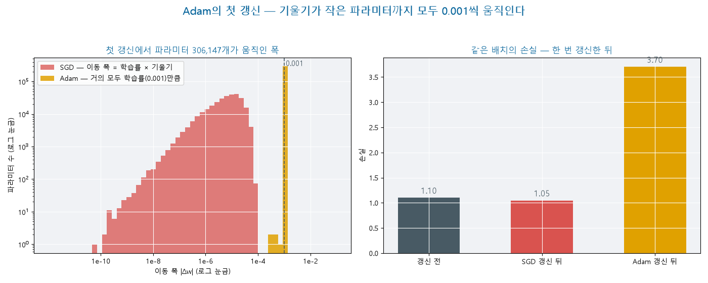

- 첫 갱신에서 Adam은 파라미터 306,147개 가운데 95%를 0.001만큼 옮겼습니다. SGD의 이동 폭은 대부분 0.00001 이하였습니다
- 같은 예시 배치의 손실은 갱신 전 1.10 → Adam 3.70 · SGD 1.05입니다

</details>

**학습 실습 2단계 — epoch 반복과 기록**

```python
EPOCHS = 15
SAVE = '/content/drive/MyDrive/day3_best.pth'             # ⑦ Drive — 세션이 끝나도 남음
history = {'train_loss': [], 'val_loss': [], 'train_acc': [], 'val_acc': []}
best_val = float('inf')

for epoch in range(EPOCHS):
    tr_loss, tr_acc = train_one_epoch(train_loader)
    va_loss, va_acc = evaluate(val_loader)
    for k, v in zip(history, [tr_loss, va_loss, tr_acc, va_acc]):
        history[k].append(v)                              # ⑧ 4개 리스트에 기록
    if va_loss < best_val:                                # ⑨ 검증 손실 최소 갱신 시
        best_val = va_loss
        torch.save(model.state_dict(), SAVE)              # ⑩ 그 시점의 가중치 저장
    print(f'[{epoch+1:2d}/{EPOCHS}] train {tr_loss:.3f} / {tr_acc:.1%}   val {va_loss:.3f} / {va_acc:.1%}')
```

| # | 역할 |
|:--:|------|
| ⑦ | Colab 로컬(`/content`)은 세션 종료 시 소멸(Day 1 5.2) — **Drive에 저장** |
| ⑨ ⑩ | **최적 epoch 저장** — 마지막 epoch가 아니라 검증 손실이 가장 낮았던 시점(8.2) |

- `RuntimeError: Parent directory /content/drive/MyDrive does not exist.` → Drive를 연결하지 않은 상태 → Day 1 5.2로 연결한 뒤 **이 셀을 다시** 실행합니다

**실행 중 관찰** — epoch마다 한 줄이 출력됩니다.

| 관찰 | 의미 |
|------|------|
| `train` 손실이 매 epoch 줄어듦 | 학습이 진행 중 |
| `val` 손실도 함께 줄어듦 | 정상 — 일반화되는 중 |
| `val` 손실이 어느 시점부터 오름 | 과적합 시작 — 8.1. ⑩이 그 이전 가중치를 이미 저장함 |
| 손실이 `nan` | 학습률 과대 — `lr=1e-4`로 낮추고 재실행 |

> **예측** — 실행하기 전에 적습니다.
> - 첫 epoch의 학습 손실 평균은 학습 전(약 1.1)보다 낮습니까? 1단계의 결과를 함께 고려합니다
> - 15 epoch 뒤 검증 정확도는 무작위 추측(33%)과 비교해 어느 정도입니까?

- **확인** — 학습·검증 손실이 epoch를 거듭하며 대체로 줄어들면 정상입니다
- 소요 시간 — 이 자료를 작성한 로컬 CPU(12스레드)에서 epoch당 약 90초 · 2스레드로 제한하면 약 134초. GPU 런타임의 소요는 수업에서 확인합니다
- 첫 줄이 출력되기까지 오래 걸리면 → 7.2 ①의 `device` 출력을 확인 → `cpu`이면 셀을 중지하고 7.4 축소 설정으로 바꾸어 **2단계를 다시** 실행합니다

<details>
<summary>예측 대조 — 이 자료 작성 시 실행 결과(로컬 CPU · 시드 0)</summary>

| epoch | 학습 손실 / 정확도 | 검증 손실 / 정확도 |
|:--:|:--:|:--:|
| 1 | 1.913 / 46.0% | 0.926 / 54.1% |
| 2 | 0.904 / 59.9% | 0.786 / 62.4% |
| 5 | 0.734 / 67.5% | 0.650 / 74.4% |
| 10 | 0.613 / 74.7% | 0.590 / 71.4% |
| **14** | 0.575 / 75.5% | **0.502 / 79.7%** — 최적 |
| 15 | 0.566 / 76.9% | 0.525 / 76.7% |

- 첫 epoch의 학습 손실 평균(1.913)은 학습 전보다 높습니다 — 1단계의 큰 첫 갱신이 평균에 포함되기 때문
- 15 epoch 뒤 검증 정확도 약 77\~80% — 무작위 추측의 2배 이상. 전체 곡선 = 8.1
- 검증 정확도가 학습 정확도보다 높은 epoch가 있습니다 — 학습 정확도는 증강으로 변형한 사진에서 epoch 도중 바뀌는 가중치로 측정되고, 검증 정확도는 변형하지 않은 사진에서 epoch 끝의 가중치로 측정되기 때문입니다

</details>

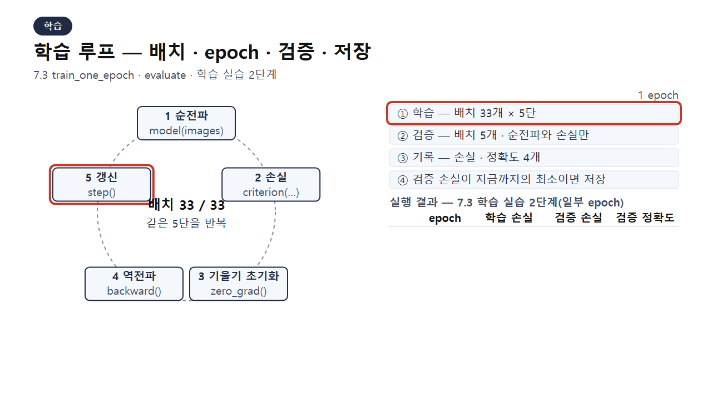

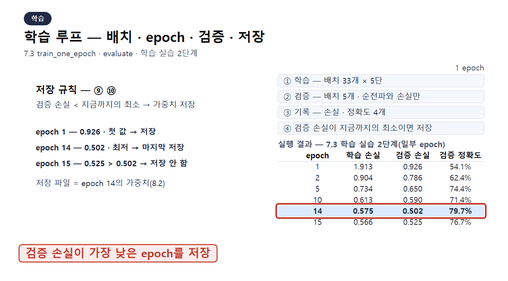

> **자주 하는 실수 —**
> - `Expected all tensors to be on the same device` → ②를 빠뜨림 — 모델은 GPU, 데이터는 CPU
> - 정확도가 첫 epoch부터 100%이고 검증도 100% → `val` 폴더에 `train`과 같은 사진이 포함된 상태 — 6.2 1단계의 `SPLITS` 대응을 확인하고 `/content/data`를 지운 뒤 다시 내보냄
> - `history`가 비어 있음 → 셀을 다시 실행하면서 `history = {...}` 줄이 함께 실행되어 초기화됨 — 기록은 학습 셀과 분리

**코드 읽기 — Python 문법 ④ 함수·반복·튜플·`with`**

| 코드 | 뜻 |
|------|------|
| `def train_one_epoch(loader):` … `return a, b` | 함수 정의 — 값을 받아 처리하고 두 값을 튜플로 반환 |
| `tr_loss, tr_acc = train_one_epoch(...)` | 반환된 튜플을 두 변수로 나누어 받음(언패킹 — 5.5 표 ①과 같은 형태) |
| `total_loss, correct, n = 0.0, 0, 0` | 세 변수를 한 줄에 초기화 — 오른쪽 튜플을 왼쪽 세 이름에 배정 |
| `with torch.no_grad():` | 블록 안에서만 기울기 계산을 끔 — 블록을 나오면 자동 복원 |

**코드 읽기 — Python 문법 ④ (계속) 텐서 값·딕셔너리·서식**

| 코드 | 뜻 |
|------|------|
| `loss.item()` | 원소 하나인 텐서를 **Python 수**로 변환 — 누적·출력용(Day 2 5절) |
| `outputs.argmax(1)` | 1번 축(클래스)에서 가장 큰 값의 위치 — 예측 클래스 번호 |
| `(outputs.argmax(1) == labels).sum().item()` | 비교 → True/False 텐서 → 합(True의 개수) → Python 수 |
| `for k, v in zip(history, [...]):` | 두 목록을 나란히 묶어 반복 — 딕셔너리를 반복하면 키가 차례로 전달됨 |
| `history[k].append(v)` | 딕셔너리 값(리스트)의 끝에 추가 |
| `float('inf')` | 무한대 — "지금까지의 최소값"의 초기값으로 관행 |
| `f'{tr_acc:.1%}'` | 0.83을 `83.0%`로 — 백분율 서식 |

**코드 읽기 — Python 문법 ④ (계속) 실습 코드**

| 코드 | 뜻 |
|------|------|
| `a(); b(); c()` | 세미콜론 = 한 줄에 여러 문장 — 학습 실습 1단계의 갱신 세 줄 |
| `range(0, len(train_ds), 8)` | 0부터 8씩 건너뛰는 번호 — 7.4 축소 설정 |
| `Subset(train_ds, small_idx)` | 원래 Dataset에서 지정한 번호의 샘플만 사용하는 Dataset |
| `model.load_state_dict(torch.load(SAVE, ...))` | 저장한 가중치를 같은 구조의 모델에 불러옴 — 8.9 |

- 이 표는 이후 Day에도 다시 싣습니다 — 지금 모두 암기할 필요는 없습니다. 코드를 읽을 때마다 표를 참조합니다

### 7.4 배치·epoch·학습률의 기준값

| 설정 | 기준값 | 근거 |
|------|:--:|------|
| 배치 크기 | 32 | 메모리와 안정성의 절충. CPU이면 16 |
| epoch | 10\~20 | 소량 데이터에서 곡선의 형태가 보이는 범위 — 8.1을 확인해 조정 |
| 학습률 | 0.001 | Adam 기본값. 손실이 요동치거나 `nan`이면 0.0001 |

**GPU 미배정 시(CPU) 축소 설정**

| 항목 | 값 |
|------|------|
| `EPOCHS` | 10 |
| `batch_size` | 16 |
| 학습 사진 수 | 8장마다 1장 — 130장(클래스별 44 · 43 · 43) |
| 소요 | 로컬 CPU 2스레드 실측 epoch당 약 20초(검증 포함) |

```python
from torch.utils.data import Subset
small_idx = list(range(0, len(train_ds), 8))          # ① 8장마다 1장 — 클래스 순서로 정렬되어 있어 세 클래스에서 고르게 선택
train_loader = DataLoader(Subset(train_ds, small_idx), batch_size=16, shuffle=True, num_workers=2)
print(len(small_idx), len(train_loader))              # → 130 9
```

- 이 셀을 실행한 뒤 7.3의 `EPOCHS`를 10으로 바꾸어 2단계를 실행합니다. 검증 로더는 그대로 사용합니다
- 학습 사진이 적으므로 정확도는 전체 학습보다 낮을 수 있습니다. 8절의 해석 방법은 그대로 적용됩니다 — 목적은 곡선과 혼동 행렬을 **각자의 결과로 확인하는 것**

### 7.5 재현성

```python
import random, numpy as np, torch
SEED = 0
random.seed(SEED); np.random.seed(SEED); torch.manual_seed(SEED)   # 세 라이브러리의 난수를 고정
```

- 노트북 **맨 위 셀**에 둡니다. 같은 코드로 같은 결과를 얻어야 9.7의 비교 실험이 성립합니다
- 증강(6.3)·섞기(5.5)·가중치 초기값(Day 2 7.5)이 모두 난수이므로, 고정하지 않으면 실행마다 결과가 달라집니다
- 학습한 모델을 다른 형식으로 변환해 출력을 대조할 때도 같은 전제입니다
- 이 자료의 실행 결과는 다른 환경(로컬 CPU)에서 얻은 값이므로, 시드를 고정해도 각자의 결과와 같지 않습니다 — 대조할 것은 수치 자체가 아니라 곡선의 형태와 오류의 경향입니다

### 7.6 응용 실습 — 손실이 1 근처에서 멈춘 모델

- 다른 학생의 모델은 `forward`의 마지막 줄만 다음과 같이 다릅니다

```python
        return torch.softmax(self.classifier(x), dim=1)   # 점수 대신 확률을 반환
```

- 같은 데이터·같은 설정으로 5 epoch 학습한 결과(이 자료 작성 시 실측)

| 모델 | 학습 손실(1 → 5 epoch) | 검증 정확도(5 epoch) |
|------|:--:|:--:|
| 위 모델 | 1.197 → 1.047 | 54.1% |
| 7.1 모델 | 2.053 → 0.802 | 66.9% |

- 원인을 찾고 손실이 1 근처에서 내려가지 않는 이유를 계산으로 확인합니다. 계산 코드는 AI 코딩 도구로 작성합니다

**① 원인 찾기**

- 두 모델의 `forward`를 비교하고, 7.2의 교차 엔트로피 설명에서 마지막 줄과 충돌하는 문장을 찾습니다

**② 손실의 하한 계산**

- 모델 출력이 확률 `[1.0, 0.0, 0.0]`이고 정답이 0번일 때 `nn.CrossEntropyLoss`의 값을 계산합니다

> **예측** — 가장 정확한 확률을 출력했으므로 손실은 0입니까?(7.2 손실 실습 1단계 — 손실 함수는 입력을 **점수**로 간주)

- **확인** — 0이 아닌 값이 출력되면 이 실습의 현상이 재현된 상태입니다

**③ 수정과 확인**

- 마지막 줄을 7.1처럼 점수를 그대로 반환하도록 고치고 2 epoch 학습합니다
- **확인** — 학습 손실이 1.0 아래로 내려가면 정상입니다

<details>
<summary>응용 실습 정리</summary>

- ① `nn.CrossEntropyLoss`가 내부에서 소프트맥스를 한 번 더 적용합니다 — 확률 0\~1을 다시 점수로 간주해 소프트맥스를 두 번 적용한 셈
- ② 출력 `[1, 0, 0]`의 손실 = −log(e¹ ÷ (e¹ + e⁰ + e⁰)) = **0.5514**(실측). 소프트맥스를 두 번 적용하면 점수의 차이가 최대 1로 제한되어, 아무리 정확해도 손실이 0.55 아래로 내려가지 않습니다
- 기울기도 작아져 학습이 느립니다 — 7.6 비교 표의 5 epoch 결과
- 오류 메시지 없이 학습이 **느리게 진행**되는 결함이므로 손실의 수준으로 발견합니다(7.2 손실 실습 2단계의 ln 3 ≈ 1.10과 비교)

</details>

### 7.7 응용 실습 — 입력 크기를 128로 줄이기

- 학습 시간을 줄이려고 입력 크기를 224에서 128로 줄입니다
- 코드는 AI 코딩 도구로 작성합니다. 단계마다 하나씩 요청하고 결과를 「확인」 기준과 대조합니다

**① 조건 없이 요청**

- 「6.4의 학습·검증 변환에서 입력 크기를 128×128로 바꾸라」고만 요청하고, 변환을 바꾼 로더로 7.3 학습 실습 2단계를 실행합니다

> **예측** — 학습이 시작됩니까? 오류가 발생한다면 어느 층입니까?(7.1 1단계 형상 추적)

- **확인** — `RuntimeError: mat1 and mat2 shapes cannot be multiplied`가 출력되면 이 실습의 현상이 재현된 상태입니다 → **②로 진행**합니다
- 학습이 정상으로 시작되면 → AI가 모델까지 함께 고친 상태입니다 → 생성된 코드에서 `Linear`의 입력 크기를 확인하고 ③으로 진행합니다

**② 원인 계산**

- 7.1 1단계의 형상 추적을 입력 (1, 3, 128, 128)로 다시 실행하고, 평탄화 결과를 오류 메시지에 표시된 크기와 대조합니다

**③ 요청 조건 적기와 다시 요청**

- ②의 계산을 근거로 다시 요청할 때 포함할 조건을 텍스트 셀에 적고, 그 조건으로 다시 실행해 전체 파라미터 수를 출력합니다

> **정할 것** — 요청문을 적기 전에 답합니다.
> - 입력 크기를 바꿀 때 변환 외에 함께 바뀌어야 하는 코드는 어디입니까?
> - 그 코드에 지정할 값은 ②의 계산으로 몇입니까?

> **예측** — 파라미터 수는 306,147보다 얼마나 줄어듭니까? 어느 층의 파라미터가 줄어듭니까?

<details>
<summary>응용 실습 정리</summary>

- ① 오류 = `mat1 and mat2 shapes cannot be multiplied (32x32768 and 100352x3)`(배치 32 · 실측은 배치 1로 `1x32768`) — 변환만 바뀌었으나 모델의 `Linear(32 * 56 * 56, 3)`은 바뀌지 않았습니다
- ② 128 → 64 → 32 · 평탄화 = 32 × 32 × 32 = **32,768** — 오류 메시지 앞쪽 행렬의 열 크기
- ③ 모범 요청 조건 = 「학습·검증 변환의 입력 크기를 128×128로 바꾸고, 모델 `Linear`의 입력 크기도 평탄화 결과 32 × 32 × 32에 맞게」 — 변환과 모델은 서로 다른 코드에 있으므로, 입력 크기를 바꾸는 요청에는 두 곳을 함께 적습니다
- ③ 결과 = `Linear(32 * 32 * 32, 3)` · 전체 파라미터 **103,395**(실측) — 합성곱 두 층(5,088)은 입력 크기와 무관하지만, 완전연결층만 301,059 → 98,307로 줄어듭니다

</details>

---

## 8. 결과 해석

**학습목표**

- 학습·검증 곡선을 보고 과적합·과소적합을 진단할 수 있다
- 혼동 행렬에서 정밀도·재현율을 계산하고, 병해 판정에서 어느 오류가 더 위험한지 판단할 수 있다
- 학습을 마친 모델을 시험 세트로 한 번 평가하고, 검증 결과와 비교할 수 있다

### 8.1 학습 곡선 — 4유형 진단

**곡선 실습 — `history` 그리기**

- 7.3에서 기록한 `history`로 그래프 두 개를 그리는 코드를 AI 코딩 도구로 작성합니다. 조건 = 왼쪽 손실 · 오른쪽 정확도 · 각 그래프에 학습·검증 두 선 · 가로축 epoch · 제목과 범례는 영문(Colab 기본 글꼴에 한글 없음)
- **두 선의 관계**를 읽습니다

> **예측** — 7.3 2단계의 출력을 보고 적습니다. 검증 손실이 계속 줄어듭니까, 어느 시점부터 오릅니까? 두 손실 곡선의 간격은 큽니까, 작습니까?

- **확인** — 그래프 두 개에 선이 두 개씩 그려지고 가로축이 1\~15이면 정상입니다
- 한글이 네모로 표시되면 → 제목·범례를 영문으로 바꾸어 다시 실행합니다

<details>
<summary>예측 대조 — 이 자료 작성 시 실행 결과</summary>

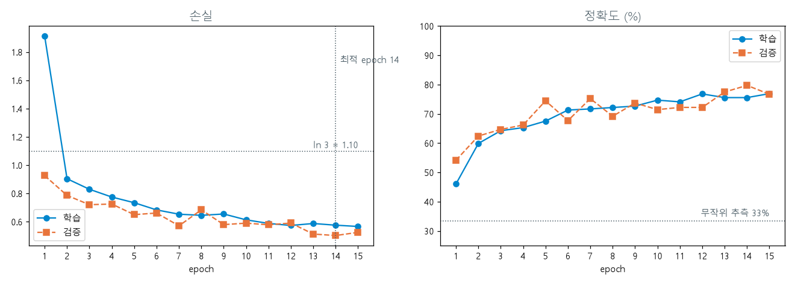

- 두 손실이 함께 줄고 간격이 작습니다 — 8.1 4유형 진단 표의 「정상」에 가깝습니다. 15 epoch 안에서는 과적합이 뚜렷하지 않습니다
- 검증 손실이 epoch 8에서 한 번 오른 뒤 다시 내려갑니다 — 검증 사진이 133장이므로 epoch마다 작은 요동이 생깁니다
- 최적 epoch = 14(검증 손실 0.502)

</details>

<details>
<summary>참고 코드</summary>

```python
import matplotlib.pyplot as plt
epochs = range(1, len(history['train_loss']) + 1)
fig, (ax1, ax2) = plt.subplots(1, 2, figsize=(11, 4))
ax1.plot(epochs, history['train_loss'], label='train')
ax1.plot(epochs, history['val_loss'],   label='val')
ax1.set_title('loss'); ax1.legend()
ax2.plot(epochs, history['train_acc'], label='train')
ax2.plot(epochs, history['val_acc'],   label='val')
ax2.set_title('accuracy'); ax2.legend()
plt.show()
```

</details>

| 관측 | 진단 | 조치 |
|------|------|------|
| 학습·검증 손실 모두 높고 정체 | **과소적합** — 모델 용량 부족·epoch 부족 | 층 추가·epoch 증가·학습률 점검 |
| 학습 손실은 내려가지만 검증 손실이 멈추거나 오름 | **과적합** | 증강·데이터 추가·조기 종료 |
| 둘 다 내려가고 간격이 작음 | **정상** | — |
| 검증 손실이 심하게 요동 | 검증 세트가 너무 작음(6.2) | 분할 재검토 |

- 과적합에서 검증 손실이 반등하는 지점이 **최적 epoch**입니다 — 8.2

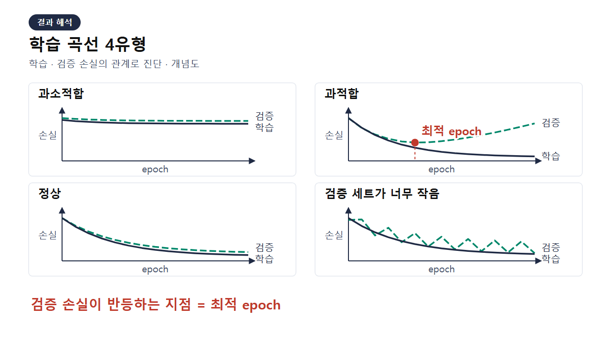

### 8.2 조기 종료와 최적 epoch 저장

| 항목 | 내용 |
|------|------|
| 현상 | epoch를 늘릴수록 학습 손실은 계속 내려가지만, 검증 손실은 어느 시점 이후 오름 |
| 원인 | 그 시점부터 모델이 학습 데이터의 **개별 사례**에 맞추어지기 시작 — 새 데이터에는 도움이 되지 않음 |
| 대응 | **조기 종료**(early stopping) — 검증 손실 최소 시점의 가중치를 채택 |

- 7.3 ⑨⑩에서 이미 처리했습니다 — `day3_best.pth`는 **마지막 epoch가 아니라 최적 epoch**의 가중치
- 다른 곳에서 사용할 파일이 마지막 epoch의 것이면, 과적합이 진행된 모델을 사용하는 셈입니다

```python
best_epoch = history['val_loss'].index(min(history['val_loss'])) + 1
print('최적 epoch =', best_epoch, '/ 검증 손실 =', round(min(history["val_loss"]), 3))
```

### 8.3 정확도만으로 알 수 없는 것

정확도 = 맞힌 수 ÷ 전체. 클래스가 **불균형**하면 이 수치만으로는 오해가 생깁니다.

| 데이터 | 모델 | 정확도 |
|------|------|:--:|
| 건강 60 · 각진 잎 반점병 20 · 녹병 20 | 모두 「건강」으로 예측 | **60%** |

- 이 모델은 병든 잎을 **한 장도 찾지 못했음에도** 정확도는 60%입니다
- 밭에서 사용하면 병든 잎을 모두 건강하다고 판정합니다 — 정확도 60%에는 이 사실이 드러나지 않음
- 오늘 데이터는 세 클래스의 장 수가 거의 같아(6.2) 이 문제가 작습니다. 직접 수집하거나 다른 데이터셋을 사용하면 클래스별 장 수가 크게 다를 수 있습니다
- 필요한 것은 **"어느 클래스를 어느 클래스로 오인하는가"** — 8.4 혼동 행렬

### 8.4 혼동 행렬 읽기

행 = 실제 클래스 · 열 = 예측 클래스. 대각선 = 정답, 나머지 = 오인의 분포입니다.

```python
import numpy as np
classes = val_ds.classes
K = len(classes)
cm = np.zeros((K, K), dtype=int)                          # ① K×K 정수 행렬(전부 0)
wrong = []                                                # 8.6용 — 틀린 사례 보관

model.eval()
with torch.no_grad():
    for images, labels in val_loader:
        preds = model(images.to(device)).argmax(1).cpu()  # ② 예측 번호 — CPU로 되돌림
        for img, t, p in zip(images, labels, preds):
            cm[t, p] += 1                                 # ③ (실제, 예측) 칸에 1 추가
            if t != p:
                wrong.append((img, t.item(), p.item()))

print(' ' * 18 + ''.join(f'{c:>18s}' for c in classes))   # 열 머리 = 예측 클래스
for i, row in enumerate(cm):
    print(f'{classes[i]:>18s}' + ''.join(f'{v:18d}' for v in row))   # 행 = 실제 클래스
```

> **예측** — 실행하기 전에 적습니다. 대각선 세 값의 합은 대략 얼마입니까?(7.3 2단계의 마지막 검증 정확도 × 133) 세 클래스 가운데 서로 가장 많이 혼동할 두 클래스는 무엇이라고 생각합니까?

- **확인** — 행 합이 44 · 45 · 44이면 정상입니다(6.2 검증 장 수)
- 행 합이 다르면 → `val_loader`가 아닌 로더로 계산한 상태 → 반복문의 로더를 고쳐 이 셀을 다시 실행합니다

<details>
<summary>예측 대조 — 이 자료 작성 시 실행 결과(마지막 epoch 모델)</summary>

| 실제 ＼ 예측 | angular_leaf_spot | bean_rust | healthy |
|:--:|:--:|:--:|:--:|
| **angular_leaf_spot** | 25 | 16 | 3 |
| **bean_rust** | 3 | 37 | 5 |
| **healthy** | 2 | 2 | 40 |

- 대각선 합 25 + 37 + 40 = 102 → 정확도 102 ÷ 133 = 76.7%(7.3 2단계 epoch 15와 같음)
- 가장 큰 혼동 = `angular_leaf_spot` → `bean_rust` 16건

</details>

| 해석 | 8.4 실행 결과에서 |
|------|------|
| 대각선 = 정답 | 102 / 133 → 정확도 76.7% |
| 대각선 밖의 큰 값 = **오인하는 쌍** | `angular_leaf_spot` → `bean_rust` 16건 |
| 행 합 = 그 클래스의 실제 장 수 | 44 · 45 · 44 |
| 열 합 = 그 클래스로 예측한 수 | `bean_rust`로 예측 55 |

- 두 병해를 서로 혼동하는 것이 이 모델의 가장 큰 문제입니다 — 두 병해 모두 잎에 갈색 반점이 생깁니다
- 이것이 데이터 보강의 **방향**입니다 — 혼동하는 사진에 어떤 특징이 있는지 8.6에서 확인

### 8.5 정밀도·재현율·F1 — 병해 판정에서 더 위험한 오류

혼동 행렬에서 클래스별 세 지표를 계산합니다. 8.4 실행 결과의 `angular_leaf_spot`을 기준으로:

| 지표 | 정의 | 뜻 | 8.4 결과에서 |
|------|------|------|:--:|
| **정밀도**(precision) | TP ÷ (TP + FP) | "이 병이라고 한 것 중 실제 이 병" — **과검출** 억제 | 25 ÷ 30 = 83.3% |
| **재현율**(recall) | TP ÷ (TP + FN) | "실제 이 병 중 찾아낸 것" — **미검출** 억제 | 25 ÷ 44 = 56.8% |
| **F1** | 정밀도·재현율의 조화 평균 | 불균형 데이터의 단일 지표 | 67.6% |

- TP(True Positive) = 대각선 값 · FP(False Positive) = 열 합 − TP · FN(False Negative) = 행 합 − TP

```python
for k, c in enumerate(classes):
    tp = cm[k, k]
    precision = tp / cm[:, k].sum() if cm[:, k].sum() else 0   # ④ 열 합 — 0 나눗셈 방지
    recall    = tp / cm[k, :].sum()                             # ⑤ 행 합
    f1 = 2 * precision * recall / (precision + recall) if precision + recall else 0
    print(f'{c:>18s}  정밀도 {precision:.1%}  재현율 {recall:.1%}  F1 {f1:.1%}')
```

> **예측** — 각자의 혼동 행렬에서 재현율이 가장 낮은 클래스와 정밀도가 가장 낮은 클래스를 먼저 계산합니다.

- **확인** — 출력을 계산과 대조합니다

<details>
<summary>예측 대조 — 이 자료 작성 시 실행 결과</summary>

| 클래스 | 정밀도 | 재현율 | F1 |
|------|:--:|:--:|:--:|
| `angular_leaf_spot` | 83.3% | **56.8%** | 67.6% |
| `bean_rust` | **67.3%** | 82.2% | 74.0% |
| `healthy` | 83.3% | 90.9% | 87.0% |

- `angular_leaf_spot`을 놓친 사진 16장이 `bean_rust`로 판정되어, `bean_rust`의 정밀도가 낮아졌습니다 — 한 클래스의 미검출은 다른 클래스의 과검출로 나타납니다

</details>

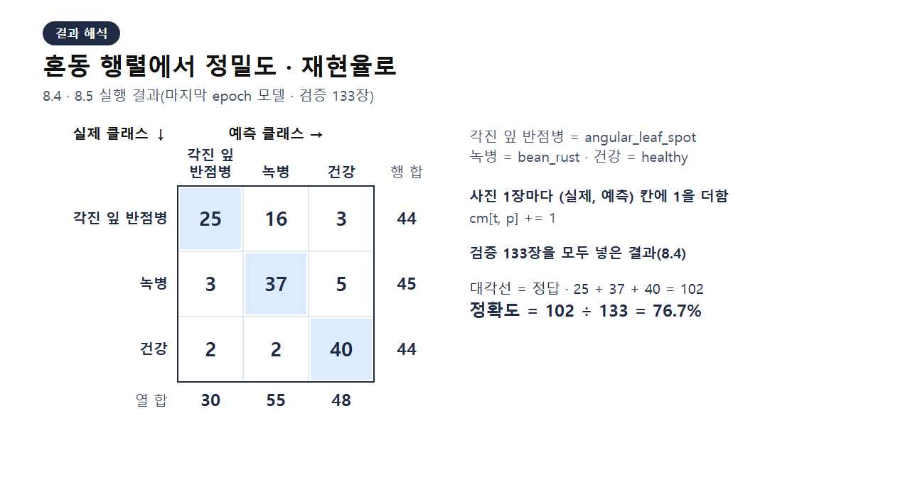

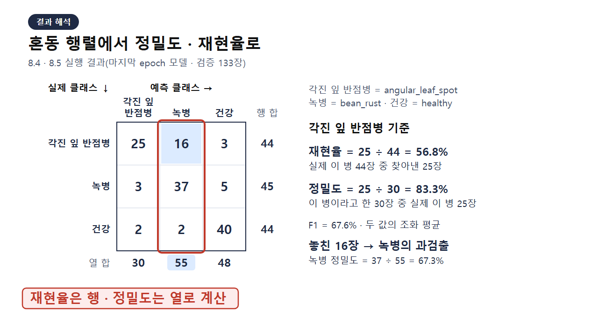

**어느 오류가 더 위험한가**

| 오류 | 뜻 | 밭에서 나타나는 결과 |
|------|------|------|
| FN — 병든 잎을 놓침 | 실제 녹병 잎을 `healthy`로 | **방제 시기를 놓쳐 병이 퍼짐** |
| FP — 건강한 잎을 병으로 판정함 | 건강한 잎을 `bean_rust`로 | 불필요한 약제 살포 |

- 병해 클래스에서는 **재현율**이 우선입니다 — 놓치는 오류(FN)의 피해가 잘못 판정하는 오류(FP)보다 큼
- 어느 지표를 우선할지는 **오류의 비용**에 따라 달라집니다. 반도체 공정 검사에서는 같은 표가 **과검출(양품 칩 폐기)·미검출(불량 출하)로** 나타납니다 — Day 4 10.4

### 8.6 오분류 사례 관찰

오분류 이미지를 실제·예측 라벨과 함께 확인합니다. 원인이 사진에서 드러나는 경우가 많습니다.

```python
def denorm(t):                                            # ⑥ Normalize를 되돌려 표시용으로
    mean = torch.tensor(MEAN).view(3, 1, 1); std = torch.tensor(STD).view(3, 1, 1)
    return (t * std + mean).clamp(0, 1).permute(1, 2, 0)  # (C,H,W) → (H,W,C)

fig, axes = plt.subplots(2, 4, figsize=(12, 6))
for ax, (img, t, p) in zip(axes.flat, wrong[:8]):        # ⑦ 최대 8장
    ax.imshow(denorm(img)); ax.axis('off')
    ax.set_title(f'true {classes[t]}\npred {classes[p]}', fontsize=9)   # ⑧ 영문 — Colab 기본 글꼴에 한글 없음
plt.show()
print('오분류', len(wrong), '장 /', len(val_ds), '장')
```

> **예측** — `len(wrong)`을 8.4의 혼동 행렬로 계산합니다. `denorm`이 반환하는 배열의 형상과 값 범위는 무엇입니까?(5.3 변환 실습)

- **확인** — 오분류 장 수가 133 − (대각선 합)과 같으면 정상입니다
- `Clipping input data to the valid range for imshow` 경고와 함께 색이 왜곡되면 → 정규화된 값을 그대로 표시한 상태 → ⑥ `denorm`을 거쳐 표시하도록 고쳐 다시 실행합니다
- `TypeError: Invalid shape (3, 224, 224) for image data`가 출력되면 → 축 순서를 바꾸지 않은 상태 → `denorm`의 `permute`를 확인하고 다시 실행합니다

<details>
<summary>예측 대조</summary>

- 이 자료 작성 시 실행 결과 = 31장(133 − 102)
- `denorm` = 정규화를 되돌림(값 × 표준편차 + 평균) → 0\~1로 제한 → (C, H, W)를 (H, W, C)로 — 형상 (224, 224, 3) · 값 0.0\~1.0
- 정규화된 값(약 −2.1\~2.6)을 그대로 표시하면 matplotlib이 0\~1 밖의 값을 잘라 색이 왜곡됩니다 · (C, H, W) 그대로는 표시할 수 없습니다

</details>

| 사진에서 드러나는 원인 | 보강 방향 |
|------|------|
| 반점이 작거나 흐림 | 입력 해상도 · 자르기 범위(6.3) 점검 |
| 잎보다 흙·배경이 화면 대부분 | 자르기 범위 · 해당 조건의 사진 추가 |
| 두 병해의 반점 모양이 비슷 | 해당 클래스 사진 추가 · 모델 용량 확대(11절 전이 학습) |
| 그늘·역광 | `ColorJitter` 범위 점검 |

- 「오분류 관찰 → 보강 → 재학습」은 모델을 개선하는 기본 순환입니다. 원인을 사진과 **지표**로 함께 확인합니다

### 8.7 확인 활동 — 진단명 붙이기·혼동 쌍 지목

**활동 ①** — 아래 네 곡선 묘사에 8.1 표의 진단명을 적습니다.

| 곡선 | 진단 |
|------|:--:|
| ㉠ 학습 0.9 → 0.1, 검증 0.9 → 0.4 → 0.7 | ? |
| ㉡ 학습 1.1 → 1.0, 검증 1.1 → 1.0 (15 epoch) | ? |
| ㉢ 학습 0.9 → 0.15, 검증 0.9 → 0.2 | ? |
| ㉣ 학습 0.9 → 0.2, 검증 0.5 → 1.2 → 0.3 → 1.0 | ? |

<details>
<summary>정답 보기</summary>

- ㉠ 과적합(4 epoch 근처가 최적) · ㉡ 과소적합 · ㉢ 정상 · ㉣ 검증 세트 과소(요동)

</details>

**활동 ②** — 각자의 혼동 행렬에서 답합니다.

| 질문 | 각자의 답 |
|------|------|
| 대각선 밖에서 가장 큰 칸은 (실제 → 예측) | |
| 그 오류는 밭에서 어떤 결과로 나타나는가 | |
| 재현율이 가장 낮은 클래스는 | |
| 그 클래스의 오분류 사진에서 드러나는 원인과 보강 방향은(8.6) | |

- 세 번째 답이 9.6 도달 과제(클래스 가중치)의 대상 클래스입니다
- 진도에 여유가 있으면 11.4에서 **한 장도 학습하지 않은 모델**(CLIP)을 같은 검증 세트·같은 표로 비교합니다

**코드 읽기 — Python 문법 ⑤ NumPy 행렬·리스트·시각화**

| 코드 | 뜻 |
|------|------|
| `np.zeros((K, K), dtype=int)` | K×K 0 행렬 — 튜플로 형상 지정(Day 1 6.2) |
| `cm[t, p] += 1` | 2차원 인덱싱 [행, 열] + 제자리 덧셈 |
| `cm[:, k].sum()` · `cm[k, :].sum()` | `:` = 그 축 전체 — k열 합 · k행 합(Day 1 6.4 슬라이스) |
| `wrong.append((img, t.item(), p.item()))` | 리스트 끝에 **튜플 하나** 추가 — 괄호가 두 겹인 이유 |
| `for ax, (img, t, p) in zip(axes.flat, wrong[:8]):` | 두 목록을 나란히 반복 + 안쪽 튜플을 즉시 언패킹 |
| `wrong[:8]` | 리스트 슬라이스 — 앞 8개(없으면 있는 만큼) |

**코드 읽기 — Python 문법 ⑤ (계속) 텐서 이동·문자열 서식**

| 코드 | 뜻 |
|------|------|
| `.cpu()` | GPU 텐서를 CPU로 — NumPy·matplotlib은 CPU 텐서만 처리 |
| `.permute(1, 2, 0)` | 축 순서 재배열 (C,H,W) → (H,W,C) — 표시용(Day 2 4.4) |
| `' '.join(리스트)` | 문자열 리스트를 공백으로 이어 한 문자열로 |
| `f'{c:>18s}'` | 18칸 오른쪽 정렬 문자열 — 표 출력 정렬용 · `' ' * 18` = 공백 18개 |

- 이 표는 이후 Day에도 다시 싣습니다 — 지금 모두 암기할 필요는 없습니다. 코드를 읽을 때마다 표를 참조합니다

### 8.8 응용 실습 — 정확도 66%, 재현율 0%

- 검증 세트(44 · 45 · 44장)에서 **정확도는 66% 이상이면서 `bean_rust`의 재현율은 0%인** 혼동 행렬을 직접 만들고, 8.5 코드로 지표를 확인합니다
- 코드는 AI 코딩 도구로 작성합니다. 단계마다 하나씩 요청하고 결과를 「확인」 기준과 대조합니다

**① 행렬 설계**

> **예측** — 실행하기 전에 계산합니다.
> - `bean_rust` 행의 대각선 값은 몇이어야 합니까?
> - 정확도 66% 이상 = 133장 가운데 몇 장 이상 정답입니까? 나머지 두 클래스의 대각선 값은 각각 몇이어야 합니까?

- 행 합이 44 · 45 · 44가 되는 3×3 정수 행렬 `cm_made`를 만들고, 대각선 합 ÷ 전체로 정확도를 출력합니다
- **확인** — 정확도가 0.66 이상이고 `cm_made[1, 1]`이 0이면 정상입니다

**② 지표 계산**

- `cm = cm_made`로 바꾼 뒤 8.5의 지표 코드를 다시 실행합니다

> **예측** — `bean_rust` 45장을 어느 열에 두었습니까? 그 열 클래스의 정밀도는 어떻게 바뀝니까?

**③ 배치 바꾸기**

- `bean_rust` 45장을 다른 열로 옮긴 행렬로 ②를 다시 실행하고, 정밀도가 낮아지는 클래스를 비교합니다

<details>
<summary>응용 실습 정리</summary>

- ① 대각선 값 = 0 · 정답이 88장 이상 필요(133 × 0.66 = 87.8) → 나머지 두 클래스를 **모두** 맞혀야 함(44 + 44 = 88 · 정확도 66.2%)
- 예 `cm_made` = `[[44, 0, 0], [0, 0, 45], [0, 0, 44]]`(`bean_rust`를 모두 `healthy`로 예측)

| 클래스 | 정밀도 | 재현율 | F1 |
|------|:--:|:--:|:--:|
| `angular_leaf_spot` | 100% | 100% | 100% |
| `bean_rust` | 0%(예측 0건) | **0%** | 0% |
| `healthy` | 49.4%(44 ÷ 89) | 100% | 66.2% |

- ③ `bean_rust`를 `angular_leaf_spot` 열로 옮기면 `angular_leaf_spot`의 정밀도가 49.4%로 낮아짐 — 놓친 사진이 **어느 클래스로 분류되었는지**가 다른 클래스의 정밀도에 나타남
- 정확도 66%는 「한 클래스를 하나도 찾지 못한 모델」과 구분되지 않습니다(8.3) — 클래스별 재현율을 함께 확인해야 합니다

</details>

### 8.9 응용 실습 — 시험 세트로 최종 확인

- 6.2에서 따로 둔 **시험 세트**(128장)로 7.3에서 저장한 최적 가중치와 마지막 epoch 모델을 각각 한 번 평가합니다
- 코드는 AI 코딩 도구로 작성합니다. 가중치를 불러오는 줄(②)만 8.9 ②의 코드를 사용합니다

**① 시험 로더**

> **정할 것** — 요청문을 적기 전에 답합니다. 시험 데이터에는 학습 변환과 검증 변환 가운데 무엇을 적용합니까?(5.3) 시험 로더는 섞습니까?(5.1 DataLoader 표)

- 두 답을 조건으로 `/content/data/test`를 읽는 `test_ds`와 `test_loader`를 요청합니다
- **확인** — `len(test_ds)`가 128이면 정상입니다

**② 최적 가중치 불러오기**

```python
best_model = SmallCNN(num_classes=len(classes)).to(device)            # 같은 구조의 새 모델
best_model.load_state_dict(torch.load(SAVE, map_location=device))     # 7.3이 저장한 최적 epoch 가중치
best_model.eval()
```

**③ 두 모델 평가**

- 8.4의 혼동 행렬 코드를 `best_model` · `test_loader`로 바꾸어 실행하고 정확도를 출력합니다. 같은 계산을 마지막 epoch 모델(`model`)로도 실행합니다

> **예측** — 실행하기 전에 적습니다.
> - 시험 정확도는 최적 epoch의 검증 정확도보다 높겠습니까, 낮겠습니까?
> - 두 모델 가운데 어느 모델의 시험 정확도가 더 높겠습니까?

**④ 판단**

- 시험 결과를 확인하고 「시험 정확도가 높은 모델」을 다시 선택하면 무엇이 문제입니까?

<details>
<summary>응용 실습 정리 — 이 자료 작성 시 실행 결과</summary>

- ① 모범 요청 조건 = 검증 변환(`val_tf`) · `shuffle=False` — 시험도 같은 이미지에 항상 같은 처리를 해야 측정이 재현됩니다(5.3)

| 모델 | 검증 정확도 | 시험 정확도 |
|------|:--:|:--:|
| 최적 epoch(14) 가중치 | 79.7% | 78.1%(100 / 128) |
| 마지막 epoch(15) 모델 | 76.7% | 81.3%(104 / 128) |

- 이 실행에서는 마지막 epoch 모델의 시험 정확도가 더 높았습니다. 두 결과의 차이는 4장입니다 — 128장 규모에서는 이 정도 차이가 쉽게 생깁니다. 검증 손실이 가장 낮은 시점이 시험 정확도까지 가장 높다는 보장은 없습니다
- 최적 가중치의 시험 혼동 행렬 = `[[30, 12, 1], [9, 32, 2], [0, 4, 38]]` — 검증과 마찬가지로 두 병해 사이의 혼동이 가장 큽니다
- ④ 시험 결과로 모델을 다시 고르면 시험 세트가 **선택에 사용된 데이터**가 되어, 처음 접하는 데이터의 성능을 나타내지 못합니다 — 따라서 시험 세트는 모든 선택을 마친 뒤 **한 번만** 사용합니다(6.2)

</details>

---

## 9. Day 산출물 — 콩잎 분류기와 직접 선택한 데이터

**학습목표**

- 콩잎 분류기의 학습·해석·저장을 마치고 가중치 파일을 확인할 수 있다
- 허깅페이스에서 이미지 분류 데이터를 직접 골라 같은 과정을 다시 수행할 수 있다
- 데이터를 교체할 때 코드에서 바꿀 곳과 클래스 수에 따라 달라지는 기준값을 설명할 수 있다

### 9.1 요건

| 구분 | 내용 | 절 |
|:--:|------|:--:|
| **필수 ①** | 콩잎 — 6절\~8절 전 과정 + `day3_best.pth` Drive 저장 + 곡선·혼동 행렬 화면 보존 | 9.2 |
| **필수 ②** | 직접 선택한 데이터 — 데이터 고르기 → 코드 바꾸기 → 6절\~8절 반복 → 콩잎 결과와 비교 | 9.3\~9.5 |
| 도달 | 재현율이 가장 낮은 클래스에 **클래스 가중치** 적용 → 혼동 행렬 전후 비교 | 9.6 |
| 도전 | **증강 유무** 비교 — 같은 epoch로 두 번 학습해 검증 곡선 대조 | 9.7 |

- 필수 ①·②를 마친 뒤 도달·도전 순으로 진행합니다. 도달·도전은 콩잎과 직접 선택한 데이터 가운데 어느 데이터로 수행해도 됩니다
- 도달·도전의 목표는 시간 내 완료가 아니라 **비교 결과를 한 번 확인하는 것**입니다

### 9.2 필수 ① — 콩잎 절차와 저장 확인

| 순서 | 과업 | 절 |
|:--:|------|:--:|
| 1 | 로더 2개 준비 · 배치 형상 확인 | 6.4 |
| 2 | 모델·손실·옵티마이저 준비 · `device` 확인 | 7.1·7.2 |
| 3 | 학습 실행 — epoch별 출력 관찰 | 7.3 |
| 4 | 곡선 그리기 · 최적 epoch 확인 | 8.1·8.2 |
| 5 | 혼동 행렬 · 정밀도·재현율 · 오분류 8장 | 8.4\~8.6 |
| 6 | **저장 확인** — 다음 코드 셀 | |

```python
import os
print(os.path.exists(SAVE), round(os.path.getsize(SAVE) / 1e6, 2), 'MB')   # ① 존재 여부·크기
state = torch.load(SAVE, map_location='cpu')
print(list(state.keys()))                                 # ② 저장된 층 이름 목록
```

| # | 기대 |
|:--:|------|
| ① | `True 1.23 MB` 근처 — 7.1의 파라미터 수 × 4바이트 |
| ② | `features.0.weight`·`features.0.bias`·`features.3.*`·`classifier.*` — 층 이름이 7.1 정의와 대응 |

**함께 보존할 것** — Colab 세션이 끝나면 `/content`의 데이터 폴더와 변수가 사라집니다. 다시 사용할 항목은 Drive에 둡니다.

| 항목 | 위치 | 이유 |
|------|------|------|
| `day3_best.pth` | `MyDrive/` | 최적 epoch의 가중치(8.2) |
| 오늘 노트북 | Colab → Drive 자동 저장 확인 | **모델 클래스 코드** — 가중치만으로는 복원 불가 |
| 클래스 순서 | `train_ds.classes` 출력을 메모 | 출력 번호 → 클래스 이름 변환(6.6) |

> **저장된 것은 가중치뿐입니다 —** `state_dict`에는 층의 **값**만 있고 **구조**는 없습니다. 다시 사용할 때는 같은 `SmallCNN` 클래스를 정의한 뒤 값을 불러옵니다(8.9).
> - 층의 크기가 다르면(클래스 수 · 채널 수) `size mismatch` 오류
> - 층의 이름이 다르면 `Missing key(s)` · `Unexpected key(s)` 오류

### 9.3 필수 ② — 데이터 고르기

콩잎과 같은 과정을 **직접 선택한 데이터**로 다시 수행합니다. 허깅페이스에서 이미지 분류 데이터를 하나 정해 내려받기 전에 구성을 확인합니다.

**고르는 기준** — 「?」 칸의 이유는 오늘 다룬 내용으로 직접 적습니다.

| 항목 | 기준 | 이유 |
|------|------|------|
| 작업 유형 | 이미지 분류 | ? |
| 라벨 열 | `ClassLabel` 형식 | ? |
| 클래스 수 | 2\~10개 | ? |
| 장 수 | 1,000\~10,000장 | ? |
| 용량 | 1GB 이하 | 내려받기 시간 · Colab 디스크 |
| 라이선스 | 명시되어 있음 | `unknown`이면 사용 조건을 확인할 수 없음 |
| 접근 | 로그인·동의 불필요 | 토큰 없이 받을 수 있음(6.1) |

> **정할 것** — 오늘 실행한 코드가 데이터의 어떤 형식을 전제했는지 떠올립니다. 클래스가 20개이면 혼동 행렬은 몇 칸입니까? 학습 사진이 클래스당 30장이면 8.1의 어느 곡선이 예상됩니까?

<details>
<summary>이유 보기</summary>

| 항목 | 이유 |
|------|------|
| 작업 유형 | 클래스별 폴더(6.2)로 내보내 `ImageFolder`(5.2)로 읽을 수 있음 |
| 라벨 열 | 클래스 이름 목록(`names`)을 얻을 수 있음 — 문자열 열이면 9.10 |
| 클래스 수 | 혼동 행렬을 한 화면에서 읽을 수 있음 — 20개이면 400칸 |
| 장 수 | 적으면 과적합이 빠르고(6.3) 검증 사진이 적어 곡선이 요동함(8.1) · 많으면 내보내기·학습 시간이 길어짐 |

</details>

**데이터 실습 1단계 — 내려받기 전 구성 확인**

```python
from datasets import load_dataset_builder
NAME = "Project-AgML/apple_leaf_disease_classification"   # ① 고른 데이터셋 이름 — 예시 = 사과잎 병해 3종
b = load_dataset_builder(NAME)                             # ② 데이터는 받지 않고 설명 정보만 읽음
print(b.info.features)                                     # ③ 열 이름과 형식 · 클래스 목록
print({k: v.num_examples for k, v in b.info.splits.items()})   # ④ 분할별 장 수
print(b.info.download_size)                                # ⑤ 내려받을 용량(바이트)
```

- **확인** — 출력이 아래 「출력 대조」와 같은 형식이면 2단계로 진행합니다

| 결과 | 조치 |
|------|------|
| `Dataset scripts are no longer supported` | 스크립트 방식(6.1) → 다른 데이터로 **1단계를 다시** |
| `... is a gated dataset on the Hub` | 로그인·동의 필요 → 다른 데이터로 **1단계를 다시** |
| ③의 라벨 열이 `Value('string')` | 문자열 라벨 → 다른 데이터를 고르거나 9.10 |

<details>
<summary>출력 대조 — 예시 데이터</summary>

| # | 출력 |
|:--:|------|
| ③ | `{'image': Image(mode=None, decode=True), 'label': ClassLabel(names=['Alternaria', 'Apple_Mosaic', 'Healthy'])}` — 라벨 열 이름이 `label`(콩잎은 `labels`) |
| ④ | `{'train': 5612}` — 학습 분할만 있음 → 검증·시험을 직접 나눔(2단계) |
| ⑤ | `66907339` — 약 67MB |

</details>

**예시 — 기준을 충족하는 데이터** (2026-10-04 확인)

- ⓐ `Project-AgML/apple_leaf_disease_classification` — 사과잎 병해 3종 · 256×256 · CC BY 4.0
- ⓑ `Bingsu/Cat_and_Dog` — 고양이·개 2종 · CC0 1.0

| 예시 | 분할 | 라벨 열 | 용량 |
|:--:|------|:--:|--:|
| ⓐ | 학습 5,612 | `label` | 67MB |
| ⓑ | 학습 8,000 · 시험 2,000 | `labels` | 228MB |

- 이 절의 코드는 첫 번째 데이터를 예로 사용합니다. 다른 데이터를 골라도 바꿀 곳은 같습니다(9.4)

### 9.4 필수 ② — 코드에서 바꿀 곳

**바꿀 곳 찾기** — 콩잎 코드(6.1 · 6.2 · 7.3)에서 데이터를 바꾸면 함께 달라져야 하는 값을 찾아 텍스트 셀에 적습니다. 나머지 코드는 그대로 사용합니다.

> **정할 것** — 목록을 적기 전에 답합니다.
> - 6.1에서 데이터셋마다 달라지는 이름은 무엇입니까? 1단계 ③의 라벨 열 이름은 콩잎과 같습니까?
> - 예시 데이터에는 검증·시험 분할이 있습니까?(1단계 ④)
> - 콩잎과 같은 폴더·파일 이름에 저장하면 무엇이 일어납니까?(6.2 「자주 하는 실수」)
> - 클래스 수는 코드의 어디에서 정해집니까?(7.1)

<details>
<summary>대조 — 바꿀 곳 4가지</summary>

| 바꿀 곳 | 콩잎 | 예시 데이터 | 위치 |
|------|------|------|:--:|
| 데이터셋 이름 | `AI-Lab-Makerere/beans` | `Project-AgML/apple_leaf_disease_classification` | 6.1 |
| 라벨 열 이름 | `labels` | `label` | 6.1 ③④ · 6.2 ③ |
| 분할 | 학습·검증·시험 | 학습만 → 직접 나눔 | 6.2 ② |
| 저장 위치 | `/content/data` · `day3_best.pth` | `/content/data2` · `mydata_best.pth` | 6.2 ① · 7.3 ⑦ |

- **클래스 수는 바꾸지 않습니다** — `SmallCNN(num_classes=len(train_ds.classes))`가 폴더 수로 계산합니다(7.1). 클래스 수에 따라 달라지는 것은 **학습 전 기준값**입니다(3단계)
- 저장 위치를 바꾸는 이유 — 콩잎 폴더에 내보내면 두 데이터의 클래스가 섞입니다(6.2 「자주 하는 실수」). 같은 `.pth` 이름을 사용하면 콩잎 가중치를 덮어씁니다

</details>

**데이터 실습 2단계 — 불러오기·나누기·내보내기**

```python
import os
from datasets import load_dataset
ds = load_dataset(NAME)                                    # ① 1단계에서 고른 데이터셋
LABEL = 'label'                                            # ② 라벨 열 이름 — 1단계 ③에서 확인
names = ds['train'].features[LABEL].names

s1 = ds['train'].train_test_split(test_size=0.3, seed=0, stratify_by_column=LABEL)   # ③ 70% 학습 / 30% 나머지
s2 = s1['test'].train_test_split(test_size=0.5, seed=0, stratify_by_column=LABEL)    # ④ 나머지를 반씩
parts = {'train': s1['train'], 'val': s2['train'], 'test': s2['test']}               # ⑤ 폴더 이름 → 분할

ROOT = '/content/data2'                                    # ⑥ 콩잎과 다른 위치
for folder, part in parts.items():
    for i, row in enumerate(part):
        dst = os.path.join(ROOT, folder, names[row[LABEL]])
        os.makedirs(dst, exist_ok=True)
        row['image'].save(os.path.join(dst, f'{i:04d}.jpg'), quality=95)
```

| # | 동작 |
|:--:|------|
| ③ | `stratify_by_column` = 나눈 뒤에도 **클래스 비율을 유지**(층화 추출) · `seed=0` = 다시 실행해도 같은 분할 |
| ④ | 나머지 30%를 다시 반으로 — 검증 15% · 시험 15% |
| ⑤ | 폴더 이름과 분할을 대응시킴 — 6.2 ②와 같은 역할 |

- 분할이 이미 있는 데이터는 ③④ 대신 `parts = {'train': ds['train'], 'val': ds['validation'], 'test': ds['test']}`로 대응시킵니다

> **예측** — 실행하기 전에 적습니다.
> - 학습 5,612장을 ③·④로 나누면 학습·검증·시험은 각각 몇 장입니까? 5,612의 30%와 그 절반부터 계산합니다
> - 세 분할의 클래스별 장 수 비율은 서로 같습니까?

- **확인** — 6.2 2단계의 장 수 출력 코드에서 `ROOT`만 바꾸어 실행하고 「예측 대조」와 비교합니다
- 합계가 적으면 → 내보내기가 끝나기 전에 중단된 상태 → `!rm -rf /content/data2`로 폴더를 지우고 **2단계부터 다시** 실행합니다
- `OSError: cannot write mode RGBA as JPEG` → 투명 배경(RGBA)·팔레트(P) 이미지가 섞인 데이터 → 저장 줄을 `row['image'].convert('RGB').save(...)`로 바꾸고 폴더를 지운 뒤 **2단계부터 다시**
- `ValueError: Stratifying by column is only supported for ClassLabel column` → 라벨이 문자열 열 → 9.10

<details>
<summary>예측 대조</summary>

| 확인 | 기대 |
|------|------|
| 분할별 장 수 | 학습 3,928 · 검증 842 · 시험 842 — 5,612 × 0.3 ≈ 1,684 → 반씩 842 |
| 클래스별 장 수 | 학습 1,324 · 1,324 · 1,280 / 검증 284 · 284 · 274 / 시험 284 · 284 · 274 |
| 비율 | 세 분할 모두 원래 비율(1,892 · 1,892 · 1,828)과 같음 — ③의 `stratify_by_column` 효과 |

</details>

**데이터 실습 3단계 — 학습 전 기준값 예측**

> **예측** — 6.4부터 다시 실행하기 전에 적습니다.
> - 학습 전 모델의 검증 손실은 얼마 근처입니까? 7.2 손실 실습 2단계에서 콩잎(3클래스)은 ln 3 ≈ 1.10이었습니다
> - 무작위로 고르는 모델의 정확도는 몇 %입니까?

<details>
<summary>예측 대조 — 클래스 수에 따른 기준값</summary>

| 클래스 수 K | 학습 전 손실 ≈ ln K | 무작위 정확도 = 1/K |
|:--:|:--:|:--:|
| 2 | 0.69 | 50% |
| 3 | 1.10 | 33% |
| 4 | 1.39 | 25% |
| 5 | 1.61 | 20% |
| 10 | 2.30 | 10% |

- 예시 데이터(3클래스) 실행 예 = 학습 전 검증 손실 1.098 · 정확도 32%(로컬 CPU · 검증 4장마다 1장)
- 학습 뒤에도 손실이 이 값 근처에 머물면 학습이 진행되지 않은 상태 — 7.6

</details>

**데이터 실습 4단계 — 6.3\~8절 반복**

| 순서 | 실행할 셀 | 바꿀 곳 |
|:--:|------|------|
| 1 | 6.3 자르기 비교 격자 | `cls_dir`의 클래스 폴더 이름(`'angular_leaf_spot'`) → 고른 데이터의 클래스 |
| 2 | 6.4 변환·로더 | 없음 — `ROOT`는 2단계에서 바뀜 |
| 3 | 7.1\~7.3 모델·학습 | 7.3 ⑦ `SAVE` → `'/content/drive/MyDrive/mydata_best.pth'` |
| 4 | 8.1\~8.6 해석 | 없음 |

- 좌우 반전(6.4 ①)을 적용할지는 고른 데이터에서 다시 판단합니다 — 방향이 클래스를 구분하는 데이터라면 주석으로 둡니다(6.3 원칙)
- 학습 장 수가 콩잎보다 많으면 epoch당 시간도 그만큼 늘어납니다 — CPU이면 7.4 축소 설정을 사용합니다
- **확인** — 6.4 2단계의 `train_ds.classes`가 고른 데이터의 클래스이고, 8.4 혼동 행렬의 행 합계가 검증 폴더의 클래스별 장 수와 같으면 정상입니다

### 9.5 필수 ② — 콩잎 결과와 비교

| 항목 | 콩잎 | 직접 선택한 데이터 |
|------|:--:|:--:|
| 클래스 수 · 학습 장 수 | 3 · 1,034 | |
| 학습 전 검증 손실 | | |
| 최적 epoch · 최저 검증 손실 | | |
| 최적 epoch의 검증 정확도 | | |
| 재현율이 가장 낮은 클래스 | | |
| 가장 많이 혼동한 클래스 쌍 | | |

- 표를 채운 뒤 두 결과의 차이가 **무엇에서 비롯되는지** 적습니다 — 클래스 수 · 장 수 · 클래스를 구분하는 단서(색·무늬·형태)의 크기
- 클래스 수가 다르면 정확도를 그대로 비교하지 않습니다 — 무작위 정확도(1/K)와 비교한 차이로 판단합니다

<details>
<summary>비교의 관점</summary>

- 클래스 수가 많을수록 무작위 정확도가 낮아, 같은 정확도라도 의미가 다름(9.4 3단계 표)
- 검증 장 수가 많으면 검증 손실 곡선의 요동이 줄어드는 경향 — 평균을 계산하는 장 수가 많아지기 때문
- 클래스를 구분하는 단서가 작을수록(콩잎의 작은 반점) 자르기·크기 축소에서 단서가 사라지기 쉬움(6.3 판정)

</details>

### 9.6 도달 — 클래스 가중치

8.7 활동 ②에서 재현율이 가장 낮았던 클래스의 오류를 **손실에서 더 크게** 계산합니다.

**가중치 실습 1단계 — 클래스별 장 수와 역수 가중치**

```python
K = len(classes)
counts = torch.tensor([sum(1 for _, y in train_ds.samples if y == k) for k in range(K)],
                      dtype=torch.float)                  # ① 클래스별 학습 장 수
inv = (1.0 / counts); inv = inv / inv.sum() * K           # ② 장 수의 역수 — 평균 1로 정규화
print(dict(zip(classes, counts.tolist())))
print(dict(zip(classes, [round(w, 2) for w in inv.tolist()])))
```

> **예측** — 콩잎 학습 폴더의 장 수(6.2 「예측 대조」)로 ②의 세 값을 예상합니다. 세 값의 차이가 크면 손실 계산이 크게 달라집니다 — 차이는 어느 정도입니까?

- **확인** — 「예측 대조」의 값과 같으면 2단계로 진행합니다

<details>
<summary>예측 대조</summary>

| 출력 | 값 |
|------|------|
| ① 장 수 | `{'angular_leaf_spot': 345.0, 'bean_rust': 348.0, 'healthy': 341.0}` |
| ② 역수 가중치 | `{'angular_leaf_spot': 1.0, 'bean_rust': 0.99, 'healthy': 1.01}` |

- 세 클래스의 장 수가 거의 같아 역수 가중치가 모두 1 근처 — 손실 계산에 주는 영향이 거의 없음
- 역수 가중치는 **장 수가 불균형한 데이터**의 보정 수단(8.3). 콩잎처럼 균형인 데이터는 2단계처럼 대상 클래스를 직접 지정

</details>

**가중치 실습 2단계 — 대상 클래스 지정과 재학습**

```python
k_low = 0                                                  # ③ 8.5에서 재현율이 가장 낮은 클래스 번호 — 실행 예 = 0(angular_leaf_spot)
weight = torch.ones(K); weight[k_low] = 2.0                # ④ 그 클래스의 오류만 2배로 계산
criterion = nn.CrossEntropyLoss(weight=weight.to(device)) # ⑤ 가중 손실로 교체
model = SmallCNN(K).to(device)                             # ⑥ 새 모델로 다시 학습
optimizer = torch.optim.Adam(model.parameters(), lr=1e-3)
```

- 이어서 7.3의 학습 셀(`SAVE` 경로를 `day3_weighted.pth`로 바꿈)과 8.4 혼동 행렬 셀을 다시 실행합니다
- **확인** — 대상 클래스의 **재현율이 올랐는가**, 다른 클래스의 정밀도가 떨어졌는가를 8.5 출력으로 비교합니다
- 장 수가 불균형한 데이터에서는 ④ 대신 1단계의 `inv`를 가중치로 사용합니다(`weight = inv`)
- 수량이 적은 클래스를 **더 수집하는 것**이 근본 대응입니다. 가중치는 그 전까지의 보정입니다

### 9.7 도전 — 증강 유무 비교

같은 모델·같은 epoch·같은 seed로 **증강 없이** 한 번 더 학습합니다.

```python
train_ds_plain = datasets.ImageFolder(f'{ROOT}/train', transform=val_tf)   # ① 학습에도 결정론 변환
train_loader_plain = DataLoader(train_ds_plain, batch_size=32, shuffle=True, num_workers=2)
```

| 절차 | 내용 |
|:--:|------|
| 1 | 7.5 seed 셀 재실행 → 7.1 모델 새로 생성 → 7.2 |
| 2 | 7.3 학습 셀에서 `train_one_epoch(train_loader_plain)`으로 교체 · `SAVE`는 별도 이름 |
| 3 | `history`를 `history_plain`으로 보존 → 8.1 코드로 **두 검증 곡선을 한 그래프에** |

> **예측** — 실행하기 전에 적습니다. 증강 없이 학습하면 학습 손실은 더 빨리 내려갑니까, 더 느리게 내려갑니까? 검증 손실이 반등하는 시점은 더 이릅니까, 더 늦습니까?(6.3 · 8.1 4유형)

- **확인** — 증강 없이 학습한 모델에서 학습 손실이 더 빨리 내려가는가, 검증 손실의 반등이 더 이르고 큰가를 두 곡선으로 비교합니다
- 데이터가 매우 적으면 차이가 작을 수 있습니다 — 그 자체가 관찰 결과입니다(11.3에 확장)

### 9.8 종료 체크

| 항목 | 확인 |
|------|:--:|
| `day3_best.pth`가 **Drive**에 있고 크기가 1MB 이상 | ☐ |
| 노트북이 Drive에 저장됨(모델 클래스 코드 포함) | ☐ |
| `train_ds.classes` 순서를 메모함 | ☐ |
| 곡선·혼동 행렬 화면을 캡처함 | ☐ |
| 직접 선택한 데이터의 비교 표(9.5)를 채움 | ☐ |

> **세션을 닫기 전에 Drive 저장을 확인합니다 —** Colab 세션이 끝나면 `/content`의 데이터 폴더와 변수가 사라지고, Drive에 저장한 파일만 남습니다. 확인하지 않고 닫으면 학습부터 다시 진행해야 합니다.

**코드 읽기 — Python 문법 ⑥ 데이터 나누기·딕셔너리**

| 코드 | 뜻 |
|------|------|
| `load_dataset_builder(NAME)` | 데이터를 받지 않고 설명 정보만 읽음 — `b.info`에 열·분할·용량 |
| `{k: v.num_examples for k, v in ...}` | 딕셔너리 내포 — 키는 그대로 두고 값만 바꾸어 새 딕셔너리 |
| `train_test_split(test_size=0.3, ...)` | 무작위로 둘로 나눔 — 결과는 `'train'`·`'test'` 두 분할 |
| `parts = {'train': ..., 'val': ..., ...}` | 폴더 이름 → 분할 딕셔너리 — 6.2의 `SPLITS`와 같은 역할 |
| `names[row[LABEL]]` | 변수에 담은 열 이름으로 접근 — 열 이름을 한 곳에서만 바꿈 |
| `.convert('RGB')` | 이미지 모드를 RGB로 변환 — 투명도·팔레트 정보 제거 |
| `dict(zip(classes, ...))` | 두 목록을 짝지어 딕셔너리로 — 이름 → 값 |

**코드 읽기 — Python 문법 ⑥ (계속) 저장 확인·가중치**

| 코드 | 뜻 |
|------|------|
| `os.path.exists(SAVE)` | 파일 존재 여부 → True/False |
| `state.keys()` · `list(...)` | 딕셔너리의 키 목록 — `state_dict`는 "층 이름 → 텐서" 딕셔너리 |
| `[... for _, y in train_ds.samples if y == k]` | 리스트 내포 — 조건에 맞는 항목만 모아 새 리스트. `_` = 사용하지 않는 값 |
| `sum(1 for ... if ...)` | 조건을 만족하는 개수 세기 — 1을 그 수만큼 더함 |
| `[round(w, 2) for w in inv.tolist()]` | 텐서 → Python 리스트 → 소수 둘째 자리로 반올림 |
| `weight[k_low] = 2.0` | 텐서의 한 원소에 값 대입 — 리스트와 같은 인덱싱 |
| `nn.CrossEntropyLoss(weight=...)` | 키워드 인자로 클래스별 가중치 전달 |

- 이 표는 이후 Day에도 다시 싣습니다 — 지금 모두 암기할 필요는 없습니다. 코드를 읽을 때마다 표를 참조합니다

### 9.9 응용 실습 — 검증 폴더에 한 클래스만 있는 결과

한 학생이 예시 데이터(9.3)를 아래 코드로 나누어 내보냈습니다.

```python
n = len(ds['train'])
cut = int(n * 0.7)
parts = {'train': ds['train'].select(range(0, cut)),     # 앞 70%
         'val':   ds['train'].select(range(cut, n))}     # 뒤 30%
```

| 폴더 | 장 수 확인 출력 |
|------|------|
| `train` | Alternaria 1,892 · Apple_Mosaic 1,892 · Healthy 144 |
| `val` | Healthy 1,684 |

**① 원인 찾기**

- 예시 데이터의 라벨을 행 번호 순서대로 확인하는 코드를 AI 코딩 도구로 작성합니다. 조건 = 라벨이 바뀌는 행 번호만 출력
- **확인** — 출력된 행 번호로 폴더별 장 수가 산출된 이유를 설명할 수 있으면 ②로 진행합니다

**② 번호의 어긋남**

- 9.9 코드로 만든 `val` 폴더를 `ImageFolder`로 읽었을 때 `classes`와 `class_to_idx`가 무엇이 되는지 5.2의 번호 규칙으로 예측하고 실행해 확인합니다
- 이 상태로 7.3을 실행하면 검증 정확도가 실제로 무엇을 나타내는 값이 되는지 학습 폴더의 번호와 비교해 설명합니다

**③ 고치기**

- 세 분할의 클래스 비율이 같도록 나누는 코드로 고치고(AI 코딩 도구), 장 수 출력으로 확인합니다

<details>
<summary>응용 실습 정리</summary>

- ① 데이터가 라벨 순서로 정렬되어 있습니다 — 라벨이 바뀌는 행 = 1,892 · 3,784(실측). 앞에서부터 자르면 뒤 30%(1,684장)가 모두 Healthy입니다
- ② `classes = ['Healthy']` · `class_to_idx = {'Healthy': 0}` — 학습 폴더에서는 0 = Alternaria · 2 = Healthy입니다. 검증의 정답 번호 0이 학습 기준으로 Alternaria를 뜻하게 되어, 검증 정확도는 「Healthy 사진을 Alternaria로 예측한 비율」을 나타냅니다. 오류 메시지 없이 틀린 값이 출력됩니다(6.6과 같은 계열)
- ③ `train_test_split(..., seed=0, stratify_by_column=LABEL)`(9.4) 또는 `ds['train'].shuffle(seed=0)`로 섞은 뒤 나누기 — 섞기만 하면 비율이 근사적으로 유지되지만, 층화 추출은 비율까지 맞춥니다

</details>

### 9.10 응용 실습 — 라벨이 문자열 열인 데이터

`geraldmc/plantvillage-tiny`(식물 잎 38종 · 1,900장 · CC0 1.0)로 9.4 2단계를 수행합니다. 이 데이터의 라벨은 `ClassLabel`이 아니라 **문자열 열** `class_label`에 있습니다.

**① 형식 확인**

- 9.3 1단계로 열 형식을 출력하고, 9.4 2단계를 `LABEL = 'class_label'`로 바꾸어 실행했을 때의 오류를 적습니다

**② 요청 조건 적기와 고치기**

- ①의 두 오류를 근거로 수정 요청에 포함할 조건을 텍스트 셀에 적고, 그 조건으로 2단계 코드의 수정을 요청합니다

> **정할 것** — 요청문을 적기 전에 답합니다.
> - 두 오류 메시지로 보아 라벨 열은 어떤 형식이어야 합니까?
> - 고친 뒤에도 유지해야 하는 2단계의 처리는 무엇입니까?(9.4 2단계 ③ · 1단계 ③)

- **확인** — 장 수 확인 출력에서 클래스 폴더가 38개이고, 세 분할의 클래스별 장 수가 고르면 해결입니다

**③ 기준값 계산**

- 9.4 3단계 표의 방식으로 이 데이터의 학습 전 손실과 무작위 정확도를 계산하고, 9.3 「고르는 기준」과 비교합니다

<details>
<summary>응용 실습 정리</summary>

- ① `'class_label': Value('string')` — `features['class_label'].names`는 `AttributeError: 'Value' object has no attribute 'names'`, 층화 추출은 `ValueError: Stratifying by column is only supported for ClassLabel column`
- ② 모범 요청 조건 = 라벨이 문자열 열이라는 사실 · 층화 추출 유지 · 클래스 이름 목록(`names`) 사용 / 해결 = `ds = ds.class_encode_column('class_label')` — 문자열 값으로 클래스 목록을 만들어 `ClassLabel`로 변환하면 `names`와 `stratify_by_column`을 사용할 수 있습니다. 실행 예 = 학습 1,330(클래스당 35) · 검증 285 · 시험 285(클래스당 7\~8)
- ③ K = 38 → 학습 전 손실 ≈ ln 38 ≈ 3.64 · 무작위 정확도 ≈ 2.6%. 클래스가 기준(2\~10개)보다 많고 클래스당 장 수가 적은 데이터입니다
- 이 데이터에는 `split` 열(train 1,524 · test 376)이 따로 있습니다 — 분할 정보가 분할 이름이 아니라 열에 기록된 경우입니다

</details>

---

## 10. 요약과 복습문제

### 10.1 요약

| 항목 | 내용 |
|------|------|
| 평탄화의 한계 | 공간 정보 손실 + 파라미터 폭증(224×224×3 → 첫 층 7,700만) |
| 합성곱 | 커널이 이미지 위를 이동하며 특징 지도 생성 — **국소성·파라미터 공유**로 700배 절약 |
| 풀링 | 크기 절반 + 이동 불변성. 학습 파라미터 없음 |
| 계층적 특징 | 얕은 층 = 선·색(범용) → 깊은 층 = 물체(과업 특화) |
| 파이프라인 | `ImageFolder`(폴더명 = 라벨·알파벳순 번호) → 변환(학습 = 증강·검증 = 결정론) → `DataLoader` |
| 학습 | 교차 엔트로피 + Adam · 학습 루프 5단 + 검증 함수 + **최적 epoch 저장** |
| 해석 | 곡선 4유형 · 정확도의 한계 · 혼동 행렬 · 정밀도(과검출)/재현율(미검출) · 오분류 관찰 |
| 데이터 교체 | 데이터셋 이름 · 라벨 열 · 분할 · 저장 위치 4곳 — 클래스 수는 폴더에서 계산 · 학습 전 기준값 = ln K · 1/K |

**오늘의 과정** — 1.2의 「오늘의 작업」을 다시 확인합니다.

| 단계 | 오늘 실행한 것 |
|------|------|
| 데이터 불러오기 | `load_dataset` → 클래스별 폴더 → `ImageFolder` · `DataLoader`(5절·6절) |
| 학습 | 7.3 — 학습 루프 5단 반복 + 검증 + 최적 epoch 저장 |
| 해석 | 8절 — 곡선 · 혼동 행렬 · 클래스별 정밀도·재현율 · 오분류 사진 |
| 다른 데이터로 반복 | 9.3\~9.5 — 같은 코드에서 4곳만 바꾸어 다시 학습·비교 |

### 10.2 복습문제

문제 (1) — 32×32 컬러 이미지를 입력으로 받을 때, 은닉 뉴런이 100개인 완전연결층과 3×3×3 커널 16개를 둔 합성곱층에서 가중치 개수를 각각 구하고 그 차이의 근원을 설명합니다.

<details>
<summary>문제 (1) 정답 및 풀이 보기</summary>

- 완전연결 = 3,072 × 100 = **307,200** / 합성곱 = 27 × 16 + 16 = **448**(2.3)
- 차이의 근원 = **파라미터 공유** — 완전연결은 픽셀마다 별도 가중치를 두지만, 합성곱은 커널 하나를 모든 위치에 재사용(3.1)

</details>

문제 (2) — 10×10 입력에 3×3 커널·패딩 1·스트라이드 2를 적용한 출력 크기를 공식으로 구합니다.

<details>
<summary>문제 (2) 정답 및 풀이 보기</summary>

- (10 − 3 + 2 × 1) ÷ 2 + 1 = 4.5 + 1 → 내림하여 **5×5**(3.2·3.6 세 번째 예)
- 스트라이드 2가 출력을 절반 규모로 줄입니다

</details>

문제 (3) — 콩잎 데이터에는 `RandomHorizontalFlip`을 사용할 수 있지만, 좌회전·우회전 표지판처럼 방향이 클래스인 데이터에는 사용하지 않습니다. 두 판정의 차이를 "라벨" 관점에서 설명합니다.

<details>
<summary>문제 (3) 정답 및 풀이 보기</summary>

- 콩잎 — 잎의 좌우가 바뀌어도 병은 같으므로 **라벨이 보존**됩니다(6.3 판별 활동 ⑤)
- 방향 표지판 — 좌우 반전은 좌회전 사진을 **우회전 사진으로 바꾸지만 라벨은 좌회전 그대로** 남습니다 — 증강이 라벨을 보존하지 못함
- 증강의 원칙 = 클래스를 구분하는 단서가 변형 뒤에도 남는 경우만 사용(6.3)

</details>

문제 (4) — 학습 손실은 계속 내려가지만 검증 손실이 5 epoch부터 오릅니다. 어떤 현상이 발생하는지 설명하고 조치 두 가지를 적습니다.

<details>
<summary>문제 (4) 정답 및 풀이 보기</summary>

- **과적합** — 모델이 학습 데이터의 개별 사례에 맞추어지기 시작(8.1·8.2)
- 조치 = 증강 추가 · 데이터 추가 · 조기 종료(5 epoch 시점 가중치 채택) 중 둘

</details>

문제 (5) — 건강 60장·각진 잎 반점병 20장·녹병 20장으로 구성한 검증 세트에서 모든 이미지를 "건강"으로 예측했을 때, 정확도와 각진 잎 반점병 클래스의 재현율을 구합니다.

<details>
<summary>문제 (5) 정답 및 풀이 보기</summary>

- 정확도 = 60 ÷ 100 = **60%**(8.3)
- 각진 잎 반점병 재현율 = TP ÷ (TP + FN) = 0 ÷ 20 = **0%**(8.5) — 정확도만으로 알 수 없는 것

</details>

문제 (6) — 작물 병해 판정에서 정밀도와 재현율 가운데 무엇을 우선하는지 적고, 그 이유를 오류의 결과로 설명합니다.

<details>
<summary>문제 (6) 정답 및 풀이 보기</summary>

- **재현율** — 병든 잎을 건강으로 판정하는 오류(FN)가 생기면 방제 시기를 놓쳐 병이 확산되므로, 건강한 잎을 병으로 판정하는 오류(FP)보다 비용이 큼(8.5)
- 지표 선택의 근거 = **오류의 비용**

</details>

문제 (7) — 마지막 epoch가 아니라 검증 손실이 최소인 epoch의 가중치를 저장해야 하는 이유를 설명합니다.

<details>
<summary>문제 (7) 정답 및 풀이 보기</summary>

- 검증 손실이 반등한 뒤의 epoch는 과적합이 진행된 상태 — 새 데이터에서 측정한 성능이 최적 시점보다 낮음(8.2)
- 시험 세트 확인(8.9)과 이후의 사용 대상이 모두 7.3에서 저장한 가중치 파일이므로, 최적 시점의 가중치여야 함(7.3 ⑨⑩)

</details>

문제 (8) — 평가 코드에서 `model.eval()`과 `with torch.no_grad():`의 역할을 구분해 설명합니다.

<details>
<summary>문제 (8) 정답 및 풀이 보기</summary>

- `model.eval()` = 학습 전용 동작(드롭아웃·배치 정규화의 학습 모드)을 **끄는 모드 전환** — 모델의 동작 방식 변경
- `torch.no_grad()` = **기울기 계산을 중단** — 메모리·시간 절약. 둘은 역할이 다르지만 평가에서 **한 쌍**으로 사용(7.3 ⑤⑥)

</details>

문제 (9) — `SmallCNN`에서 두 번째 풀링 출력 (32, 32, 56, 56)에 `torch.flatten(x, 1)`을 적용한 결과의 형상을 적고, 그 값이 코드의 어느 자리에 나타나는지 설명합니다.

<details>
<summary>문제 (9) 정답 및 풀이 보기</summary>

- **(32, 100352)** — 0번 축(배치 32)은 유지, 나머지 32 × 56 × 56 = 100,352를 한 축으로(7.1 형상 추적 5단계)
- `nn.Linear(32 * 56 * 56, num_classes)`의 첫 인자 — 이 값이 다르면 `size mismatch`

</details>

---

## 11. 보충

> 진도에 여유가 있을 때 다루는 독립 소재입니다. Day 4는 11절 없이도 이어집니다.

### 11.1 전이 학습 — 소량 데이터의 표준 접근

4.3에서 확인한 사실 — **얕은 층은 범용이고 깊은 층은 과업에 특화됩니다.** 그렇다면 수백만 장으로 이미 학습된 모델의 얕은 층을 **그대로 가져오고 마지막 층만** 오늘의 데이터로 학습할 수 있습니다.

| 시나리오 | 방법 | 학습 대상 |
|------|------|------|
| **파인튜닝**(fine-tuning) | 사전학습 가중치로 초기화 후 **전체** 학습 | 전 층 |
| **고정 특징 추출기** | 마지막 완전연결층 외 **모두 동결** | 마지막 층만 |

**실측 수치** — PyTorch 공식 전이 학습 튜토리얼(개미·벌 2클래스)

| 항목 | 값 |
|------|------|
| 데이터 규모 | 학습 약 120장/클래스 · 검증 75장/클래스 — **콩잎 학습 데이터(클래스당 약 345장)의 약 1/3** |
| 파인튜닝 | 정확도 94.1% · GPU 약 36초 |
| 고정 특징 추출기 | 정확도 **95.4%** · GPU 약 28초 |

- 클래스당 120장으로 정확도 95%에 도달합니다. 오늘 처음부터 학습한 `SmallCNN`의 검증 정확도와 비교하면, 소량 데이터에서 전이 학습이 왜 표준인지 이 표로 확인할 수 있습니다

**핵심 코드** — 고정 특징 추출기(①\~④)

```python
from torchvision import models
model_conv = models.resnet18(weights='IMAGENET1K_V1')     # ① ImageNet 사전학습 ResNet18
for param in model_conv.parameters():
    param.requires_grad = False                           # ② 전 층 동결 — 기울기를 계산하지 않음
num_ftrs = model_conv.fc.in_features
model_conv.fc = nn.Linear(num_ftrs, len(classes))        # ③ 마지막 층만 새로 — 이 층만 requires_grad=True
optimizer = torch.optim.Adam(model_conv.fc.parameters(), lr=1e-3)   # ④ 옵티마이저에는 새 층만
```

| # | 뜻 |
|:--:|------|
| ② | `requires_grad = False` = **"기울기를 계산하지 않는다 = 학습하지 않는다"** — Day 2 5.5에서 예고한 세 가지 용도 중 두 번째 |
| ③ | 새로 만든 층은 기본값이 `True` — 이 층만 학습됨 |
| ④ | 동결된 파라미터를 옵티마이저에 전달해도 갱신되지 않지만, 새 층만 전달하는 것이 명확 |

- 5.3의 ImageNet 정규화 값이 **여기서 필수**가 됩니다 — 사전학습 조건과 같은 입력 분포여야 얕은 층이 기대대로 동작
- 7.3의 학습 셀을 `model_conv`로 그대로 실행하면 됩니다 — 파이프라인은 동일

**모델 크기 비교**

| 모델 | 파라미터(3클래스) | 비고 |
|------|--:|------|
| `SmallCNN`(오늘 다룬 모델) | 306,147 | 7.1 모델 실습 2단계 |
| ResNet18(전이 학습) | 11,178,051 | `SmallCNN`의 약 37배(실측) |

- 모델 크기가 추론 지연·메모리에 주는 영향은 Day 4 경량화에서 다룹니다

### 11.2 Grad-CAM — 모델이 주목하는 영역

혼동 행렬로는 **무엇을** 틀렸는지만 확인할 수 있고 **왜** 틀렸는지는 알 수 없습니다. Grad-CAM은 마지막 합성곱층으로 전달되는 **기울기**를 이용해 예측에 기여한 이미지 영역을 열지도(heatmap)로 표시합니다. **재학습·구조 변경 없이** 적용됩니다.

| 확인 | 정상 | 문제 |
|------|------|------|
| 열지도의 위치 | 잎의 반점·병변 부위 | **배경**(흙·주변 잎·하늘) |
| 함의 | 병의 특징을 학습 | 배경을 특징으로 학습 — 촬영 장소가 바뀌면 실패 |

- 8.6 오분류 사진으로 추정한 원인을 열지도로 확인하는 도구입니다
- 구현은 20\~30줄 규모입니다

**동작 원리 요약**

| 단계 | 내용 |
|:--:|------|
| ① | 마지막 합성곱층의 출력(특징 지도 32장)과 그 층에 대한 **예측 점수의 기울기**를 저장 |
| ② | 기울기를 특징 지도별로 평균 → 각 지도의 **중요도 가중치** |
| ③ | 가중치 × 특징 지도를 합산 → ReLU → 56×56 열지도 |
| ④ | 224×224로 확대해 원본 위에 겹침 |

- `requires_grad`의 세 번째 용도 — 학습이 아니라 **설명**을 위해 기울기를 계산합니다(Day 2 5.5)

### 11.3 증강 효과의 정량 비교

9.7 도전 과제의 확장입니다. 조건을 통제해 **증강의 효과를 수치로** 확인합니다.

| 실험 | 고정 | 변화 |
|------|------|------|
| A | 모델·epoch·seed·데이터 | 증강 없음 vs 있음 |
| B | 모델·epoch·seed·증강 | 학습 데이터 **클래스당 10·20·40장** |

| 기대 결과 | 해석 |
|------|------|
| A — 증강 있음의 검증 정확도가 높고 반등이 늦음 | 증강 = 과적합 지연 |
| B — 장 수가 늘수록 검증 정확도 상승, 증가폭은 점차 감소 | 데이터 추가의 한계 효용 |
| B에서 증강이 "장 수 2배"와 비슷한 효과 | 증강의 실질 가치 — 수집 비용 대비 |

- 결과를 표로 정리하면 **"데이터를 더 수집할 것인가, 증강을 더 할 것인가"의** 판단 근거가 됩니다

### 11.4 학습 없이 분류하기 — CLIP 제로샷과 대비

오늘은 클래스당 약 345장의 **라벨이 있는 사진**으로 학습했습니다. **한 장도 학습하지 않고** 같은 콩잎을 분류하는 모델이 있습니다.

| 항목 | 오늘의 CNN | CLIP 제로샷 |
|------|------|------|
| 학습 데이터 | 라벨이 있는 콩잎 1,034장 | **0장** — 인터넷 규모의 이미지·문장 쌍으로 사전학습 |
| 클래스 지정 | 폴더 이름 | **영어 문장** — "a photo of a healthy bean leaf" |
| 원리 | 픽셀 → 특징 → 클래스 점수 | 이미지와 문장을 **같은 벡터 공간**에 놓고 가장 가까운 문장 선택 |
| 새 클래스 추가 | 사진 수집·재학습 | 문장 한 줄 추가 |

**대비 활동** — 같은 검증 세트·같은 표(혼동 행렬·F1)로 두 모델을 비교합니다.

```python
# pip install open_clip_torch  — 처음 실행할 때 먼저 설치
import open_clip
clip_model, _, clip_tf = open_clip.create_model_and_transforms('ViT-B-32', pretrained='openai')
tokenizer = open_clip.get_tokenizer('ViT-B-32')
prompts = ['a photo of a bean leaf with angular leaf spot', 'a photo of a bean leaf with rust',
           'a photo of a healthy bean leaf']              # ① classes 순서(angular_leaf_spot·bean_rust·healthy)와 같게
text = tokenizer(prompts)
with torch.no_grad():
    text_feat = clip_model.encode_text(text)
    text_feat /= text_feat.norm(dim=-1, keepdim=True)     # ② 단위 벡터
```

- 이어서 검증 이미지를 `clip_tf`로 변환해 `encode_image` → 정규화 → `text_feat`와 내적 → `argmax`가 예측 클래스. 8.4 셀의 `preds`를 이 값으로 바꾸면 **같은 형식의 혼동 행렬**을 얻습니다
- ①의 문장 설계가 결과를 좌우합니다 — 병명을 어떤 문장으로 표현할지 학생이 여러 형태로 시도합니다

| 관찰 | 의미 |
|------|------|
| 문장을 바꾸면 결과가 달라지는가 | 클래스의 정의가 문장 설계에 의존 — 전문 분야의 병명은 문장으로 정의하기 어려움 |
| 오늘의 CNN이 CLIP보다 정확도가 높음 | 이 과업의 사진에 **맞춘** 학습의 이점 — 라벨 데이터의 가치 |
| CLIP이 더 높음 | 학습 데이터 수량 부족의 신호 — 11.3 |

- "라벨이 있는 1,034장 대 0장"의 대비입니다. Day 5에서는 이미지를 **언어 모델 API에 질의**하는 세 번째 방식을 다룹니다

### 11.5 백본의 교체 — CNN 이후의 구조

11.1의 ResNet18 자리에 다른 **백본**(특징 추출부)을 둘 수 있습니다. 2020년 이후 이미지 분야의 변화 — **합성곱 대신 어텐션을 사용합니다.**

| 백본 | 구조 | 특징 |
|------|------|------|
| ResNet(2015) | 합성곱 + 스킵 연결 | 국소 특징을 층으로 조립 |
| ViT(2020) | 이미지를 16×16 패치(patch)로 나누어 **Transformer**에 입력 | 패치 사이의 관계를 전역적으로 |
| DINOv3(2025) | 자기지도(라벨 없음) ViT — 7B급(70억 파라미터) 원본을 소형으로 **증류** | 파인튜닝 없이 분할·깊이·검색에 사용 |

- ResNet의 스킵 연결(3.4)이 Transformer의 잔차 연결로 이어집니다 — Day 5 4.2
- "이미지를 패치로 나누어 패치 사이의 관계를 살펴본다"가 Day 5 어텐션의 이미지 적용 형태입니다. 오늘의 합성곱은 그 이전 세대이지만, 엣지 기기에서는 여전히 합성곱 계열이 주류입니다(Day 4 10.3)

### 11.6 클래스 불균형 — 가중치 외의 대응

9.6의 클래스 가중치 외에 두 방법이 있습니다.

| 방법 | 내용 | 장단 |
|------|------|------|
| **오버샘플링** | 소수 클래스를 반복해 추출 — `WeightedRandomSampler` | 증강과 결합하면 같은 장이 다른 모습으로 반복 |
| 언더샘플링 | 다수 클래스를 줄임 | 데이터를 버림 — 소량 데이터에서 부적합 |
| 가중 손실(9.6) | 소수 클래스 오류를 크게 계산 | 구현 1줄 |

```python
from torch.utils.data import WeightedRandomSampler
sample_w = [1.0 / counts[y] for _, y in train_ds.samples]        # ① 각 샘플의 뽑힐 가중치 = 클래스 장 수의 역수
sampler = WeightedRandomSampler(sample_w, num_samples=len(sample_w), replacement=True)
train_loader_bal = DataLoader(train_ds, batch_size=32, sampler=sampler, num_workers=2)   # ② shuffle 대신 sampler
```

- ②에서 `shuffle=True`와 `sampler`는 함께 사용할 수 없습니다 — sampler가 순서를 정하기 때문
- 어느 방법이든 **근본 대응은 소수 클래스의 추가 수집**입니다

### 11.7 학습률 스케줄러와 옵티마이저 선택

오늘은 학습률을 고정했습니다. 학습 중에 학습률을 **줄여 가는** 방식이 최종 성능을 높입니다.

| 시점 | 학습률 | 이유 |
|------|:--:|------|
| 초반 | 높게 | 최적점에서 멀어 빠르게 접근 |
| 후반 | 낮게 | 최적점 근처에서 미세하게 수렴 |

```python
scheduler = torch.optim.lr_scheduler.StepLR(optimizer, step_size=5, gamma=0.5)   # 5 epoch마다 절반
for epoch in range(EPOCHS):
    ...                                                   # 7.3 학습·검증
    scheduler.step()                                      # epoch 끝에 한 번
```

| 스케줄러 | 동작 |
|------|------|
| `StepLR` | `step_size` epoch마다 `gamma`배 |
| `CosineAnnealingLR` | 코사인 곡선을 따라 매끄럽게 감소 — 널리 사용 |
| `ReduceLROnPlateau` | 검증 손실이 정체하면 감소 |

**SGD와 Adam** — Day 2 7.4 세대 표의 실무 관점

| 비교 | SGD(+모멘텀) | Adam |
|------|------|------|
| 수렴 속도 | 느림 | **빠름** |
| 안정성 | 요동 가능 | 안정 |
| 일반화 | **넓은 최소점**을 찾는 경향 — 시험 성능 유리 | 날카로운 최소점에 수렴할 수 있음 |
| 설정 | 학습률·모멘텀 조정 필요 | 기본값으로 대부분 동작 |

- 관행 — Adam으로 빠르게 기준 성능을 확보한 뒤, 최고 성능이 필요하면 SGD+모멘텀으로 마무리
- 오늘 규모에서는 Adam 고정으로 충분합니다. 이 표는 11.3 실험을 확장할 때의 선택지

---

## 12. 다음 시간

**Day 4 — 경량화 · 온디바이스 추론 · AI 반도체 (10/30)**

- PyTorch 모델을 **ONNX로 변환해 Raspberry Pi 5에서 실행**합니다
- Colab에서 학습한 모델이 CPU만 있는 보드에서 어느 정도의 속도와 정확도를 내는지 직접 측정합니다

### 12.1 다음 시간 준비(선택) — Raspberry Pi 5에 onnxruntime 설치

Day 4에서는 Raspberry Pi 5의 가상환경(venv)에 설치한 onnxruntime으로 추론을 실행합니다. 아래 절차를 미리 마치면 Day 4 실습을 준비 시간 없이 시작할 수 있습니다. 마치지 못했으면 Day 4 오전 수업과 병행해 진행합니다.

```bash
# Raspberry Pi 5에서 — 약 5분 · 네트워크 필요
python3 -m venv ~/onnx-env                       # ① 가상환경 생성
source ~/onnx-env/bin/activate                   # ② 활성화 — 프롬프트 앞에 (onnx-env) 표시
pip install onnxruntime numpy pillow             # ③ 설치
python -c "import onnxruntime as ort; print(ort.__version__)"   # ④ 확인
```

| 결과 | 조치 |
|------|------|
| ④에서 버전이 출력됨 | 설치 완료 — Day 4에서는 ②만 실행 |
| ③에서 `externally-managed-environment` 오류 | 가상환경이 활성화되지 않은 상태 → **②부터 다시** |
| 네트워크 오류로 ③이 중단됨 | 여기서 멈추고 Day 4 오전에 설치 |

- **새 터미널**에서 실행합니다 — ROS2 환경을 불러온 터미널에서는 어느 Python이 사용되는지 구분하기 어렵습니다
- `--break-system-packages` 옵션은 지정하지 않습니다 — 지정하면 ROS2가 사용하는 시스템 Python이 변경됩니다
